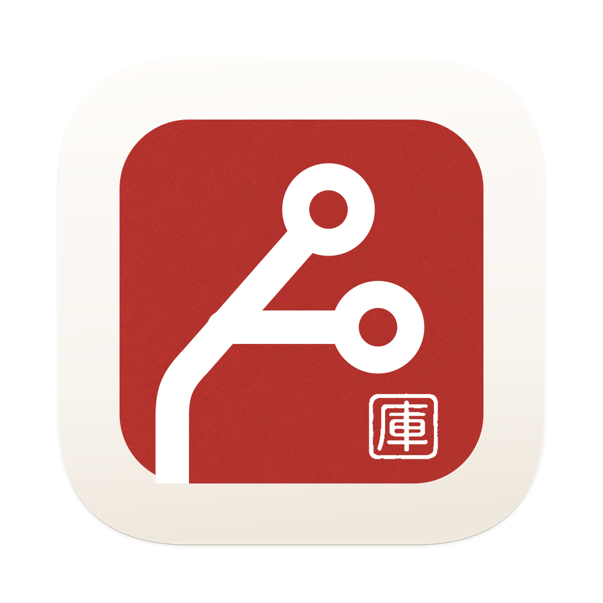

<div align="center">
  <picture>
    <source media="(prefers-color-scheme: dark)" srcset="design/brand/macos/app-icon-dark-1024.png">
    
  </picture>
  <h1>WeGit</h1>
  <p><strong>A native Git workspace for macOS.</strong></p>
  <p>Read changes clearly. Shape your commits. Keep your workflow close.</p>
  <p>
    
    
    
    
    
    <a href="LICENSE"></a>
  </p>
  <p><strong>English</strong> · <a href="README.zh-CN.md">简体中文</a></p>
  <p><a href="https://github.com/WeOpen/WeGit/releases">📦 Releases</a> · <a href="https://github.com/WeOpen/WeGit/issues">🐛 Report an issue</a> · <a href="docs/README.md">📚 Documentation</a></p>
</div>

---

## 👋 Meet WeGit

WeGit is a SwiftUI Git client built around the work you do every day: inspect a diff, stage the right changes, create a commit, browse history, manage branches, and sync with a remote.

It uses your existing Git installation, configuration, credential helpers, and SSH agent. Native windows, keyboard shortcuts, a menu bar panel, and light, dark, and custom themes keep the experience at home on macOS. The Git core has no third-party runtime dependencies.

> **WeGit 1.2.0-rc.1** · [Download](https://github.com/WeOpen/WeGit/releases/tag/v1.2.0-rc.1) · [Website](https://wegit.willxue.com/). Universal DMG for Apple Silicon and Intel. Ad-hoc signed, not notarized by Apple; see the [release notes and validation limits](docs/releases/v1.2.0-rc.1.md).

## ✨ Features

| | What you can do |
| --- | --- |
| 📂 **Repositories** | Open or clone repositories, drop folders into the app, and switch between recent and favorite repositories. |
| 🔍 **Diffs** | Read unified or split diffs with syntax highlighting, word changes, hunk navigation, expandable context, and exact source-text selection and copying. Large diffs use paged disk snapshots. |
| 🧩 **Commits** | Stage or unstage files, hunks or selected changed lines, discard changes with confirmation, amend a commit, and keep a draft for each repository. |
| 🌿 **Branches & history** | Browse a paginated commit graph, compare commit files, copy a SHA, create a branch from a commit, or check out a detached HEAD. |
| 🔄 **Remotes & conflicts** | Fetch, pull, and push to explicit targets; choose merge, rebase, or fast-forward-only pulls; continue or abort supported merge/rebase conflicts. |
| 🛡️ **Operation recovery** | Reject stale changes, coordinate repository operations, preserve drafts on failures, and verify an uncertain push result before retrying. |
| 🎨 **Appearance** | Use native light/dark themes or save a separate custom palette with 17 color roles, live preview, contrast hints, and JSON import/export. |
| ⌨️ **Native workflow** | Use keyboard navigation, repository search, a command palette, configurable panels, and a menu bar quick-access panel. |
| 🌍 **Languages** | Switch between English, Simplified Chinese, and the system language without restarting the app. |
| 🗂️ **Git tools** | Manage Stashes, Tags, Remotes and linked worktrees; inspect file history and Blame; preview Cherry-pick/Revert; edit conflicts and plan interactive rebases. |

See the [product specification](docs/WeGit_PRD.md), [interface notes](docs/INTERFACE_POLISH.md), and [compatibility record](docs/COMPATIBILITY.md) for scope and evidence. Product capabilities and completed release acceptance are tracked separately.

## 🖥️ Requirements

- **macOS 26 or later**, on **Apple Silicon or Intel**. One Universal DMG contains native `arm64` and `x86_64` executables, including AskPass. Intel Macs must support macOS 26; macOS 27 runs on Apple Silicon.
- **Git 2.46 or later**. WeGit checks the required configuration-isolation and remote-address behavior at startup.
- To build: **Xcode 27**, including the macOS 27 SDK. The verified local toolchain is Swift 6.4.
- **XcodeGen 2.43+** is optional for normal builds; it is needed to regenerate the project after changing `project.yml`. The generated Xcode project is included.

## 📦 Downloads & distribution

WeGit is distributed through **GitHub Releases and the project website**. It is not planned for the Mac App Store or TestFlight.

Download [WeGit 1.2.0-rc.1](https://github.com/WeOpen/WeGit/releases/tag/v1.2.0-rc.1) with its **DMG**, SHA-256 checksum and source manifest. Open the DMG and drag **WeGit.app → Applications**. The website links to the same versioned assets. See the [installation, data and rollback notes](docs/releases/v1.2.0-rc.1.md).

There is currently no Apple Developer Program account for this project. Public packages use **ad-hoc signing** and are **not notarized by Apple**. Ad-hoc signing does not provide a verified developer identity, and macOS may block a downloaded build. For an app you have chosen to trust, consult [Apple’s guidance on opening apps safely](https://support.apple.com/102445). Downloaded-package installation on a clean Mac is still pending validation.

If macOS reports **“WeGit is damaged and can’t be opened”**, verify the download’s checksum and, after moving this trusted app into Applications, run:

```bash
sudo xattr -dr com.apple.quarantine "/Applications/WeGit.app"
open "/Applications/WeGit.app"
```

This removes the quarantine attribute from WeGit only. It does not repair a corrupted download; download the DMG again if its checksum does not match.

## 🚀 Build & run

```bash
git clone https://github.com/WeOpen/WeGit.git
cd WeGit
scripts/build.sh Debug
open .build-app/Build/Products/Debug/WeGit.app
```

You can also open `WeGit.xcodeproj` in Xcode, select the **WeGit** scheme, and run it. Local ad-hoc builds do not require Developer ID credentials.

To create a local Release preview:

```bash
scripts/build.sh Release
scripts/package-release.sh --preview
```

Release builds default to **Universal**; use `scripts/build.sh Debug x86_64` to compile the Intel slice explicitly. The package script checks the build-source receipt, both executable architectures and deployment versions, startup/theme icons, AskPass, license, signature and exclusion of test entry points. It writes a **DMG**, checksum and manifest to `.build/releases/package-*`, verifies the image and mounts it read-only to check the install layout. Download and installed-bundle budgets are 30 MiB and 60 MiB. This command creates a local development package; it does not publish a GitHub Release.

## ⌨️ Handy shortcuts

| Action | Shortcut |
| --- | --- |
| Open a repository | `⌘O` |
| Changes / History / Branches | `⌘1` / `⌘2` / `⌘3` |
| Refresh | `⌘R` |
| Commit staged changes | `⌘↩` |
| Pull / Push target form | `⌘⇧L` / `⌘⇧U` |
| Menu bar quick-access panel | `⌘⇧M` |
| Settings | `⌘,` |

🌍 Choose **Settings → General → Interface language** to change the app language. Repository names, paths, branches, commit messages, code, and patches retain their original content.

🎨 Choose **Settings → Appearance → Edit custom theme…** to create a full custom scheme. Built-in Light and Dark remain unchanged.

## 🧪 Development & validation

```bash
# Compile Core tests; XCTest execution belongs in hosted CI
swift build --build-tests

# Compile native views and UI tests
xcodebuild -project WeGit.xcodeproj -scheme WeGit -configuration Debug \
  -destination 'platform=macOS,arch=arm64' -derivedDataPath .build-app build-for-testing
```

Run costly Core/Git/GPG, backend performance and package checks only for backend-code changes. Site, native frontend, documentation and tooling use their own checks; see [AGENTS.md](AGENTS.md). Local verification compiles tests; actual XCTest runs on hosted macOS machines.

The fixed v1.2 main source `126ca20` passed hosted smoke **1/1**, native functional **69/69**, and **144 reading combinations**. Three Git installations each passed **266 tests / 47 suites**, and five backend performance reports retained **450 valid samples** within their original budgets. These dated results belong to that source; the new macOS deployment target and Intel distribution have their own release checks. See the [evidence and remaining limits](docs/acceptance/2026-11-03/v1-2-final/README.md).

Tests use isolated configuration files, temporary repositories, and separate preferences. Never run write tests against a repository you cannot afford to change.

## 🗺️ Scope & roadmap

The next version is **v2.0**, focused on a complete local Git client: recovery, comparison, patches, file tools, signing, multiple windows, repository extensions and updates. It also brings Liquid Glass back to navigation and floating controls, with stable content surfaces. See the [complete development plan](docs/V2_0_PLAN.md). Provider collaboration and optional AI are planned after this release; v2.0 implementation has not started.

The plan also includes a custom-theme library, direct website-to-app theme import, automatic release downloads, and Universal, Apple Silicon and Intel installers. The website will recommend a matching installer while retaining manual choice. Development validation runs in workflow-sized batches, with shared backend evidence for the three packages, rather than once per subtask.

The [v1.1](docs/V1_1_PLAN.md) and [v1.2](docs/V1_2_PLAN.md) implementations are combined in 1.2.0-rc.1: Stash/Remote/Tag management, file history, Worktrees, Cherry-pick/Revert, Blame, selected-line staging, a conflict editor, standalone/Interactive Rebase, and Submodule/LFS inspection. Bare repositories remain unsupported; hosting-provider integrations are future work.

Intel hardware and macOS 26 runtime validation, protected-Mac installation, complete VoiceOver, final whole-app performance and real Beta feedback remain separate from compiled Universal support. GitLab, interactive Pinentry/hardware keys and other untested environments are tracked in the [compatibility matrix](docs/COMPATIBILITY.md).

## 📚 Explore the project

| Path | Contents |
| --- | --- |
| `WeGit/` | SwiftUI app, state, native presentation, design system, and features |
| `WeGitCore/` | Git domain services, process runner, repository queue, snapshots, and watchers |
| `WeGitAskPass/` | Bundled authentication helper |
| `WeGitTests/` · `WeGitUITests/` | Core/integration tests and native UI regression suites |
| `design/brand/` | Current R5 brand and native icon sources |
| `branding/` | Retained earlier resources |
| `docs/` | Product, design, architecture, plans, and acceptance evidence; primarily in Chinese |

- 🧭 [Documentation index](docs/README.md)
- ✅ [V1.0 release checklist](docs/V1_RELEASE_CHECKLIST.md)
- 🏗️ [Architecture](docs/WeGit_Architecture.md)
- 📈 [Performance](docs/PERFORMANCE.md) · ♿ [Accessibility](docs/ACCESSIBILITY.md)
- 📋 [Changelog](CHANGELOG.md) · 📦 [Release procedure](docs/RELEASE.md)

## 🤝 Issue-driven development

Start with an [Issue](https://github.com/WeOpen/WeGit/issues/new/choose), define acceptance criteria, and deliver through a linked PR. See [CONTRIBUTING](CONTRIBUTING.md) and the [GitHub workflow guide](docs/GITHUB_WORKFLOW.md) for labels, CI and gated draft releases.

## 💬 Feedback & contributions

Use [GitHub Issues](https://github.com/WeOpen/WeGit/issues) to report a problem with reproduction steps, the app/macOS/Git versions, and the expected and actual results. For changes, describe the workflow and validation evidence in your pull request.

🔒 Diagnostic summaries are exported only when you request them in Settings. They exclude code, diffs, commit messages, repository paths, and credentials. Review any additional screenshots or logs before sharing them.

## 📄 License

[MIT](LICENSE) © 2026 WeOpen.
