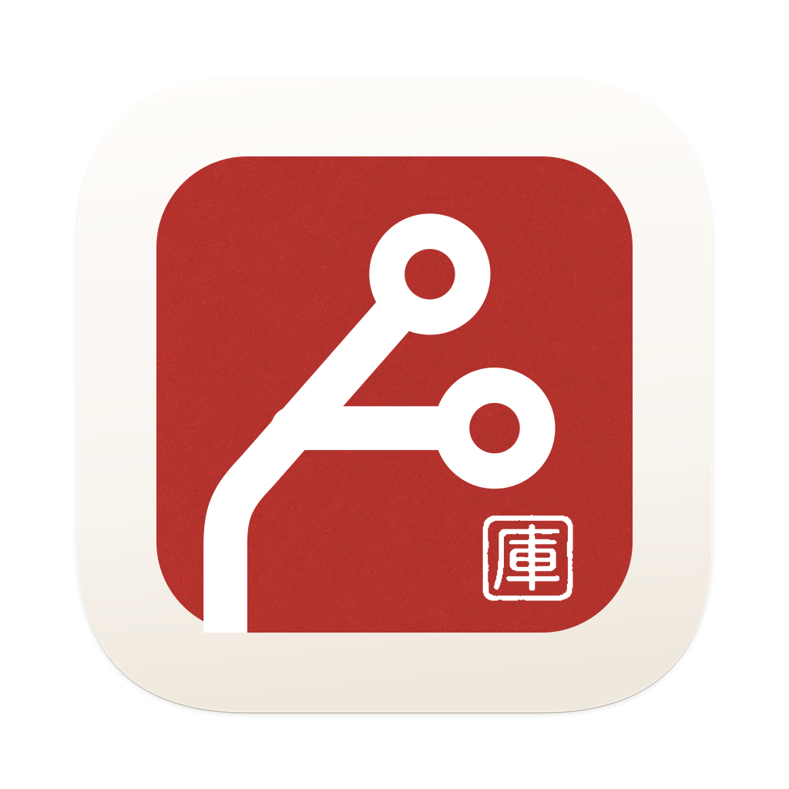

<div align="center">
  <picture>
    <source media="(prefers-color-scheme: dark)" srcset="design/brand/macos/app-icon-dark-1024.png">
    
  </picture>
  <h1>WeGit</h1>
  <p><strong>为 macOS 打造的原生 Git 工作台。</strong></p>
  <p>清晰阅读改动，从容整理提交，让日常 Git 操作自然顺手。</p>
  <p>
    
    
    
    
    
    <a href="LICENSE"></a>
  </p>
  <p><a href="README.md">English</a> · <strong>简体中文</strong></p>
  <p><a href="https://github.com/WeOpen/WeGit/releases">📦 版本下载</a> · <a href="https://github.com/WeOpen/WeGit/issues">🐛 问题反馈</a> · <a href="docs/README.md">📚 项目文档</a></p>
</div>

---

## 👋 认识 WeGit

WeGit 使用 SwiftUI 构建，围绕日常开发流程组织界面：阅读差异、选择改动、暂存提交、浏览历史、管理分支与同步远端。

它复用已有的 Git 安装、配置、Credential Helper 和 SSH Agent。原生窗口、键盘快捷键、菜单栏快捷面板，以及浅色、深色和独立自定义主题，让 Git 工作流融入 macOS。Git 核心没有第三方运行时依赖。

> **WeGit 1.2.0-rc.1** · [下载](https://github.com/WeOpen/WeGit/releases/tag/v1.2.0-rc.1) · [项目网站](https://wegit.willxue.com/)。Apple Silicon 与 Intel 共用 Universal DMG。ad-hoc 签名，未经 Apple 公证；验证范围见[版本说明](docs/releases/v1.2.0-rc.1.md)。

## ✨ 核心功能

| | 可以完成的工作 |
| --- | --- |
| 📂 **仓库管理** | 打开、克隆或拖入仓库，在最近记录与收藏之间切换。 |
| 🔍 **差异阅读** | Unified / Split、语法高亮、词级差异、差异块导航、上下文展开，以及保留原文的选择与复制；大差异采用磁盘快照分页。 |
| 🧩 **整理提交** | 按文件、差异块或选中的变化行暂存、取消暂存；确认后丢弃改动，支持 Amend 和按仓库保存的提交草稿。 |
| 🌿 **分支与历史** | 分页提交图、提交文件比较、复制 SHA、从提交创建分支和 Detached HEAD 检出。 |
| 🔄 **同步与冲突** | 明确目标的 Fetch / Pull / Push，选择 Merge、Rebase 或仅快进 Pull，继续或中止支持的冲突流程。 |
| 🛡️ **操作恢复** | 拒绝过期改动、协调仓库任务、失败时保留草稿，推送结果未知时先核对再重试。 |
| 🎨 **外观与配色** | 原生浅深色，或独立保存的 17 角色自定义配色；支持实时预览、对比度提示和 JSON 导入导出。 |
| ⌨️ **原生交互** | 键盘操作、仓库搜索、命令面板、可调整分栏与菜单栏快捷访问。 |
| 🌍 **双语界面** | 跟随系统、简体中文和 English 即时切换，无需重启。 |
| 🗂️ **Git 工具** | 管理 Stash、Tag、Remote 和 linked worktree；查看文件历史与 Blame；预演 Cherry-pick/Revert，编辑冲突并规划交互式变基。 |

范围与证据见 [产品需求](docs/WeGit_PRD.md)、[界面记录](docs/INTERFACE_POLISH.md)及[兼容性记录](docs/COMPATIBILITY.md)。功能已实现与发布验收已完成分别记录。

## 🖥️ 环境要求

- **macOS 26 或更新版本，Apple Silicon 或 Intel**。同一个 Universal DMG 包含原生 `arm64` / `x86_64` 主程序及 AskPass。Intel Mac 需要能运行 macOS 26；macOS 27 适用于 Apple Silicon。
- **Git 2.46 或更新版本**。启动时实际检测配置隔离与远端地址处理能力。
- 源码构建需要 **Xcode 27** 和 macOS 27 SDK；本机已验证 Swift 6.4 工具链。
- **XcodeGen 2.43+**：普通构建可选，修改 `project.yml` 后重新生成工程时需要；仓库已包含生成的 Xcode 工程。

## 📦 下载与分发

WeGit 通过 **GitHub Releases 和项目网站**分发，不计划上架 Mac App Store，也不采用 TestFlight。

下载 [WeGit 1.2.0-rc.1](https://github.com/WeOpen/WeGit/releases/tag/v1.2.0-rc.1)，同时获取 **DMG、SHA-256 与来源清单**。打开 DMG，将 **WeGit.app 拖入 Applications** 即可安装。网站引用同一份 GitHub 版本化资产。安装、数据与回退说明见[版本说明](docs/releases/v1.2.0-rc.1.md)。

项目目前没有 Apple Developer Program 账号。公开版本使用 **ad-hoc 签名，未经 Apple 公证**。ad-hoc 签名不代表经过验证的开发者身份，macOS 可能拦截下载后的应用。对于自行确认可信的应用，可参考 [Apple 的安全打开说明](https://support.apple.com/zh-cn/102445)。在干净 Mac 上通过实际下载进行安装的闭环仍待验证。

如果 macOS 提示 **“WeGit 已损坏，无法打开”**，先核对下载包的校验和，将可信的应用拖入 Applications 后，在终端执行：

```bash
sudo xattr -dr com.apple.quarantine "/Applications/WeGit.app"
open "/Applications/WeGit.app"
```

此命令仅移除 WeGit 的下载隔离属性。校验和不一致代表下载文件有问题，应重新下载 DMG。

## 🚀 构建与运行

```bash
git clone https://github.com/WeOpen/WeGit.git
cd WeGit
scripts/build.sh Debug
open .build-app/Build/Products/Debug/WeGit.app
```

也可以使用 Xcode 打开 `WeGit.xcodeproj`，选择 **WeGit** scheme 后运行。本地 ad-hoc 构建不需要 Developer ID 凭据。

生成本地 Release 预览包：

```bash
scripts/build.sh Release
scripts/package-release.sh --preview
```

Release 默认构建 **Universal**；单独编译 Intel 可使用 `scripts/build.sh Debug x86_64`。打包脚本核对源码回执、双架构及最低系统版本、启动与主题图标、AskPass、许可证、签名和测试入口排除，输出 **DMG、校验和与 manifest**，保存到 `.build/releases/package-*`，并实际校验、只读挂载检查安装布局。下载包和安装后应用预算分别为 30 MiB / 60 MiB。该命令只生成本地开发包，不会发布 GitHub Release。

## ⌨️ 常用快捷键

| 操作 | 快捷键 |
| --- | --- |
| 打开仓库 | `⌘O` |
| 更改 / 提交历史 / 分支 | `⌘1` / `⌘2` / `⌘3` |
| 刷新 | `⌘R` |
| 提交已暂存内容 | `⌘↩` |
| 打开 Pull / Push 目标表单 | `⌘⇧L` / `⌘⇧U` |
| 菜单栏快捷面板 | `⌘⇧M` |
| 设置 | `⌘,` |

🌍 在 **设置 → 通用 → 界面语言** 切换语言。仓库名称、路径、分支、提交消息、代码和补丁保持原文。

🎨 在 **设置 → 外观 → 编辑自定义主题…** 创建完整配色方案，内置浅色与深色保持不变。

## 🧪 开发与验证

```bash
# 编译 Core 测试；实际 XCTest 在托管 CI 执行
swift build --build-tests

# 编译原生视图与 UI 测试
xcodebuild -project WeGit.xcodeproj -scheme WeGit -configuration Debug \
  -destination 'platform=macOS,arch=arm64' -derivedDataPath .build-app build-for-testing
```

只有后端代码变化才运行耗时的 Core/Git/GPG、后端性能与客户端打包校验；网站、原生前端、文档和工具执行各自检查，见 [AGENTS.md](AGENTS.md)。本机只编译测试，实际 XCTest 使用托管 macOS 环境。

固定 v1.2 主线 `126ca20` 已通过托管 smoke **1/1**、原生功能 **69/69** 和 **144 个阅读组合**；三套 Git 各通过 **266 项测试 / 47 组**，五份后端性能报告共保留 **450 个有效样本**并通过原预算。上述结果属于该固定源码；新的最低系统版本与 Intel 分发单独验收。来源与限制见[完整记录](docs/acceptance/2026-11-03/v1-2-final/README.md)。

测试采用隔离配置、临时仓库与独立偏好。请勿把写入测试指向不能承受改动的仓库。

## 🗺️ 范围与路线图

[v1.1](docs/V1_1_PLAN.md) 与 [v1.2](docs/V1_2_PLAN.md) 的实现合并在 1.2.0-rc.1：Stash / Remote / Tag 管理、文件历史、Worktree、Cherry-pick / Revert、Blame、选中行暂存、冲突编辑器、独立 / Interactive Rebase，以及 Submodule / LFS 检查。Bare 仓库仍不支持；Hosting Provider 集成留在后续版本。

Intel 实机与 macOS 26 运行验证、受保护 Mac 安装、完整 VoiceOver、整版应用性能与真实 Beta 反馈仍单独记录，不能由 Universal 编译通过推定。GitLab、交互式 Pinentry/硬件密钥和其他未覆盖环境见[兼容性矩阵](docs/COMPATIBILITY.md)。

## 📚 项目结构与文档

| 路径 | 内容 |
| --- | --- |
| `WeGit/` | SwiftUI 应用、状态、原生呈现、设计系统与功能页面 |
| `WeGitCore/` | Git 领域服务、进程、仓库队列、快照与监听 |
| `WeGitAskPass/` | 随应用打包的认证辅助程序 |
| `WeGitTests/` · `WeGitUITests/` | 核心/集成测试与原生 UI 回归 |
| `design/brand/` | 当前 R5 品牌与原生图标源文件 |
| `branding/` | 保留的历史资源 |
| `docs/` | 产品、界面、架构、执行计划与验收证据；主要使用中文 |

- 🧭 [文档索引](docs/README.md)
- ✅ [V1.0 发布清单](docs/V1_RELEASE_CHECKLIST.md)
- 🏗️ [技术架构](docs/WeGit_Architecture.md)
- 📈 [性能记录](docs/PERFORMANCE.md) · ♿ [辅助访问](docs/ACCESSIBILITY.md)
- 📋 [版本记录](CHANGELOG.md) · 📦 [发布操作](docs/RELEASE.md)

## 🤝 用 Issue 管理需求

先创建 [Issue](https://github.com/WeOpen/WeGit/issues/new/choose)、明确验收条件，再通过关联 PR 交付。标签、CI 与草稿发布门槛见 [贡献说明](CONTRIBUTING.md)和 [GitHub workflow 方案](docs/GITHUB_WORKFLOW.md)。

## 💬 反馈与贡献

请通过 [GitHub Issues](https://github.com/WeOpen/WeGit/issues) 提供复现步骤、应用/macOS/Git 版本、预期行为和实际结果。提交改动时，请在 PR 中说明对应工作流与验证证据。

🔒 诊断摘要仅在设置中由用户主动导出，不包含代码、Diff、提交消息、仓库路径或凭证。分享额外截图和日志前，请自行检查其中内容。

## 📄 许可证

[MIT](LICENSE) © 2026 WeOpen。
