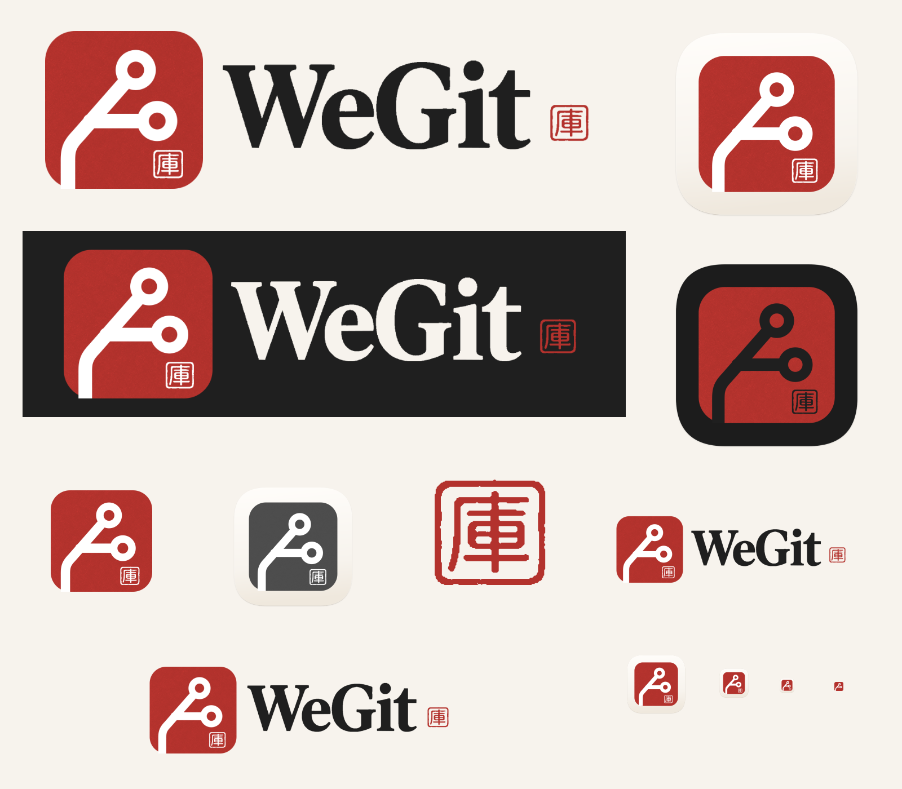

# WeGit 品牌资源 · R5

按最新参考图重新生成的完整高清资源：两枚空心 Git 节点、开放主干、薄底座与轻阴影；深色 Icon 的分支和小篆「庫」印章均为墨黑。

- [高清横版 Logo 4800px](logo/wegit-logo-horizontal-4800.png) / [SVG 母版](logo/wegit-logo-horizontal.svg) / [深色背景 Logo](logo/wegit-logo-horizontal-dark-4800.png)
- [浅色 Icon 2048px](macos/app-icon-2048.png) / [深色 Icon 2048px](macos/app-icon-dark-2048.png) / [单色版](macos/app-icon-monochrome-2048.png)
- [Icon Composer 工程](macos/WeGit.icon) / [浅色 ICNS](macos/WeGit-light.icns) / [深色 ICNS](macos/WeGit-dark.icns)
- [独立 imagegen 高清 Logo 原图](r5/generated/logo-horizontal.png) / [Icon 原图](r5/generated/app-icon.png) / [深色 Icon 原图](r5/generated/app-icon-dark.png)
- [Symbol](logo/wegit-symbol.png) / [字标](logo/wegit-wordmark.png) / [保留原轮廓的小篆印文](logo/seal-ku-red.png)
- [GitHub 头像](github/avatar.png) / [Banner](github/banner.png) / [Social Preview](github/social-preview.png) / [Favicon](github/favicon.ico)
- [品牌规范](BRAND.md) / [几何规则](docs/GEOMETRY.md) / [规格与复现](docs/EXPORT-SPECS.md) / [验证记录](validation.json)

原图保留完整画布，交付资源不从参考板裁切。Logo 原图为 2172×724，Icon 原图为 1254×1254；2048 Icon 和 4800 Logo 从共享矢量前景与独立印泥材质重新渲染。带质感的组合 SVG 包含位图材质，三个纯几何母版不依赖位图或字体。

`source/package-assets.py` 打包为 `../WeGit-brand-r5.zip`，包含文件清单和 SHA-256 校验。R5 已接入 `codex/v1-1-1-polish` 的本地开发构建，原生检查见项目 `docs/acceptance/2026-10-25/reference-inspector/`；尚未执行本版完整托管回归和公开发布。
