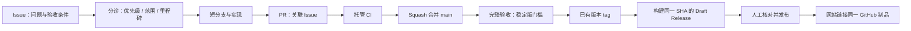

# 🧭 GitHub 开发、需求与 CI/CD 方案

更新：2026-10-16。适用仓库：[WeOpen/WeGit](https://github.com/WeOpen/WeGit)。仓库已获用户授权设为 public；项目网站未上线。本方案不需要 Apple Developer Program 账号，不上架商店、不用 TestFlight。

## 1. 需求的唯一入口：Issues

需求、缺陷、工程验收和发布工作均通过 Issue 记录；长文档继续保存产品规范、架构和证据，Issue 保存优先级、负责人、依赖和当前验收状态。



预发布的 `vX.Y.Z-beta.N` 等标签仍需同一 SHA 的 main CI，但可以在完整验收前生成明确标记的预发布草稿；不据此宣布 V1.0 验收完成。

### 表单与标签

- 🐛 Bug：问题、复现步骤、环境、影响、证据和验收条件。
- ✨ Feature：用户问题、预期行为、替代方案、范围边界和验收条件。
- 🧩 Task：工程/验证目标、范围、依赖、验收条件及证据。
- 优先级：`priority:P0` 阻塞里程碑，`P1` 重要后续，`P2` 可选改进。
- 区域：`area:git/ui/accessibility/performance/ci/release/website`。
- 状态只保留一个：`status:triage` → `status:ready` → `status:in-progress`；依赖明确时使用 `status:blocked`。完成使用 GitHub Closed 状态，不再添加重复的 done 标签。
- 里程碑：V1.0 仅放首版 P0；V1.1 接后续功能，不编造截止日期。

标签/里程碑由 `.github/labels.json`、`milestones.json` 定义，现有 V1.0 待办由 `backlog.json` 迁入。初始化幂等：不覆盖已存在 Issue 的人工内容，也不重开已关闭事项。

```bash
# 只读预览计划
python3 scripts/ci/project_setup.py --repo WeOpen/WeGit --seed-backlog
# 执行；需要已登录 gh 及相应仓库权限
python3 scripts/ci/project_setup.py --repo WeOpen/WeGit --seed-backlog --apply
```

也可在 main 运行 `Project metadata` 手动 workflow。不要把 PAT 放入仓库；该 workflow 使用限定为 issues:write 的 GITHUB_TOKEN。

## 2. 分支与 PR

- `main` 保持可构建；使用短分支，例如 `codex/42-diff-selection`，完成后 Squash 合并并自动删除远端分支。
- 人工 PR 使用 Conventional Commit 标题，正文通过 `Closes #N` 或 `Refs #N` 关联本仓库真实 Issue，至少一项未关闭。
- `Closes` 表示完整交付，只有进入 main 才自动关闭；部分交付使用 `Refs`，保留剩余验收。
- 当前单维护者配置不强制第二人批准；CI、会话解决、禁止强推/删除 main 仍有效。新增维护者后可提高审批数。
- `.github/CODEOWNERS` 标记当前已验证的管理员 @xuewill 负责 workflow 和构建工具；不能用作者自批替代将来需要的独立评审。
- 推荐并绑定的必需检查名为 `PR policy`、`Repository policy`、`Native macOS`。分支保护应禁止强推和删除、要求 PR 与会话解决，并使用严格的最新基线检查。

## 3. CI 的三个层次

| 层次 | 触发 / 环境 | 检查与结果 |
| --- | --- | --- |
| PR policy | PR，Ubuntu 托管 VM | 标题、真实 Issue 关联；Dependabot 只免 Issue 关联 |
| Repository policy | PR/main/手动，Ubuntu 托管 VM | actionlint、workflow 权限/输入契约、Issue 表单、链接、工具行为测试、完整提交历史凭据扫描 |
| Native macOS | PR/main/手动，`xcode-27` 托管 arm64 VM | 实际系统/工具链检查、格式、核心、Debug、固定上游 Git 2.46、已存在功能的原生行为检查、UI 编译、普通 Release 与开发预览包 |

GitHub 当前官方 `xcode-27` 镜像为 macOS 27.0.1；这是公开预览标签，不使用会随时间变化的 macos-latest 冒充目标系统。每次运行再次核对真实 OS、架构和 Xcode；若镜像不可分配或不匹配，该项保持失败/待运行，不自动降到 macOS 26。

PR 代码只在 GitHub 托管 VM 运行。所有 action 固定提交 SHA，checkout 不持久保存凭据；默认令牌只读。PR 标题/正文/手动输入不插入 shell 源码，发布参数经环境和严格格式检查。CI 工具下载校验固定 SHA-256；两条 gitleaks 例外只对应初始提交性能报告中的确切源码摘要误报，不忽略整个文档目录。

`WEGIT_SKIP_PROJECT_GENERATION=1` 防止不同 XcodeGen 版本改写已提交工程，制品与源码回执保持对应。旧版本没有某个功能模块时不宣称其专项通过；模块一旦存在，对应行为检查脚本必须存在并执行。

失败结果保留，CI 预览包只保存为 Actions artifact，不自动创建公开 Release。没有把整个 .build 或个人文件目录打包上传。

## 4. 专用完整验收

`Full acceptance` 仅手动、仅 main，运行固定的 github.sha。Runner 标签为：

```text
self-hosted, macOS, ARM64, wegit-macos27, wegit-interactive
```

必须使用隔离、可恢复的专用设备/VM，并有真实交互登录会话；不连接个人凭据环境或让外部 PR 在其上执行。按已有测试隔离约束准备环境，先确认最小 XCTest 可用。

任务超时 120 分钟；跨 workflow 的交互资源锁不取消正在运行的验收。依次进行两套 Git、原生行为、完整功能/144 阅读组合、独立辅助访问、普通/大型 Release 30 次采样和固定滚动轨迹。测试失败仍保留证据并重建普通 Release，workflow 总结论保持失败。VoiceOver、干净机器和真实 Beta 等人工验收仍由对应 Issue 记录。

当前没有注册该专用 Runner。常规托管 CI 不再依赖它，但稳定版的完整验收门槛仍然依赖实际通过记录。

## 5. 无开发者账号的 CD

现有 `--preview` 保留；新增正式 Bundle ID 的显式 ad-hoc 模式：

```bash
# 使用已提交 Xcode 工程，不需要 Apple 证书、团队或公证 profile
WEGIT_SKIP_PROJECT_GENERATION=1 scripts/package-release.sh --adhoc
```

正式标识为 `com.willxue.wegit`，文件名包含 macOS/arm64/ad-hoc，签名完整性和普通 Release 权限仍检查。该路径未经 Apple 公证，不能声称已识别开发者身份。未来取得账号后，现有 `--sign` / `--notarize` 路径仍可选。

### Draft release workflow

1. 在 main 通过 CI，完成相应验收。更新项目版本和变更记录后，再对已评审的 main 提交创建 tag：`vX.Y.Z` 或 `vX.Y.Z-alpha.N / beta.N / rc.N`。
2. 在 **Actions → Draft release → Run workflow** 选择 main，输入已有 tag；稳定标签还需要同一 SHA 的 Full acceptance run ID。
3. 解析轻量/注解 tag，确认属于 main 历史，核对规范 CI workflow、main 事件、成功状态与实际执行成功的必要 job。
4. 对确定 SHA 重新构建、核心验证、打包普通 ad-hoc Release。app 版本必须匹配 tag；拒绝脏工作区、开发 Bundle ID、错误签名状态、错配清单与校验和。
5. 发布 job 在独立 Ubuntu VM 获得 contents:write；重新检查 tag 和验收没有错配，只创建 **Draft Release**，不覆盖既有 Release，不创建 tag，不自动公开发布。
6. 草稿包含 ZIP、便于本地校验的 SHA-256、manifest、release.json 及按 PR 标签生成的变更说明。制品里如实标注“ad-hoc／未公证”。
7. 维护者完成干净机器实际下载、安装提示、Beta、里程碑阻塞与说明核对后，人工发布草稿；网站只链接该版本的同一份资产，不重新构建同版本文件。

没有网站代码/域名/部署平台，因此本次不创建猜测性的站点部署 workflow，也不申请网站密钥；该依赖单独用 Issue 管理。

## 6. 启用与维护

- 该配置通过独立 PR 合并 main 后，Issue 表单/Dependabot/手动 workflow 才成为默认分支配置；PR CI 应先在该 PR 上完成。
- 将默认 GITHUB_TOKEN 权限设为 read，并关闭 Actions 自动批准 PR；仅 metadata/publish job 显式提升所需权限。
- 绑定三个必需检查，禁止 main 强推/删除、要求会话解决。保留单维护者可以合并自己 PR 的策略，不创建无法满足的第二人审批要求。
- 不自动合并 Dependabot；每周分组更新 action 与 CI Python 依赖，CI 通过后按正常 PR 合并。
- Actions artifacts 有保留期；发布证据、变更说明和最终制品需作为版本长期归档。
- 当前应用开发工作区包含未提交 UI/品牌改动。本次独立 PR 只承载 workflow/工具/文档，不能用其 CI 结果宣称未提交应用代码已在远端验证。

官方参考：[Runner 镜像](https://github.com/actions/runner-images/blob/main/images/macos/xcode-27-arm64-Readme.md)、[workflow 安全](https://docs.github.com/en/actions/reference/security/secure-use)、[Issue 表单](https://docs.github.com/en/communities/using-templates-to-encourage-useful-issues-and-pull-requests/syntax-for-issue-forms)、[自动版本说明](https://docs.github.com/en/repositories/releasing-projects-on-github/automatically-generated-release-notes)。
