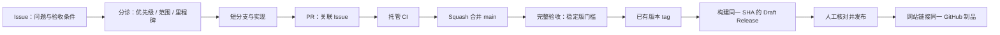

# 🧭 GitHub 开发、需求与 CI/CD 方案

## v2.0 最新要求：业务批次验收（2026-11-04）

用户明确GitHub校验过慢，子任务不逐项触发/等待重CI。多个子任务形成完整用户流程后使用一个批次分支/PR，稳定head统一送验；开发中只在定位问题时做按需局部检查，等待远端时继续独立后续工作。[V20-16](V2_0_PLAN.md#v20-16--批次验证与开发效率)作为M0前置实现触发/排队、可信批次用例集合、构建缓存与输入证据复用。

M0已实现事件级批次决定：草稿/中间synchronize不启动实际编译、site或后端长流程，稳定PR ready_for_review/非草稿opened或重新添加`batch:validate`按范围统一送验。既有label不会授权后来的新head。轻量策略仍运行，未送验的必需汇总明确失败；未知Git范围仍阻断。纯Markdown先按类型识别，包括site/README；CI工具不额外跑网站。对应工具通过，实际托管结果见[进度](V2_0_PROGRESS.md)。

Core/签名/功能/性能/应用分别计算不可变输入与工具链，只从canonical实际成功的main/已审入同仓库PR回执复用，并从源Git对象重算字节。构建缓存独立，不作为通过证据；包始终构建验实物。`Native UI validation`的batch选项从可信main注册表选择完整方法集合，一次编译+smoke后执行一次集合，实际数不符即失败。基线集合不是v2.0新增行为验收。

以下记录保留原日期。分支/Issue可以细分进度，验收单位以本版业务批次为准；最新契约见[V2_0_CONTRACTS.md](V2_0_CONTRACTS.md)。

更新：2026-10-16。适用仓库：[WeOpen/WeGit](https://github.com/WeOpen/WeGit)。仓库已获用户授权设为 public；项目网站采用 [GitHub Pages](https://weopen.github.io/WeGit/)。本方案不需要 Apple Developer Program 账号，不上架商店、不用 TestFlight。

2026-10-19 v1.0.0 单次例外：维护者明确授权暂缓辅助功能并直接发布。本次在受保护 PR、同提交 main CI 和正式制品校验后人工创建并发布草稿；不声称 Full acceptance 通过，也不改变下述默认稳定版 workflow。范围、未完成项与制品来源见 [1.0.0 版本说明](releases/v1.0.0.md)。

## 1. 需求的唯一入口：Issues

需求、缺陷、工程验收和发布工作均通过 Issue 记录；长文档继续保存产品规范、架构和证据，Issue 保存优先级、负责人、依赖和当前验收状态。



预发布的 `vX.Y.Z-beta.N` 等标签仍需同一 SHA 的 main CI，但可以在完整验收前生成明确标记的预发布草稿；不据此宣布 V1.0 验收完成。

### 表单与标签

- 🐛 Bug：问题、复现步骤、环境、影响、证据和验收条件。
- ✨ Feature：用户问题、预期行为、替代方案、范围边界和验收条件。
- 🧩 Task：工程/验证目标、范围、依赖、验收条件及证据。
- 优先级：`priority:P0` 阻塞里程碑，`P1` 重要后续，`P2` 可选改进。
- 区域：`area:git/ui/accessibility/performance/ci/release/website`。
- 状态只保留一个：`status:triage` → `status:ready` → `status:in-progress`；依赖明确时使用 `status:blocked`。完成使用 GitHub Closed 状态，不再添加重复的 done 标签。
- 里程碑：V1.0 仅放首版 P0；V1.1 接后续功能，不编造截止日期。

标签/里程碑由 `.github/labels.json`、`milestones.json` 定义，现有 V1.0 待办由 `backlog.json` 迁入。初始化幂等：不覆盖已存在 Issue 的人工内容，也不重开已关闭事项。

```bash
# 只读预览计划
python3 scripts/ci/project_setup.py --repo WeOpen/WeGit --seed-backlog
# 执行；需要已登录 gh 及相应仓库权限
python3 scripts/ci/project_setup.py --repo WeOpen/WeGit --seed-backlog --apply
```

也可在 main 运行 `Project metadata` 手动 workflow。不要把 PAT 放入仓库；该 workflow 使用限定为 issues:write 的 GITHUB_TOKEN。

## 2. 分支与 PR

- `main` 保持可构建；使用短分支，例如 `codex/42-diff-selection`，完成后 Squash 合并并自动删除远端分支。
- 人工 PR 使用 Conventional Commit 标题，正文通过 `Closes #N` 或 `Refs #N` 关联本仓库真实 Issue，至少一项未关闭。
- `Closes` 表示完整交付，只有进入 main 才自动关闭；部分交付使用 `Refs`，保留剩余验收。
- 当前单维护者配置不强制第二人批准；CI、会话解决、禁止强推/删除 main 仍有效。新增维护者后可提高审批数。
- `.github/CODEOWNERS` 标记当前已验证的管理员 @xuewill 负责 workflow 和构建工具；不能用作者自批替代将来需要的独立评审。
- 推荐并绑定的必需检查名为 `PR policy`、`Repository policy`、`Native macOS`。分支保护应禁止强推和删除、要求 PR 与会话解决，并使用严格的最新基线检查。

## 3. CI 按变更范围分流

2026-11-03最新规则：只有后端代码变化才运行耗时的Core/Git/GPG、后端性能和客户端打包。完整PR三点diff或push的before..after决定分流，rename源和目标都计算。后端为WeGitCore业务/执行/基础设施Swift、AskPass、Package定义及明确的应用业务状态文件；展示/本地化辅助另行归类。具体正向名单在`change_scope.py`，不再把“site之外”或共享CI/文档改动默认当作后端。范围读取失败就阻断读取并修正，不能默认花时间运行长流程。

site只验网站，原生前端只编译视图及UI测试源，文档只做链接检查，CI/工具只验对应工具，后端测试源单独改动时只编译。混合变更仅在包含真实后端代码时增加后端校验。保留原必需Repository policy名称汇总适用的真实成功结果，失败/取消/遗漏不算通过；job显式跳过以免paths-ignore留下Pending门禁。手动入口默认只验site，backend_validation需显式选择。

网站PR只由CI中的Site checks执行一次完整校验。独立Pages/Workers workflow继续处理原main/release/手动事件，原部署权限和输入边界保持。自动分流不是额外产品校验；本机的纯site任务也不执行通用仓库、Swift/Core/XCTest、原生/GPG或客户端打包。

| 层次 | 触发 / 环境 | 检查与结果 |
| --- | --- | --- |
| PR policy | 后端变更 PR，Ubuntu 托管 VM | 标题、真实 Issue 关联；非后端跳过 |
| Repository validation | 后端或CI/工具变更，Ubuntu 托管 VM | actionlint、workflow 权限/输入契约、Issue 表单、链接、工具行为测试、完整提交历史凭据扫描；不启动原生流程 |
| Native macOS | 后端变更或显式手动选择，`xcode-27` 托管 arm64 VM | 实际系统/工具链检查、格式、核心、Debug、固定上游 Git 2.46、后端行为/性能、签名、UI编译、Release与预览包 |
| Site checks | 网站或其共享输入发生变化，Ubuntu 托管 VM | 网站专属测试、构建、资源预算和生产Worker本地校验 |
| Native frontend build | 仅原生前端变化，`xcode-27` 托管 VM | 编译视图/UI测试源，不运行XCTest/Core/GPG/性能/打包 |
| Core test compilation | 仅后端测试/基准源变化，`xcode-27`托管 VM | 只编译，不执行后端套件 |
| Documentation checks | 只改文档，Ubuntu托管 VM | 只检查变化文档的链接 |
| Repository policy | 所有CI事件，Ubuntu 托管 VM | 只汇总对应分流的必需成功结果，保留固定门禁名称 |

GitHub 当前官方 `xcode-27` 镜像为 macOS 27.0.1；这是公开预览标签，不使用会随时间变化的 macos-latest 冒充目标系统。每次运行再次核对真实 OS、架构和 Xcode；若镜像不可分配或不匹配，该项保持失败/待运行，不自动降到 macOS 26。

托管 VM 显式使用 `swift test --no-parallel` 调度外层核心用例，避免大量真实 Git 夹具争用有限资源、触发隔离探针超时；测试内部的 TaskGroup 并发、队列、取消和超时断言保持不变。`WEGIT_SERIAL_CORE_TESTS=1` 可在本机复现该 CI 调度方式；普通本地运行默认不改。保留 main 首轮失败记录，不通过重试或增加超时掩盖。该配置不是性能预算调整。

PR 代码只在 GitHub 托管 VM 运行。所有 action 固定提交 SHA，checkout 不持久保存凭据；默认令牌只读。PR 标题/正文/手动输入不插入 shell 源码，发布参数经环境和严格格式检查。CI 工具下载校验固定 SHA-256；保留初始提交的两条精确指纹；新增 9 个已核对源码 SHA-256 例外同时匹配 JSON 回执路径、文件名与明确哈希，实际扫描器验证其他凭据字段仍被检出，不忽略整个文档目录。

`WEGIT_SKIP_PROJECT_GENERATION=1` 防止不同 XcodeGen 版本改写已提交工程，制品与源码回执保持对应。旧版本没有某个功能模块时不宣称其专项通过；模块一旦存在，对应行为检查脚本必须存在并执行。

失败结果保留，CI 预览包只保存为 Actions artifact，不自动创建公开 Release。没有把整个 .build 或个人文件目录打包上传。

## 4. 专用完整验收

`Full acceptance` 仅手动、仅 main，运行固定的 github.sha。Runner 标签为：

```text
self-hosted, macOS, ARM64, wegit-macos27, wegit-interactive
```

必须使用隔离、可恢复的专用设备/VM，并有真实交互登录会话；不连接个人凭据环境或让外部 PR 在其上执行。按已有测试隔离约束准备环境，先确认最小 XCTest 可用。

任务超时 120 分钟；跨 workflow 的交互资源锁不取消正在运行的验收。依次进行两套 Git、原生行为、完整功能/144 阅读组合、独立辅助访问、普通/大型 Release 30 次采样和固定滚动轨迹。测试失败仍保留证据并重建普通 Release，workflow 总结论保持失败。VoiceOver、干净机器和真实 Beta 等人工验收仍由对应 Issue 记录。

当前没有注册该专用 Runner。常规托管 CI 不再依赖它，但稳定版的完整验收门槛仍然依赖实际通过记录。

## 5. 无开发者账号的 CD

现有 `--preview` 保留；新增正式 Bundle ID 的显式 ad-hoc 模式：

```bash
# 使用已提交 Xcode 工程，不需要 Apple 证书、团队或公证 profile
WEGIT_SKIP_PROJECT_GENERATION=1 scripts/package-release.sh --adhoc
```

正式标识为 `com.willxue.wegit`，文件名包含 macOS/arm64/ad-hoc，签名完整性和普通 Release 权限仍检查。该路径未经 Apple 公证，不能声称已识别开发者身份。未来取得账号后，现有 `--sign` / `--notarize` 路径仍可选。

### Draft release workflow

1. 在 main 通过 CI，完成相应验收。更新项目版本和变更记录后，再对已评审的 main 提交创建 tag：`vX.Y.Z` 或 `vX.Y.Z-alpha.N / beta.N / rc.N`。
2. 在 **Actions → Draft release → Run workflow** 选择 main，输入已有 tag；稳定标签还需要同一 SHA 的 Full acceptance run ID。
3. 解析轻量/注解 tag，确认属于 main 历史，核对规范 CI workflow、main 事件、成功状态与实际执行成功的必要 job。
4. 对确定 SHA 重新构建、核心验证、打包普通 ad-hoc Release。app 版本必须匹配 tag；拒绝脏工作区、开发 Bundle ID、错误签名状态、错配清单与校验和。
5. 发布 job 在独立 Ubuntu VM 获得 contents:write；重新检查 tag 和验收没有错配，只创建 **Draft Release**，不覆盖既有 Release，不创建 tag，不自动公开发布。
6. 草稿包含 ZIP、便于本地校验的 SHA-256、manifest、release.json 及按 PR 标签生成的变更说明。制品里如实标注“ad-hoc／未公证”。
7. 维护者完成干净机器实际下载、安装提示、Beta、里程碑阻塞与说明核对后，人工发布草稿；网站只链接该版本的同一份资产，不重新构建同版本文件。

网站已采用本仓库静态代码和 GitHub Pages 默认地址，无自定义域名、第三方密钥或独立应用制品。`Project website` 对 PR 只构建，main/手动及 Release 事件更新站点；Release 事件显式解析 main 的提交再签出。仅部署 job 具有 Pages/OIDC 写权限，环境限定 main 与 v* 标签。浏览器只读同源的公开版本快照，版本/资产行为和部署约束有回归。操作见 [网站说明](../site/README.md)；Issue #8 仍等待真实发布文件下载验收。

## 6. 启用与维护

- 该配置通过独立 PR 合并 main 后，Issue 表单/Dependabot/手动 workflow 才成为默认分支配置；PR CI 应先在该 PR 上完成。
- 将默认 GITHUB_TOKEN 权限设为 read，并关闭 Actions 自动批准 PR；仅 metadata/publish job 显式提升所需权限。
- 绑定三个必需检查，禁止 main 强推/删除、要求会话解决。保留单维护者可以合并自己 PR 的策略，不创建无法满足的第二人审批要求。
- 不自动合并 Dependabot；每周分组更新 action 与 CI Python 依赖，CI 通过后按正常 PR 合并。
- Actions artifacts 有保留期；发布证据、变更说明和最终制品需作为版本长期归档。
- 最新应用由 PR #15 / Issue #12 单独整理接入；只引用对应提交的运行结果，不能用此前 175 项 CI 基线替代其 183 项应用源码验收。

官方参考：[Runner 镜像](https://github.com/actions/runner-images/blob/main/images/macos/xcode-27-arm64-Readme.md)、[workflow 安全](https://docs.github.com/en/actions/reference/security/secure-use)、[Issue 表单](https://docs.github.com/en/communities/using-templates-to-encourage-useful-issues-and-pull-requests/syntax-for-issue-forms)、[自动版本说明](https://docs.github.com/en/repositories/releasing-projects-on-github/automatically-generated-release-notes)。

## 7. 本轮落地结果（2026-10-16）

[PR #10](https://github.com/WeOpen/WeGit/pull/10) 与 [PR #14](https://github.com/WeOpen/WeGit/pull/14) 均已按分支保护合并，[main 托管 CI](https://github.com/WeOpen/WeGit/actions/runs/38881671955) 通过，19 项工具行为与两套 Git 各 175 项基线通过；元数据 workflow 实际通过且重复计划为 0。当前未提交应用改动由 [#12](https://github.com/WeOpen/WeGit/issues/12) 管理；完整交互验收、干净安装、Beta、真实 tag/Release 和网站仍未完成。详见 [验收记录](acceptance/2026-10-16/github-workflow/README.md)。

## 8. 最新应用与网站接入（2026-10-16）

PR #15 已合并 main `9889517`，应用 CI 为 183 项/32 套件 × 两套 Git，另有 34/18/27 原生主题/图标/菜单专项、UI 编译与 Debug/Release 构建；来源摘要仍为 `6fbcded9970a9bb44ea7383051f84a3f0cb515e0934f11e2494fa2990c2acbda`。网站新增独立构建/部署与 11 项版本资产行为测试。完整 UI、辅助访问、最终性能及安装/Beta 仍开放。

CI 的 Native macOS 在原生专项之后串行执行 Apple/Homebrew Git 的真实 OpenPGP 校验与 Homebrew Git 完整核心回归。使用镜像已有工具和私有临时配置/密钥，输出 `.build/ci/gpg-compatibility/` 与 `homebrew-core.log`；原始密钥目录不属于上传范围，私有服务停止及清理失败会使检查失败。它不替代 Pinentry、真实服务或 UI 验收，详见 [兼容性记录](COMPATIBILITY.md)。
