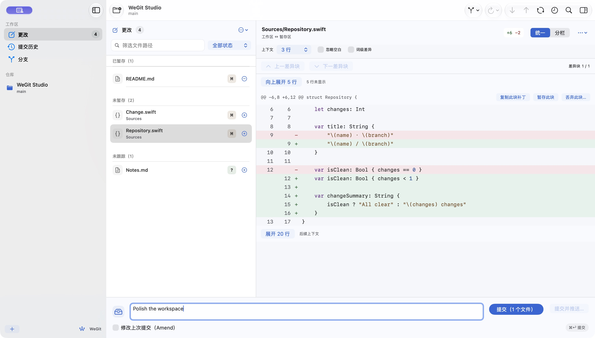
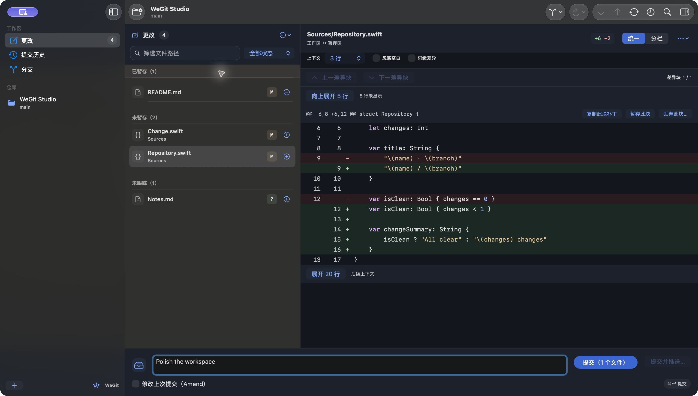
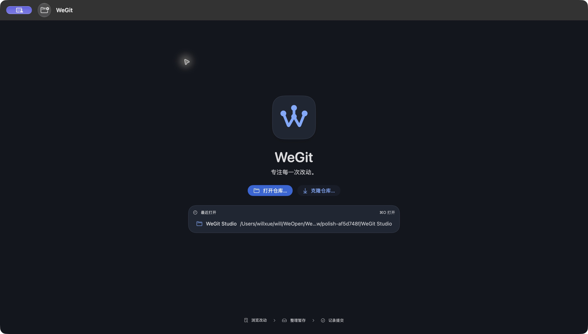
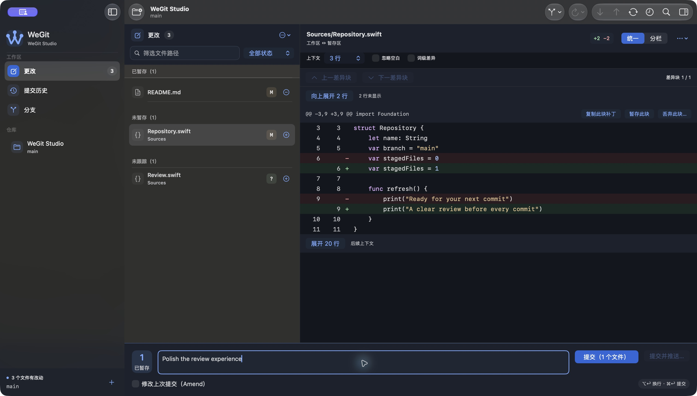
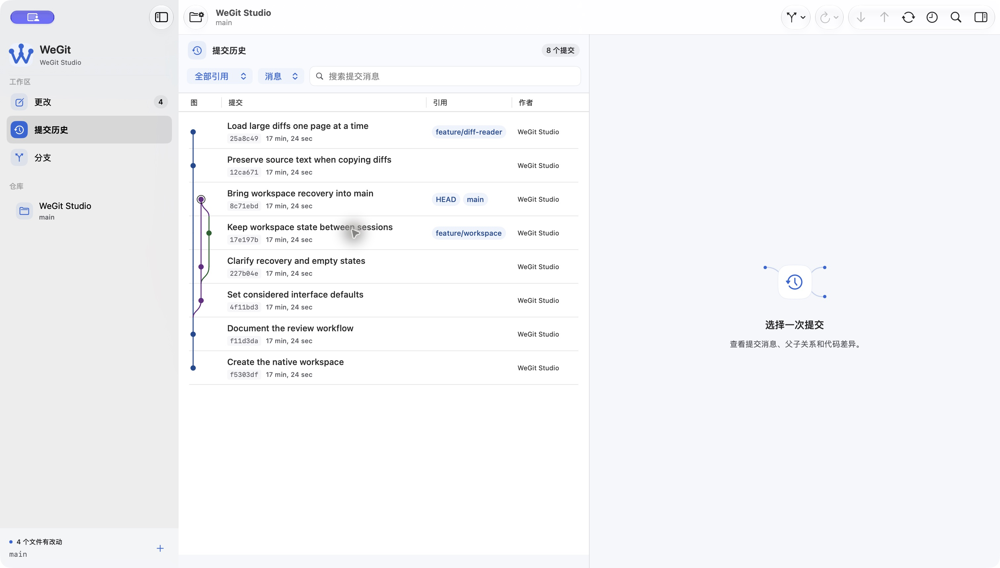
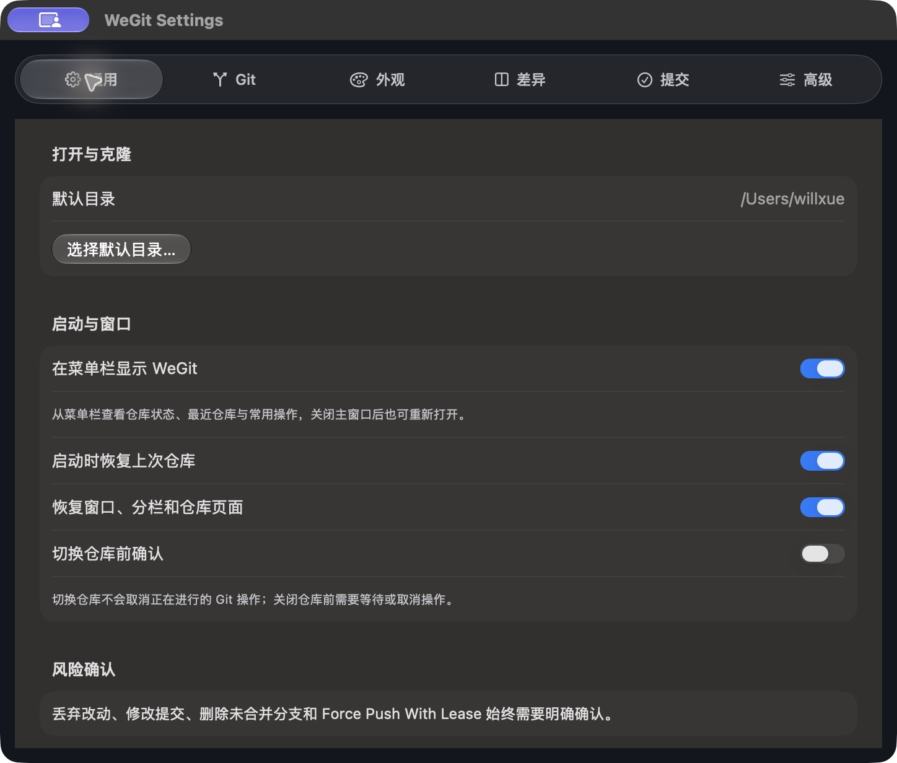

# WeGit 界面美化与动效记录

日期：2026-10-12。版本仍为 0.1.0 开发预览。本轮按“统一、原生、克制，适量增加辨识度与交互反馈”实施，保留现有 Git 服务、队列与风险确认。

## 1. 视觉与组件

使用现有品牌的蓝色 W 分支标记，界面以系统字体、中性色和轻量结构线为主。代码阅读和原生列表继续使用稳定的内容背景；没有引入自定义玻璃叠层、动画背景或第三方 UI/动画依赖。

| 位置 | Before | After | Why |
| --- | --- | --- | --- |
| Changes / History / Branches 标题 | 字号、内边距与计数分别配置 | PanelHeader 与 CountBadge 共用标题层级和数字样式 | 页面切换时保持稳定层级 |
| 页面、切换器和命令搜索 | 原生字段各自排版 | WorkbenchSearchField 包装原生 TextField，统一搜索图标、边框、焦点和清除入口 | 清除后立即继续输入，保留已有键盘命令 |
| 文件行 | 通用文件图标、较小暂存点击区域 | 按文件类型使用 SF Symbols，保留字母状态，扩大暂存控件区域 | 更快识别代码、配置、文本和图片，降低点选难度 |
| 差异 Header / Context / Navigation | 背景和增删颜色分散 | 稳定 Chrome 背景与 DiffChangeSummary，使用现有语义色 | 区分操作区域和代码区域 |
| 提交反馈与状态提示 | 普通文字、色块 | OperationFeedback 状态胶囊与 BannerSurface 提示条 | 成功、进行中和异常有持续可见的文字与形状提示 |
| 常用 Sheet | 各自的大标题与间距 | SheetTitle 共用图标底座与标题；表单和危险确认保留原有结构 | 统一弹窗而不重做操作流程 |
| History 表格 | 默认交替背景延伸到空行 | 原生 InsetTableStyle 关闭交替底纹 | 去掉多余的空白条纹，保留选择、列宽和提交图 |
| Welcome | 通用分支符号与技术实现文案 | W 标记、近期仓库卡片与“浏览—暂存—提交”流程说明 | 让首次进入具有品牌辨识度，文案面向使用者 |

组件位于 `WeGit/DesignSystem/AppColors.swift`、`AppStyle.swift` 和 `Components.swift`。填充主按钮使用 #2B67D8；深色主题的文字强调使用 #79AAFF，危险主按钮保留红色。选中行、菜单、Sheet 和常规按钮继续由原生控件处理。

## 2. 动效边界

| 交互 | 配置 | 关闭与减少动态效果 |
| --- | --- | --- |
| 欢迎标记 | 280 ms 路径描绘与节点淡入 | 直接显示完整标记 |
| 最近仓库悬停 | 120 ms 背景反馈 | 直接变化 |
| 操作状态 | 160 ms 淡化，成功保留勾选图标与文字 | 直接变化 |
| 刷新 | 仅 isRefreshing 为真时旋转 SF Symbol | 静态图标 |

Appearance 新增“界面动效”开关，默认开启，重置界面时恢复默认值。应用开关与系统 `accessibilityReduceMotion` 同时约束自定义动效；系统减少动态效果优先。代码行、文件选择、命令面板、列表导航和主题切换没有自定义等待或进场动画。原生进度指示仍负责表示真实工作状态。

## 3. 实际界面

以下为运行中的原生应用截图，仓库为本轮隔离夹具。

更多截图包括 History、Branches、Appearance 设置和最小窗口的 Split / Compact，位于 `docs/acceptance/2026-10-12/ui-polish/`。截图源码摘要为 `0d3c16a34b87b3e76c4b6617d9d188ad416a33bb44207b2d0719ccdcc868c2e5`；之后只隐藏欢迎页装饰箭头的辅助访问元素并修复认证视图格式，没有视觉或 Git 行为变化。最终源码摘要与差异清单见 [validation.json](acceptance/2026-10-12/ui-polish/validation.json)。

## 4. 验证与限制

最终源码下，Apple Git 2.54 和独立 Git 2.46 各 176 项 / 31 套件通过。严格格式检查、Debug、普通 Release 和新增原生回归的编译通过。最小 XCTest 探针在执行测试前因“启用自动化模式超时”失败；没有重复无变化的初始化尝试，也没有降低系统保护。初次格式检查中认证按钮的一处换行问题已修复，失败日志保留为 `format-failed.log`。

手动检查使用 `--uitesting`、私有偏好域 `org.weopen.WeGit.UITests`、内存 SwiftData 与本轮拥有的 Git 仓库。检查了 Light/Dark、Unified/Split、约 981～984 × 692～693 pt 最小窗口、两种密度、清除后的输入焦点、History/Branches/Settings/Welcome，以及动效开关的开—关—开。实际暂存与 ⌘↩ 提交产生的 SHA、消息及两个提交文件已由 Git 核对；全局 Git 配置校验和保持原基线。

新增 `InterfacePolishTests.testSearchClearKeepsInputFocusAndKeyboardCommitInBothThemes`，断言筛选空状态、清除后的直接输入、两种主题与关闭动效时的键盘提交，并核对 Git 消息。该用例已编译，尚未执行。中文命令粘贴、筛选和 Return 导航通过；CUA 的中文 typeText 没有插入文本，完整输入法键盘路径不在本次通过范围内。

关键颜色 Token 的静态检查见 [color-pairs.json](acceptance/2026-10-12/ui-polish/color-pairs.json)：主按钮白色文字 5.205:1，危险按钮白色文字 7.473:1。这只核对定义的色对，不代替系统材质、实际控件状态或自动辅助访问审查。

未验证：完整原生功能套件、144 阅读组合的新源码重测、复制逐字一致的原生回归、系统显示辅助选项实际切换、VoiceOver/完整键盘、慢速及逐帧动效检查、30 次 Release 性能验收。已有 V1.0 验收结果继续保留各自来源，不能直接沿用为此次界面源码的验收结论。

本轮已检查组件的手动视觉与行为范围：Approve。自动化、辅助访问和性能范围仍待验，不计入该结论。

## 5. 开发预览

最终普通 Release 开发包为 `.build/releases/package-PKpJav/WeGit-0.1.0-development.zip`，SHA-256：`7459a2b8b7c2305ed3a026d5c504c680760919a01eeadf87e6e0f6ec2d2ca86a`。源码回执、签名完整性、空权限、AskPass/许可证、测试入口排除与 ZIP CRC 均通过。

该包仍使用开发 Bundle ID 与 ad-hoc 签名，未公证。源码、原始日志、夹具核对、截图摘要和待验项均记录于 [validation.json](acceptance/2026-10-12/ui-polish/validation.json)，不关闭正式发布门槛。

## 启动恢复专项补充 · 2026-10-13

用户正常启动恢复打开的 Inspector 时暴露了此前隔离视觉检查未覆盖的布局循环。旧 Approve 只覆盖当时的手动范围；它不证明所有恢复状态可用。现已替换 Inspector 展示宿主并保护窄窗口宽度，最终普通 Debug/Release 启动、开关与重启恢复通过，浅深色 6 种启动组合全部通过。关闭辅助栏时保留原有 980 pt 工作区，打开时需要 1292 pt；完整字号/密度、键盘、辅助访问和性能矩阵仍待验。此前 package-PKpJav 属于历史产物，最新修复包及来源见 [启动恢复验收](acceptance/2026-10-13/inspector-startup/README.md)。

## 第二轮 · 2026-10-13 分支连接与工作区辨识度

沿用 W 分支标记，将顶部品牌区、路由图标底座、真实仓库状态、面板标题、暂存计数和分支空状态连成一致的视觉语言。提交编辑器保留原生字段和焦点，明确提示 ⌥↩ 换行、⌘↩ 提交；历史加入引用标签、短 SHA 底座与平滑分支线。导航和代码阅读仍即时响应，120 ms 悬停反馈扩展至侧栏最近仓库。

实际检查包括浅深色默认工作区、深色最小窗口、检查器打开后的扩展、舒适/紧凑密度、关闭动效、搜索清除焦点、欢迎页及历史。隔离 Git 核对了多行草稿恢复、暂存计数 1 → 2 → 0 和两个文件的键盘提交。普通 Release 恢复正常用户 History/Inspector 通过；测试域和原窗口/分栏恢复，正常视图 JSON 语义与非布局偏好相同。最小检查器状态仍有部分原生分栏预留空隙，控件可达，后续继续优化自适应间距。

最终源码 `43c855caf7d1396f75649abec8375d373beeba3dd6bd60bfb55c4cf86a372f0b`，开发包 package-tFvFLY，SHA-256 `80787d0ca49cd0fa24cf8fc1cedd2c9a049d61a5779f953991d4b176bfd799ca`。两套 Git 各 176 项、严格格式、构建与原生增强回归编译通过，启动 6 种组合通过。完整 XCTest、辅助技术、144 组合、新源码性能及逐帧动效仍待验。浅色截图之后仅修复空引用的辅助访问名称，没有绘制或交互变化；来源边界与每项证据见 [第二轮界面优化](acceptance/2026-10-13/interface-identity/README.md) 和 [validation.json](acceptance/2026-10-13/interface-identity/validation.json)。

## 顶部与菜单栏 · 2026-10-13

顶部现在展示分支与真实同步状态；宽窗口保留获取/拉取/推送标签，窄窗口合并为同步菜单，查看/布局及更多入口保留可访问名称。新增原生 W 状态图标及快捷弹层，复用品牌、表面与原生按钮，可从更多菜单和 ⌘⇧M 打开。通用设置可以关闭菜单栏。弹层使用即时开关，不增加键盘等待动画。

实际检查和失败修复见 [工具栏与菜单栏验收](acceptance/2026-10-13/toolbar-menu-bar/README.md)。最终源码 `151e20665007ee76ce8605b4a79605274937aec507f1bf69a6dc323920d0b4e4`，新开发包 package-OaCDAm。原生编译、核心与启动通过，完整自动化、辅助技术和新源码性能继续未验。

## 胶囊液态玻璃 · 2026-10-13

按钮使用中性原生玻璃胶囊，主操作保留强调色，单图标动作/菜单使用圆形玻璃。设置分类、Unified/Split 与搜索范围使用共享轨道和滑动玻璃选中胶囊，保持原生命中、radio button 语义、焦点与即时方向键激活。正常字体/宽度以既有工作区预算为准，代码阅读背景保持清晰。减少动效、关闭界面动效、减少透明度及增强对比度有条件适配；实际系统选项、VoiceOver 和性能仍待验。

最终源码 `b3d057695e3c4f5180aeebc8b71016cb35f3c6c1a4b823862492355fc9045adb`，开发包 package-IDrILs。本轮修复和验证范围见 [液态玻璃控件验收](acceptance/2026-10-13/glass-controls/README.md)；旧轮次的 package-OaCDAm 保留历史来源。

## 原生中性色收敛 · 2026-10-14

检查器按钮在两种状态均使用中性圆形玻璃。面板、读取内容、输入与分隔统一使用系统角色，单色符号和品牌、淡色引用/计数与中性悬停组织层次；颜色集中于系统主操作、焦点及 Git 数据的语义反馈。代码高亮也改用系统颜色。保留玻璃控件、原生列表/表单与既有动效，最终源码 `b5b9e32eeb997e1e091c509f6895fb3a6c1eb20601e16e602ef83c4fbcf0d866`。Debug/Release、格式、六种启动与浅深色局部检查有证据；package-M47FMn 为未公证开发预览，见 [原生面板配色验收](acceptance/2026-10-14/native-surfaces/README.md)。

## 主题与交互修复 · 2026-10-14

Tabs 鼠标选择去掉蓝色双重边框，键盘使用中性焦点；侧栏按钮采用同一圆形玻璃样式。主题由单一应用偏好同时控制原生窗口与 SwiftUI 内容，跟随系统清除覆盖。浅深色及系统模式实际切换、侧栏开关/快捷键与 Tabs 方向键有证据，最终源码 `26d0f892e51c1f4aa2edf95a01f3edcd45377af0b4663437c03c49e6432e9c4e`。首次环境顺序失败及默认按钮重复已修复；跨窗口像素/尺寸等增强回归已编译，未执行。见 [主题与焦点修复](acceptance/2026-10-14/theme-focus/README.md)。

## 侧栏与快捷面板收敛 · 2026-10-14

侧栏折叠回到左列原生标题栏，品牌移到底部，Add 放大到顶部按钮尺寸；更改列表/分组和 Diff 采用同一阅读底色，快捷面板扩大并增加按钮内边距。应用主题与系统状态栏 appearance 分开，避免强制深色影响浅色系统栏模板图标。局部浅深色/系统、侧栏和 Add 通过，六种恢复启动通过；整条系统菜单栏对比度和完整 XCTest 仍待验，源码 `4d8d4d26236a88a7188a16401e372187352b7470bf97e7b727bc517fc55cec07`，见 [侧栏与快捷面板调整](acceptance/2026-10-14/sidebar-layout/README.md)。

## 系统主题与悬浮卡片 · 2026-10-15

修复返回系统后的残留主题及浅色检查器黑线。侧栏底部改为有留白的原生玻璃卡片，只保留 WeGit/品牌与 Add。实际系统浅深色变化、显式主题、草稿/Add 和六种恢复启动通过；Auto/两偏好域恢复，核心夹具未改。原生回归编译通过未执行，完整矩阵/辅助技术/新源码性能仍待验，源码 `dbf169442292508368c91345850ea186b69777de516be7cdc1032fe2690cc34f`，见 [主题与悬浮卡片修复](acceptance/2026-10-15/theme-footer/README.md)。

## 标识迁移与 Diff 阅读边界 · 2026-10-15

移除检查器打开时的水平额外留白，内存/磁盘列标题统一 12 pt 水平内边距。根命名空间更新为 com.willxue.wegit，普通新版本一次迁移旧偏好并保留数据库；历史验收记录保留其原值。两套核心、15 项迁移、构建/编译/格式、六种启动与实际界面检查有证据，完整验收范围仍待验，见 [标识迁移与 Diff 边界](acceptance/2026-10-15/bundle-layout/README.md)。

## 侧栏蓝色与点击区域 · 2026-10-15

按用户最新意见恢复底部 W 和侧栏路由的系统蓝色，其他面板继续中性色。修复 Spacer 只在收藏仓库出现及命中形状位于 Button 外导致的空白不可点；A/B 短仓库名的行尾空白在浅深色下均能切换。快捷面板四个图标入口统一增大内框、保留原生玻璃与动作。单设 tint 仍显示灰色和蓝色叠灰色的中间回合均保留；最终只绘制一层蓝色选择。构建、格式与六种恢复启动通过，完整辅助访问和性能不扩展通过，见 [侧栏蓝色与点击区域验收](acceptance/2026-10-15/sidebar-blue/README.md)。

## 历史与分支页底色、遮挡修复 · 2026-10-15

分支页不再沿用原生分栏页面的全局横向安全区忽略，修复标题/筛选/名称被侧栏覆盖。历史表格、提交文件和分支列表采用统一 canvas，分组不再额外绘制灰色条。实际像素中原灰底 (48,48,46) 改为与详情一致的 (30,30,30)，浅色阅读区为 (255,255,255)；这些是表面对齐证据，不是对比度验收。窄窗口与面板开关通过局部复测，完整门槛仍待验，见 [历史与分支页面修复验收](acceptance/2026-10-15/history-branches/README.md)。

## 统一提交按钮与英文适配 · 2026-10-15

提交并推送从较小的次要按钮改为与提交一致的主要玻璃样式。增加中英文文案、单复数和语言设置，实际双向切换保留中文草稿、路径、分支和原始代码。英文复测发现提交区被侧栏覆盖、History 两个 Picker 被截断，现分别按实际视口差值补偿和自适应两行筛选修复。局部深浅色、最小窗口及快捷面板有证据，完整门槛仍待验，见 [按钮与中英文本地化验收](acceptance/2026-10-15/i18n/README.md)。

### 原生菜单语言应用 · 2026-10-15

普通界面即时切换后，通用设置会显示“系统菜单语言尚未应用”和“重新启动并应用语言”。重启遵循启动恢复设置，忙时及未保存草稿时禁用。实际应用后系统菜单、设置窗口标题与工具栏统一语言。详见 [验收](acceptance/2026-10-15/native-menu-language/README.md)。

### 即时菜单语言 · 2026-10-15

顶部菜单改由应用持有的普通原生菜单项提供，语言变化时同时更新文字与辅助访问标题。无需重启，保留原生外观和快捷键；系统窗口排列项目也即时本地化，名称数据保持原文。移除重启语言入口，实际草稿、Git 读取与窗口恢复通过，见 [验收](acceptance/2026-10-15/live-menu-language/README.md)。

## 重置确认框与统一 Inspector 底色 · 2026-10-15

修复 NSAlert 不继承 SwiftUI 主题，以及直接启动时默认应用图标为通用占位的问题。原生确认显式选择当前主题，并从 Bundle 读取真实 AppIcon。Inspector grouped Form 隐藏额外滚动底色，与中间统一 controlBackgroundColor；原生卡片层次保留。浅深色取样最大通道差为 0，确认/取消及重置后 Unicode 草稿保留有实际证据，完整辅助访问/性能仍待验，见 [验收](acceptance/2026-10-15/alert-inspector/README.md)。

## 品牌第二版（2026-10-15）

新素材使用更轻的连续 W、右上单节点分叉、钴蓝/石墨底板和珍珠白主体，平面 Logo 保持单色。通过原生 Icon Composer 收敛生成概念中的强高光，检查浅深色和 16/32/64/128 px；保留第一版及原始生成图。素材生成当轮仅交付独立文件，后续应用接入见下一节，见 [第二版品牌素材](../branding/wegit-v2/README.md)。

## 第二版品牌实际接入（2026-10-16）

已将第二版原生图标和共享几何接入应用，侧栏保留系统蓝，快捷面板/欢迎页采用同一新标记，系统状态项采用单色光学版本。实际浅深色图像、关于图标和普通包恢复有证据，旧版 67 个资源逐文件未变。独立素材与应用接入范围分别记录，见 [第二版品牌接入验收](acceptance/2026-10-15/brand-v2/README.md)。

## 运行中图标与应用主题一致（2026-10-16）

此前原生图标外观独立于应用主题，深色内容下 Dock 可继续显示蓝底。现明确让运行中的 Dock、关于和确认框跟随 Light/Dark/System，深色使用石墨 ICNS，浅色使用蓝色 ICNS；无需重启或清缓存。Finder 和退出后的静态图标继续由系统管理。实际与回归范围见 [Dock 图标主题同步修复](acceptance/2026-10-16/dock-icon-theme/README.md)。

## 原生表面与独立 Custom（2026-10-16）

内置浅深色使用相同的表面关系：工具栏、正文、Inspector 外层和底部提交区一致，设置标题栏与正文一致，原生分组卡片保留层次。自定义是第四种完整独立方案，17 个角色覆盖应用表面、文字、状态、Diff 与高亮，提供预览/取消、原生颜色井及 JSON 往返。自定义表单与原生表单保持右对齐控件。实际三种主题路由和英文编辑器已核对，详见 [原生底色与独立自定义主题验收](acceptance/2026-10-16/custom-themes/README.md)。

## Dock 比例与原生材质（2026-10-16）

静态图标补足 macOS 留白，与系统图标底板比例对应。默认钴蓝/深色石墨蓝及珠白主体改用原生渐变与浅层浮雕，平面 Logo 不变；明确原生版本与生成概念的光照差异，见 [Dock 比例与材质修正](acceptance/2026-10-16/dock-scale-material/README.md)。
