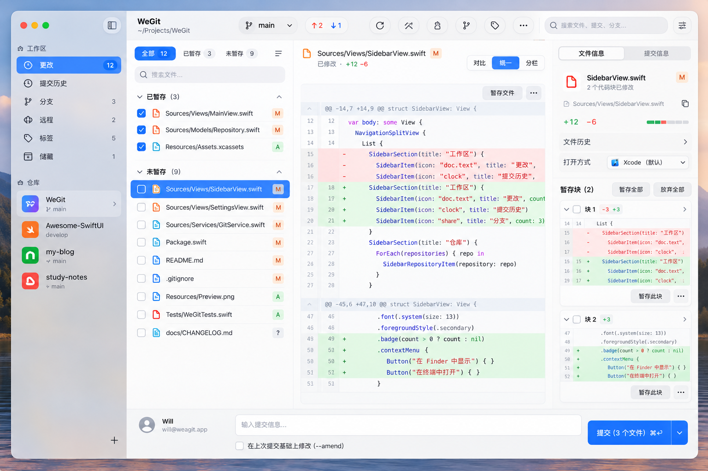

# WeGit UI/UX 设计规范

| 项目 | 说明 |
| --- | --- |
| 平台 | macOS 27+，具体系统组件与 API 在所选 SDK 验证 |
| 设计方向 | Native / Fast / Clear / Focused / Beautiful |
| 文档修订版 | v1.1 |
| 更新日期 | 2026-10-06 |
| 状态 | 目标规范；首轮运行验证与未完成项见 [开发进度](DEVELOPMENT.md) |
| 关联文档 | [文档索引](README.md) · [PRD](WeGit_PRD.md) · [架构](WeGit_Architecture.md) · [执行计划](PLAN.md) |

## 1. 设计原则与范围

界面围绕当前仓库、当前分支和当前对象组织。文件改动、差异阅读与提交保持在同一页面；高频操作有键盘路径，低频功能放入菜单或辅助面板。

所有功能版本以 [PRD 第 2 节](WeGit_PRD.md#2-版本范围) 为准。本规范同时描述 P0 和后续页面，未到相应版本的功能不显示为空页面、无效按钮或假入口。

正文以中文说明，中文与英文名称作为界面映射保留。应用使用本地化资源管理文案，同一语言模式下保持一致；是否首发多语言在 Phase 0 确认。路径、分支、提交消息和 Git 命令保持原文，不做自动翻译。

### 1.1 视觉参考

[ui.png](ui.png) 是现有视觉方向参考，重点是紧凑的代码工作台、清楚的选择态、中心差异区域和底部提交输入。



参考图中的标签、示例代码、状态计数、工具栏图标和账户区域不构成功能承诺。实现需遵循本文交互、PRD 范围和实际数据：

- 右侧面板是可折叠 Inspector；中心 Diff 是主详情。
- 底部身份显示使用当前 Git 提交身份，不暗示 P0 已有云端账户登录。
- Tags、Stashes、Remote 编辑和文件历史按版本开放。
- 文件选中与暂存是两个动作；不能把列表选择自动等同于暂存。

## 2. 主窗口与响应式布局

### 2.1 尺寸

最小窗口建议为 980 × 640 pt，默认尺寸为 1280～1440 × 820～960 pt；实际尺寸受可用屏幕限制。支持缩放、全屏、Sidebar 折叠、Inspector 开关和窗口恢复。

初始分栏建议：Sidebar 200～260 pt、对象列表 280～360 pt、详情至少 420 pt、可选 Inspector 260～320 pt。不能把所有最小宽度相加后仍要求在 980 pt 窗口同时显示。

### 2.2 布局职责

```text
┌──────────────────────────────────────────────────────────────────┐
│ Toolbar：仓库 / 分支 / 同步 / 搜索 / 活动                          │
├────────────┬─────────────────┬─────────────────────┬─────────────┤
│ Sidebar    │ 对象列表        │ 主详情              │ Inspector   │
│            │ 文件 / 提交     │ Diff / 提交详情     │ 可选元数据  │
│            ├─────────────────┴─────────────────────┴─────────────┤
│            │ Commit Composer（仅 Changes 页面）                 │
└────────────┴────────────────────────────────────────────────────┘
```

主三栏使用 `NavigationSplitView`；Inspector 用独立辅助面板承载，局部层级可用 `NavigationStack`。Commit Composer 位于 Changes 内容区底部，不覆盖 Sidebar。

### 2.3 窄窗口规则

宽度不足时按顺序隐藏 Inspector、缩减工具栏标签、合并同步菜单，必要时折叠 Sidebar。差异区域优先保留可读宽度，Split 可临时切换 Unified，并提供切回入口。

临时自适应不覆盖用户保存的偏好。折叠面板后仍有菜单/快捷键恢复入口；不能裁切提交按钮或让关键操作只能依赖横向滚动。

## 3. Toolbar

| 区域 | 内容 | 交互要求 |
| --- | --- | --- |
| 左侧 | Sidebar 开关、仓库切换 | 名称明确，可查看完整路径 |
| 中部 | 分支切换、Fetch/Pull/Push | 标明当前分支、同步状态和正在执行的操作 |
| 右侧 | 搜索、Activity、Inspector、更多菜单 | 命令面板可经菜单和快捷键打开，不要求全部入口常驻 |

图标按钮必须有工具提示和可访问名称。同步操作没有变化时可只显示图标，但无上游、未知状态和已同步不能使用同一展示。

`↑2 ↓1` 表示相对上游领先/落后；提示中显示上游名称与最近获取时间。Detached HEAD 使用明确文字与短 SHA，Unborn 分支显示「尚无提交」，Merge/Rebase 状态使用可持续看见的提示条。

后台活动不得让整个窗口不可操作；互斥的写操作禁用并说明原因，历史和其他安全读取按实际能力保留。

## 4. Sidebar 与导航

P0 导航包含 Changes、History、Branches；Remote 信息可从同步目标或设置中查看。V1.1 增加 Tags、Stashes、Remotes 管理；V1.2 按能力增加 Worktrees、Submodules。

使用系统选中态，行结构为图标、标签、可选数量和状态。Changes 数量按唯一路径计算；分组内的数量允许重叠，不能简单相加当成总数。

导航变化保留每个页面的筛选、滚动和对象选择。恢复对象不存在时选择合理的空状态，不能继续展示旧对象的可执行按钮。

## 5. Welcome 与仓库切换

### 5.1 欢迎页

无仓库时显示产品名、简短说明、Open Repository、Clone Repository 和最近仓库。没有最近记录时不显示空列表装饰。

最近仓库显示名称、路径、最近打开时间和收藏；缓存分支信息须在打开后刷新。上下文操作包括打开、收藏、Finder、Terminal、适用时的 Xcode、复制路径、移除记录。

「移除最近记录」明确不会删除本地文件。Open in New Window 在多窗口能力完成后显示。

### 5.2 切换器

仓库切换 Popover 提供搜索、收藏、最近、打开和克隆。方向键选择，Return 打开，Esc 关闭；打开时聚焦搜索，关闭后回到触发控件。

切换仓库时保存各自提交草稿。当前仓库有进行中的写操作时，说明能否后台继续或需要等待，不能直接丢弃操作上下文。

### 5.3 仓库异常

路径移动、权限失效、Git 不可用、非仓库、Bare 或未支持 Worktree 使用不同说明。适用操作包括重新选择路径、重新授权、选择 Git、重试和移除记录。

## 6. Clone Repository

P0 字段为 Repository URL、Destination Folder 和 Folder Name。支持 HTTPS、SSH 和 SCP 风格地址；校验提示贴近对应字段，不能只用红色边框。

| 状态 | 呈现与操作 |
| --- | --- |
| 编辑 | 可粘贴 URL，显示最终目标路径，校验是否存在与可写 |
| 克隆中 | 显示当前阶段、可靠进度/传输信息、Cancel；禁止重复提交 |
| 等待认证 | 明确需要什么认证，敏感输入遮蔽，不持久化到普通表单记录 |
| 失败 | 保留可重试参数，解释网络、认证、权限或磁盘原因 |
| 已取消 | 说明目录是否保留；仅为本次创建目录提供确认清理入口 |
| 完成 | 打开新仓库并更新最近记录 |

浅克隆和递归 Submodule 选项随对应能力上线后再显示。没有总进度时显示阶段和不定进度，不显示猜测百分比。

## 7. Changes 页面

### 7.1 结构

顶部显示总改动数、刷新、路径筛选、过滤与 Stage All/Unstage All。文件列表按「冲突、已暂存、未暂存、未跟踪」排序；支持状态分组，目录分组和扁平列表可作为显示选项。

同一文件可能在已暂存和未暂存区各出现一次。点击某一行时，Diff Header 必须显示当前比较层，不能只显示文件名。

Stage All 的范围在标签或提示中说明为当前仓库全部适用文件，不随筛选暗中变化，也不包含自动标记冲突解决。

### 7.2 文件行

显示状态、文件图标、文件名、相对目录和暂存动作。相同文件名用路径区分，长路径支持中间截断及完整路径提示；重命名展示原路径到新路径。

| 状态 | 标识 | 可访问说明示例 |
| --- | --- | --- |
| 修改 | `M` | 已修改，未暂存 |
| 新增 | `A` | 新文件，已暂存 |
| 删除 | `D` | 已删除 |
| 重命名 | `R` | 从原路径重命名到新路径 |
| 复制 | `C` | 已复制 |
| 未跟踪 | `?` | 尚未跟踪 |
| 冲突 | `U` | 冲突，尚未解决 |
| 类型变化 | `T` | 文件类型已改变 |

选中行用于查看，Stage/Unstage 用独立按钮或可理解的复选框动作。鼠标悬停可以显示辅助操作，但键盘焦点、上下文菜单和菜单栏也必须能访问。

### 7.3 上下文菜单

P0 按所在分组提供 Stage/Unstage、Discard、打开文件、适用的 Xcode、Finder、复制相对/绝对路径。不存在的文件禁用打开；冲突行使用冲突动作。Show File History 在 V1.1 开放。

## 8. Diff Viewer

### 8.1 Header 与比较基准

Header 包含路径、增删统计、比较基准、Unified/Split、忽略空白、前后差异导航、外部打开和更多菜单。

比较基准使用「工作区 ↔ 暂存区」「暂存区 ↔ HEAD」「父提交 ↔ 当前提交」等明确标签。Merge 提交显示当前选定父提交，根提交说明相对空树。

### 8.2 文本与差异块

Unified 使用旧/新行号和 `+`/`−` 标识；Split 的两侧滚动与差异对齐，缺失行显示为空位，不伪造行号。语法高亮与增删背景须同时保持可读。

差异块 Header 显示范围和对应的 Stage Hunk、Unstage Hunk、Discard Hunk、Copy Hunk。提交历史中的差异只读，不显示工作区写操作。

复制选区默认输出代码文本，不夹带行号或装饰标识；Copy Patch 作为独立入口保留补丁格式。无末尾换行和行尾差异有可理解提示。

### 8.3 上下文、词级差异与过期状态

折叠区显示隐藏行数并支持按需展开。词级差异只增强阅读；不能把高亮后的内容作为补丁。

忽略空白等阅读模式无法保证块级操作准确时，禁用该操作并说明如何切回。文件变化导致当前 Diff 过期时显示「内容已变化，请刷新后操作」，避免对旧行号继续写入。

### 8.4 大文件和二进制

大差异先显示文件大小、原因和 Load Diff/Open Externally，加载期间可取消。只读到部分内容时明确提示，不把截断末尾当成文件结束。

P0 二进制显示变更类型、可获得的大小和外部打开入口。V1.1 图片支持 PNG/JPEG/WebP、Before/After、尺寸和文件大小；滑杆比较待排期。V1.2 才提供选中行暂存；P0 不显示失效的行级 Stage 控件。

## 9. Commit Composer

提供标题、可选描述、Amend 和主提交按钮；Commit & Push 放在按钮菜单中。描述输入支持换行，Return 不触发提交，提交使用 `⌘↩`。

| 状态 | 行为 |
| --- | --- |
| 普通提交就绪 | 有暂存内容、有效消息且没有未解决冲突或互斥操作 |
| 普通提交不可用 | 说明「请填写消息」「请先暂存文件」等具体原因 |
| Amend | 加载当前提交消息并可编辑；允许只改消息，无新增暂存内容 |
| Merge 待完成 | 使用继续合并流程，不错误套用普通提交的空暂存规则 |
| 提交中 | 显示进度并禁止重复执行，保留草稿 |
| Hook/签名失败 | 表单内显示错误和可展开输出，草稿保留 |
| 提交成功 | 更新差异与历史，按草稿策略清理已提交消息 |
| 提交成功但推送失败 | 显示两个独立结果，并提供「重试推送」 |

Amend 前明确改写的是哪个提交；已发布状态未知时不能保证没有远端影响。V1.1 增加显式签名按钮和消息历史；P0 尊重已有 Git 签名配置。

提交后仍可能保留未暂存内容，提示不使用固定的「工作区已干净」。Git 提交身份属于仓库配置，不展示成托管平台登录状态。

## 10. History 与 Commit Detail

历史列表包含 Graph、Message、Refs、Author、Date，支持调整列宽、分页和范围选择。初始最多 200 个提交；默认 refs 范围与 [PRD](WeGit_PRD.md) 保持一致，当前分支过滤需明显可见。

提交行使用稳定高度与节点对齐；Branch/Tag 徽标不能只靠颜色区分。相对时间提供绝对时间、时区和作者/提交者时间说明。头像不可用时有本地占位。

提交详情显示消息、完整/短 SHA、作者、提交者、父提交、引用、统计、文件和 Diff。窄窗口下使用局部层级展开文件差异，不在主三栏中无限嵌套新分栏。

P0 提供复制 SHA、检出提交、新建分支和父提交比较。检出提交说明 Detached HEAD。V1.1 起逐步开放 Tag、Cherry-pick、Revert、Reset、文件历史和扩展比较；多选和批量操作须有明确版本验收后启用。

分页末尾区分「正在加载」「全部加载完毕」「浅克隆边界」和「加载失败，重试」。新提交到来时提供刷新并保持可解释的选中状态，避免列表无提示跳动。

## 11. Branches 与 Branch Switcher

Branches 按本地/远端跟踪分组，行显示名称、当前标记、上游、领先/落后和最近提交。Git 不记录通用的「分支创建时间」或唯一「基础分支」；若展示推断结果，必须标为推断并说明依据。

Branch Switcher 提供搜索、最近、本地、远端和新建入口，方向键选择、Return 切换、Esc 关闭。新建分支统一使用 `⌘⇧N`，不另设与其他入口冲突的局部 `⌘N`。

New Branch Sheet 包含名称、起点和创建后切换，实时提示非法名称、引用冲突和已有分支。选择远端分支时说明新建本地分支与上游的关系。

切换将覆盖未提交改动时，P0 提供取消、查看文件和先提交建议。V1.1 才提供 Stash & Checkout；操作不得自动丢弃本地内容。

删除本地分支时显示准确名称、当前目标和未合并风险；当前分支或其他 Worktree 占用时解释禁用原因。不把远端跟踪引用删除与服务端分支删除混为一谈。

## 12. Merge 与基础冲突流程

### 12.1 合并弹窗

标题采用「将 `feature/login` 合并到 `main`」，并列出来源、目标和工作区状态。选项用互斥策略表达，如「允许快进」与「始终创建合并提交」，避免两个含义重复的复选框。

确认后若当前分支或源引用变化，停止执行并要求重新查看目标。合并冲突是需要处理的工作流状态，不是普通成功提示。

### 12.2 P0 冲突模式

在 Toolbar 下持续显示操作类型和未解决文件数，例如「正在合并：还剩 3 个冲突」。Changes 将冲突分组置顶。

P0 提供外部打开、定位、查看可用差异、标记已解决以及相应 Continue/Abort。没有内置编辑器时说明需在外部编辑结果，再回来标记解决。

Continue 仅在 Git 索引不再有未合并项且操作可继续时启用；Rebase 继续后可能出现下一轮冲突。Abort 说明会撤回操作中的更改，不能保证恢复所有未提交内容。

外部 Cherry-pick/Revert 等 P0 尚未支持的状态显示明确提示与 Terminal 入口，禁用不兼容操作，不假装仓库正常。

### 12.3 V1.2 内置冲突编辑器

三方视图使用 OURS/THEIRS/RESULT，同时显示各侧的实际分支/提交来源。Rebase 下不能固定把 OURS 标为「我的改动」。

提供接受一侧、Accept Both、手工编辑、按块复原、保存结果与标记解决。保存和标记解决是不同动作；Accept Both 不代表逻辑冲突已解决。对二进制、删除/修改和重命名冲突提供专门选择或外部工具路径。

## 13. 同步与 Remote

P0 Fetch/Pull/Push 明确展示 Remote 和目标分支；无上游时进入目标选择与设置流程。Pull 展示当前有效策略，分叉时不能无提示改变策略。

Force Push With Lease 放在显式高级入口中，确认包含远端、目标引用、预期提交和历史影响。远端变化时拒绝并刷新，不自动改用普通 Force。

V1.1 Remotes 页面显示名称、Fetch/Push URL、可推断的连接类型，提供新增、编辑、删除、Fetch 和复制脱敏 URL。SSH/HTTPS 协议并不等同于已认证，不能显示未经验证的「已连接」。

## 14. 后续页面

| 版本 | 页面 | 关键内容与风险 |
| --- | --- | --- |
| V1.1 | Stashes | 标识、消息、分支、时间、Diff；Apply/Pop/Delete、从储藏创建分支；冲突时正确保留储藏状态 |
| V1.1 | Tags | 名称、目标、轻量/附注类型、可用消息/时间；本地与远端删除分开说明 |
| V1.1 | File History | 文件路径、重命名追踪范围、提交和差异 |
| V1.1 | Reset | Soft/Mixed/Hard 对 HEAD、暂存区、工作区的影响逐项说明 |
| V1.1 | Cherry-pick / Revert | 目标提交、当前分支、执行结果、冲突、继续和中止 |
| V1.1 | Image Diff | 前后图片、尺寸、大小和缺失一侧状态 |
| V1.2 | Interactive Rebase | 基准、顺序、pick/reword/edit/squash/fixup/drop、确认与恢复 |
| V1.2 | Blame | 作者、提交、时间、行归属和详情入口 |
| V1.2 | Worktrees / Submodules / LFS | 路径、分支、占用、初始化/工具缺失与各自操作状态 |

Reflog 浏览与恢复界面待排期；现有恢复提示仍应说明已保存的提交信息和适用的 Terminal 操作。

轻量 Tag 没有独立的 Tagger 时间，不能把目标提交时间不加说明地当成 Tag 创建时间。

## 15. 搜索与命令面板

搜索明确「当前仓库」和对象范围。P0 支持提交消息/SHA/作者查询、文件路径和分支筛选；V1.1 再增加增强的跨对象搜索。显示结果来自完整查询还是已加载数据。

查询更新时取消旧请求；加载、无结果和错误有不同呈现。搜索结果说明对象类型和匹配字段，选择后定位到对应页面。

命令面板使用 `⌘⇧P`，打开时聚焦输入，支持方向键、Return、Esc。排序优先精确匹配，再考虑当前上下文、最近执行与全局命令。不可执行命令可隐藏或附禁用原因；危险命令仍需要正常确认。

仓库快速切换统一使用 `⌘K`，不再同时表示 Quick Actions。

## 16. Activity 与错误反馈

Activity 列表显示命令摘要、仓库、开始时间、耗时和状态：Queued、Running、Succeeded、Failed、Cancelled、Needs Attention，以及必要的「结果待核对」。

点击查看脱敏 stdout/stderr、退出码和操作详情；大输出明确截断。复制/导出仍应用脱敏，不直接复制凭证或完整环境。

| 情况 | 用户反馈 |
| --- | --- |
| Git 不可用 | 重新检测、选择可执行文件、帮助 |
| 身份或认证失败 | 说明属于 Git 作者身份、HTTPS、SSH 或签名问题，提供对应设置/重试 |
| 推送被拒绝 | 说明远端有新提交，提供 Fetch/查看差异；不直接自动强推 |
| 锁占用 | 说明其他进程可能正在操作，提供重试；不提供盲目删除锁按钮 |
| 仓库或权限失效 | 重新定位/授权、Finder、移除最近记录 |
| 操作已取消 | 说明已停止部分和仍需核对的结果，刷新当前状态 |

不要用 Toast 承载需要用户恢复的重要错误。非阻塞成功提示可短暂显示；需要处理的问题保留在相应上下文。

## 17. Settings

使用原生 Settings Scene。分类和首版范围与 [PRD 第 14 节](WeGit_PRD.md#14-搜索设置与原生能力r11r12) 一致：General、Git、Appearance、Diff、Commit、Advanced。

Git 配置编辑必须显示作用域、有效值和继承来源；保存后刷新实际值。修改应用显示偏好不应偷偷写入 `.gitconfig`。

危险操作的关键确认不能被 General 中的普通确认偏好关闭。Accounts、签名管理、消息历史和 Experimental Features 仅在相应能力存在时显示，不保留空占位。

重置应用 UI 状态需说明影响偏好和布局，不删除仓库或 Git 配置。日志保留设置说明保存位置、容量/期限和清除入口。

## 18. 危险操作确认

普通读取、暂存和普通提交尽量不弹出额外 Alert。风险确认统一展示对象、方向、影响和恢复限制，按钮使用明确动作名称，取消作为安全默认选择。

| 操作 | 确认必须说明 |
| --- | --- |
| Discard | 文件/块数量、未暂存或同时清除暂存的范围、未提交内容可能无法恢复 |
| 未跟踪文件删除 | 删除哪些文件、进入废纸篓还是永久删除 |
| Amend | 改写哪个提交、是否可能影响已发布历史 |
| 删除未合并分支 | 名称、目标与可确认的未合并提交情况 |
| 删除 Tag | 本地还是远端，是否影响其他使用者 |
| Hard Reset | 目标提交及 HEAD、索引、工作区影响 |
| Force Push With Lease | 远端、分支、预期目标、可能覆盖历史 |
| Abort Merge/Rebase | 撤销正在进行的操作及操作中编辑的恢复限制 |

只有已计算出准确数量时，才显示「有 3 个提交尚未合并」等文案；否则明确说明尚未确认，不能伪造精确数字。

危险操作不通过单次 Delete 按键直接执行。列表 Delete 如有定义，只能打开与当前对象匹配的确认；文本输入中仍是普通删除字符。

## 19. 键盘与菜单

此表是默认快捷键的唯一维护位置。菜单、工具栏和命令面板共享同一动作与可用状态；以后增加快捷键自定义时仍要检测冲突。

| 功能 | 快捷键 | 说明 |
| --- | --- | --- |
| 打开仓库 | `⌘O` | 选择已有仓库 |
| 克隆仓库 | `⌘⇧O` | 打开克隆表单 |
| 新建分支 | `⌘⇧N` | 在当前仓库创建分支 |
| 提交 | `⌘↩` | 当前提交动作可执行时生效 |
| 命令面板 | `⌘⇧P` | 全局入口 |
| Changes | `⌘1` | 切换页面 |
| History | `⌘2` | 切换页面 |
| Branches | `⌘3` | 切换页面 |
| 仓库内搜索 | `⌘⇧F` | 显示当前仓库搜索范围 |
| 快速切换仓库 | `⌘K` | 打开仓库切换器 |
| 刷新 | `⌘R` | 刷新当前仓库可见数据 |
| Pull | `⌘⇧L` | 使用显示的同步目标和策略 |
| Push | `⌘⇧U` | 需要设置上游时先进入选择流程 |
| 设置 | `⌘,` | 系统设置入口 |

列表方向键选择，Return 执行明确的主动作，Tab 按视觉顺序移动焦点；表单 Return 不冒充危险确认。Quick Look 可后续评估，不影响现有 Space/输入行为。

关闭 Popover/Sheet 后恢复到触发控件；切换仓库、加载 Diff 或操作失败不得把焦点无故移到窗口起点。所有仅悬停可见的操作也必须对焦点和菜单开放。

## 20. 视觉基础与可访问性

### 20.1 材质、字体与间距

优先系统 Toolbar、Sidebar、Popover 和 Sheet；仅系统组件不足时评估 `.glassEffect()` 或 `GlassEffectContainer`，并核对 SDK 可用性。自定义玻璃叠层不超过两层，代码、提交列表和 Graph 使用稳定内容背景。

UI 使用系统字体，代码使用系统等宽字体；建议代码字号 12～14 pt，可由用户调整。页面标题、分组、行主文案、元数据使用有层级的系统文字样式，不用固定小字号压缩全部信息。

| Token | 初始建议 | 用途 |
| --- | --- | --- |
| 间距 | 4 / 8 / 12 / 16 / 24 / 32 pt | 从控件内部到页面分组 |
| 密度 | Compact / Comfortable | 使用同一组 Token，避免页面各自硬编码 |
| 图标 | SF Symbols 优先 | 系统无法表达 Git 概念时再创建自定义图标 |
| 颜色 | 系统动态颜色 + Diff 语义色 | 分别验证浅色、深色、选中与高对比度状态 |
| 动效 | 简短、可中断、尊重系统设置 | 状态过渡不延迟 Git 操作或阅读 |

### 20.2 可访问性要求

- 状态不只靠颜色；Diff 同时提供增删符号和可访问说明。
- VoiceOver 能读取仓库、分支、列表项状态、比较基准和当前操作。
- Graph 提供提交和父关系的文字信息，不能只暴露不可理解的 Canvas。
- 减少透明度时使用不透明替代背景，减少动态效果时取消非必要移动。
- 键盘可完成打开、暂存、提交、分支切换和同步；焦点可见且不会困在浮层。
- 增强对比度、色觉差异和较大字号下仍能区分状态，不截断关键操作。
- 文本和控件对比度以 WCAG AA 作为检查参考：普通文字 4.5:1，大文字及关键非文本边界 3:1；同时验证系统实际材质背景。
- 小图标可保留紧凑视觉尺寸，但点击与焦点区域应符合所选 macOS 控件的可用尺寸，避免只能精确点中几像素。

## 21. 页面状态矩阵

所有数据页面须分别处理初次加载、刷新、空数据、正常、失败、禁用和进行中操作。刷新时保留可用的旧内容并标明状态，不反复清空整页。

| 页面/区域 | 特殊状态 | 下一步 |
| --- | --- | --- |
| Welcome | 无记录、路径失效、权限丢失 | 打开、克隆、重新定位/授权 |
| Changes | Clean、部分暂存、冲突、外部变化 | 查看层级、暂存、解决、刷新 |
| Diff | 无选择、二进制、大文件、过期、读取失败 | 选择、外部打开、显式加载、刷新/重试 |
| Commit | 无消息、无暂存、Amend、Hook 失败、推送失败 | 补全、修正、仅重试失败步骤 |
| History | 无提交、Detached、浅克隆、分页失败 | 首次提交、新建分支、说明边界、重试 |
| Branches | 无上游、未诞生、切换受阻、分支已删除 | 设置上游、首次提交、检查改动、刷新 |
| Sync | 离线、认证、被拒绝、远端结果未知 | 认证/重试、Fetch、核对状态 |
| Conflict | Merge/Rebase、未解决、可继续、中止失败 | 外部编辑、标记、继续或查看详情 |
| 后续 Tags/Stashes | 无数据、操作冲突、目标变化 | 创建、恢复流程、刷新 |

空状态文案说明状态与可用行动。例如「工作区干净：没有未提交改动」不暗示已推送；「暂无提交」引导创建首个提交；「无搜索结果」允许清除筛选。

## 22. 页面交付与设计验收

P0 页面包含 Welcome、Open、Clone、主窗口、Changes、Diff、Commit Composer、History、Commit Detail、Branches、两个切换器、新建分支、Merge、基础冲突处理、同步目标/认证、搜索、命令面板、Activity、Settings、风险确认和错误详情。后续页面见第 14 节。

每个阶段交付时验证：

1. 用户能看清当前仓库、分支、工作区和同步状态。
2. 从已选择文件且消息已填写开始，普通暂存与提交在 3 次交互内完成。
3. 不离开 Changes 即可完成普通提交；部分提交不丢失剩余内容。
4. 980 × 640 pt、默认尺寸和大窗口下关键内容及操作完整可达。
5. Diff 长时间阅读清楚，Inspector 关闭后核心工作流仍完整。
6. 核心流程可用键盘完成，焦点恢复正确，危险操作有准确确认。
7. Light/Dark、减少透明度、减少动态效果、增强对比度和 VoiceOver 均通过检查。
8. Loading、Empty、Error、Disabled、Running 等状态有真实数据或可重复 fixture 支撑。
9. 参考图与实际交付的差异有明确产品原因，不以静态效果图代替运行结果。
