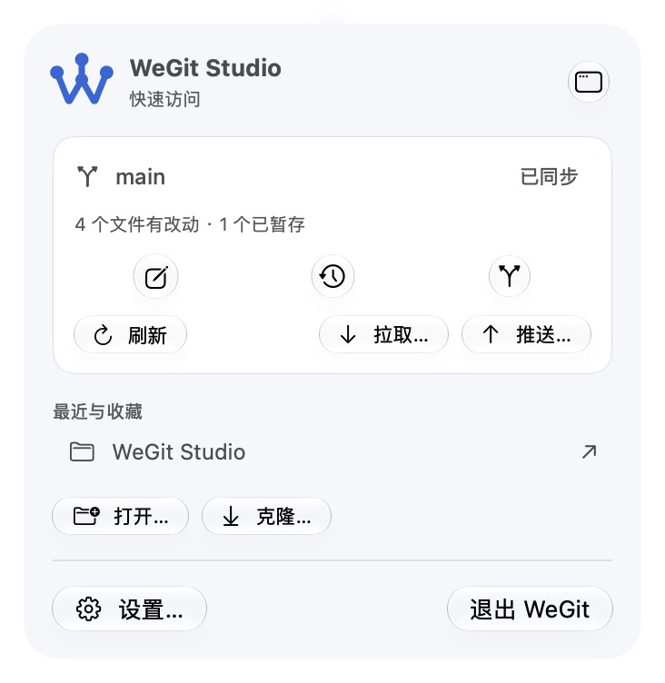
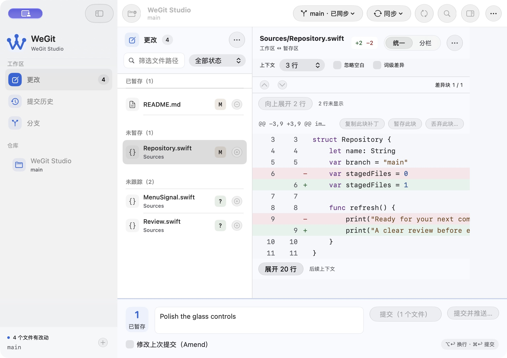

# 胶囊液态玻璃控件验收 · 2026-10-13

按用户参考图统一文字按钮、单图标按钮与 Tabs。当前为可追溯的开发预览；不关闭 V1.0 发布门槛。

## 实现与样式

| 控件 | 最终效果 | 行为 |
| --- | --- | --- |
| 常规按钮 | 中性原生玻璃胶囊 | 保留原生按下、禁用、角色、焦点及默认快捷键 |
| 主要操作 | 强调色玻璃胶囊 | 提交、保存、确认使用既有权限和动作 |
| 图标按钮与图标菜单 | 圆形玻璃 | 工具栏、搜索清除、行暂存、Diff 导航、菜单栏快捷入口 |
| Tabs | 低重量材质轨道 + 原生玻璃选中胶囊 | 同一共享组件覆盖六类设置、内存/磁盘/提交 Diff、搜索范围 |

实现见 `WeGit/DesignSystem/GlassControls.swift`。使用 [Apple 的 Liquid Glass API](https://developer.apple.com/documentation/swiftui/applying-liquid-glass-to-custom-views) 和 [GlassButtonStyle](https://developer.apple.com/documentation/swiftui/glassbuttonstyle)，并通过本地 macOS 27 SDK 和构建核对。Tabs 的轨道使用较轻的材质，以避免重叠的玻璃折射；选中层使用原生玻璃。可读区域继续使用既有背景。

Tabs 的透明 `NSSegmentedControl` 层拥有命中、焦点和 AX radio button；SwiftUI 标签隐藏于辅助访问树，只绘制轨道与选中层。鼠标点击建立焦点，左右键即时激活目标；选中状态、移动胶囊和页面绑定同步。未按键期间不运行循环动画。减少动态效果或关闭界面动效时取消胶囊位移动画；减少透明度或增强对比度时使用实色背景和明确边界。这些条件分支已实现，实际系统选项与辅助技术验收继续待做。

设置页从旧原生标签索引迁移初始分类，后续保存在 `app.defaults` 的 `settingsTab`，测试实例写入私有域，未向正常域写入测试分类。

## 验证与边界

- macOS 27.0.1 (26A434)、Xcode 27.0 (27A266a)、arm64；应用源码摘要 `b3d057695e3c4f5180aeebc8b71016cb35f3c6c1a4b823862492355fc9045adb`。
- Apple Git 2.54.0 和最低 Git 2.46.0 各 176 项核心测试通过，严格格式检查和 Debug/普通 Release 构建通过。
- 原生回归编译通过；增强 `InterfacePolishTests` 的真实鼠标聚焦、左右键布局/AX 状态及 Git 内容保持断言，更新设置 Tabs 定位。没有重复既有无变化的 XCTest 初始化失败；完整执行仍阻塞。
- 最终源码浅/深色 × 更改/历史/分支的 Inspector 启动 6 种组合均存活至少 10 秒，保存状态、夹具数据与该启动夹具索引字节保持不变。
- 原生实际检查六类设置、三个搜索范围、Unified/Split、左右键选择、启用/禁用胶囊、圆形按钮、浅深色和菜单栏弹层。980 × 693 pt 的隔离恢复窗口中，同步菜单、更多按钮、Tabs 和提交区域保持可见。
- 较早键盘/颜色检查后的最终差异仅为窄工具栏同步标签；它已在最终源码的 `compact-final.ax.txt` 与截图中重新核对。
- 私有复制夹具的 HEAD、暂存条目、工作区状态和 Diff 内容一致；物理 index 字节发生缓存元数据刷新，保留该差异，未宣称本轮读操作的 index 字节完全相同。后台状态“不写可选索引”的独立核心行为回归通过。
- 正常偏好、原窗口/分栏及私有测试域已恢复；仓库视图 JSON 比较语义，其余偏好逐值比较。系统辅助访问选项未修改。

失败回合保留：最初普通按钮继承了全局强调色，呈蓝色；已在共享层清除普通 tint，主操作仍保留强调色。初次鼠标聚焦后原生左右键只移动焦点，现已明确即时激活；方向键证据见 AX 文件。两次拖动未成功改变窗口，随后用独立 autosave 命名空间恢复 980 × 693 pt 窗口核对，没有将无变化的拖动算成通过。

完整 VoiceOver/键盘路径、系统辅助访问选项、144 阅读组合、特殊文件、最终源码 Release 性能/内存/FPS，以及正式签名、公证、干净安装和真实 Beta 仍待验。

## 交付

普通 Release 开发包：`.build/releases/package-IDrILs/WeGit-0.1.0-development.zip`。

SHA-256：`e334867c544782f80ad2a807c42bd8b27fddb4d992aac62b50a4d1c25cb1320e`。

来源回执、签名完整性、AskPass/MIT、测试入口排除和 ZIP CRC 通过；普通 Release 实际恢复用户更改页和 Inspector 后正常显示；版本 0.1.0，开发标识 `org.weopen.WeGit.development`，ad-hoc 签名，未公证。源码仍未提交，manifest 如实保留 dirty 状态。

完整证据和待验项见 [validation.json](validation.json)。截图中的紫色屏幕共享标识和指针光晕来自验收工具，并非新增应用控件。
