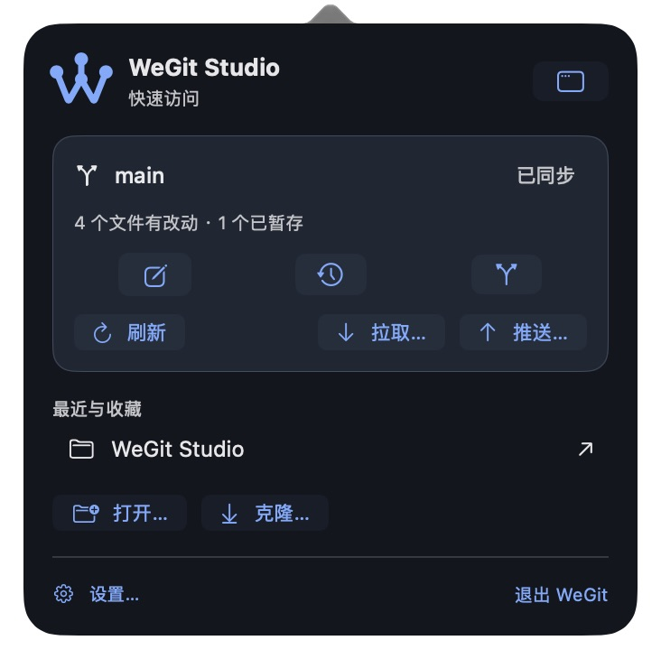
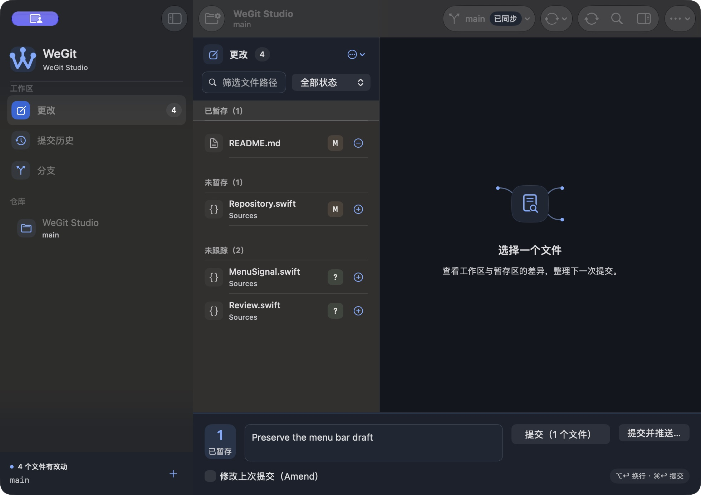

# 顶部工具栏与菜单栏快捷面板

日期：2026-10-13。macOS 27.0.1（26A434）/ Xcode 27.0（27A266a）/ arm64。版本仍为 0.1.0 开发预览。

## 实现

| Severity | Location | Before | After | Why |
| --- | --- | --- | --- | --- |
| MEDIUM | WorkspaceView / WorkspaceToolbar | 分支与同步主要依靠图标，右侧操作较密 | 分支名与明确同步状态、同步标签、查看/布局动作与更多菜单 | 更快识别操作、上游状态和当前上下文 |
| MEDIUM | WorkspaceView / WindowStateBridge | 最小窗口进入系统溢出菜单 | 用原生窗口真实宽度，在 1180 pt 以下合并获取/拉取/推送 | 关键入口留在工具栏，菜单使用现有可用条件 |
| MEDIUM | MenuBarController / MenuBarPanel | 关窗后只能经 Dock 或 Window 菜单返回 | 系统 W 模板图标与原生弹出层；最近/收藏、状态、刷新、页面和同步入口 | 保持轻量快速访问，全部动作复用当前 AppState 与仓库服务 |
| MEDIUM | AppState / WorkspaceView | 重开窗口再次执行初始恢复，可能覆盖当前选择 | 首次恢复后重开保持现有会话、页面和草稿；窗口/面板按生命周期持有观察 | 快捷面板重新打开主窗口时保留工作上下文 |
| LOW | SettingsView / AppPreferences | 没有菜单栏选项 | 通用设置“在菜单栏显示 WeGit”，默认开启且持久化 | 用户可控制常驻入口 |

快捷入口为系统右上角 W 图标、顶部“更多 → 菜单栏快捷面板”、工作区菜单或 `⌘⇧M`。这些入口打开同一 NSStatusItem 所属 NSPopover，不生成独立的模拟面板。图标使用原有 W 分支几何的模板图像，系统负责浅深色菜单栏着色。

菜单栏打开时激活当前仓库观察并刷新权威快照；主窗口和面板都关闭时暂停观察。拉取/推送进入既有目标确认与验证流程；配置保存、过期状态和写入活动使用已有可用条件。退出继续调用 NSApplication 的统一委托保护。没有添加新的 Git 公共接口或操作队列。

普通 UI / 性能夹具默认不插入状态项，专用菜单栏回归通过 Debug 参数明确开启。普通 Release 不包含该测试入口。

## 实际检查

- 隔离仓库包含真实本地提交、一个私有 Bare Remote 与 origin/main；未向用户远端发送写入。
- 实际打开浅深色面板；关窗后新增一个夹具文件，快捷面板刷新计数 3 → 4。
- 通过面板重开主窗口，History 页面和原提交草稿保留。
- 最小窗口显示“同步”菜单，获取/拉取/推送可达；拉取和面板推送进入正常确认，未执行这些确认后的写入。
- 设置入口打开通用设置；菜单栏开关关闭时快捷入口不执行，重新启用后可打开。
- 配置保存延迟夹具中点击菜单栏退出，应用保留运行、写入控件禁用；该延迟写入随后超时，原 user.name 不变。没有捕获退出提示框，不将提示框显示判定为通过。空闲时菜单栏退出实际结束进程。
- 原生快捷面板和窄工具栏行为回归已编译；XCTest 自动化初始化仍不可用，此轮没有标记自动执行通过。

普通 Release 启动恢复正常用户 History 与打开的 Inspector，通过最终辅助访问树核对同步状态值。源码、两套核心各 176 项、严格格式、Debug/普通 Release、原生编译、6 种最终源码启动生存回归、签名与来源见 [validation.json](validation.json)。

初始窄布局未触发合并，改为原生窗口宽度观察；初始弹层根标识覆盖了子按钮，移除后独立标识可见。失败截图和错误夹具路径回合保留。测试原生 Settings 页签、窗口/分栏与私有测试域已恢复，正常仓库视图按 JSON 语义比较一致，全局 Git 配置摘要保持不变。

Not verified：界面工具无法捕获系统状态栏宿主窗口，因此系统 W 图标的直接鼠标点击未自动核对；通过同一原生控制器的键盘/工具栏入口检查真实菜单栏锚定弹层。完整 VoiceOver/键盘、原生全套、144 阅读矩阵、新源码 30 次 Release 性能与干净机器分发继续待验。

本轮检查过的布局与行为范围：Approve。未检查的自动化与辅助技术范围不计入该结论，V1.0 发布继续未完成。

