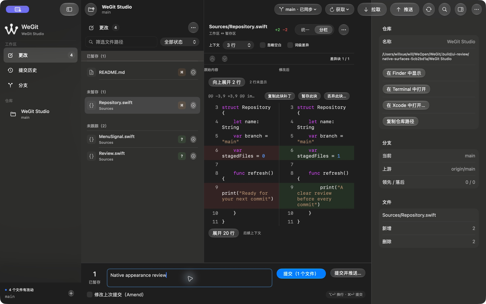
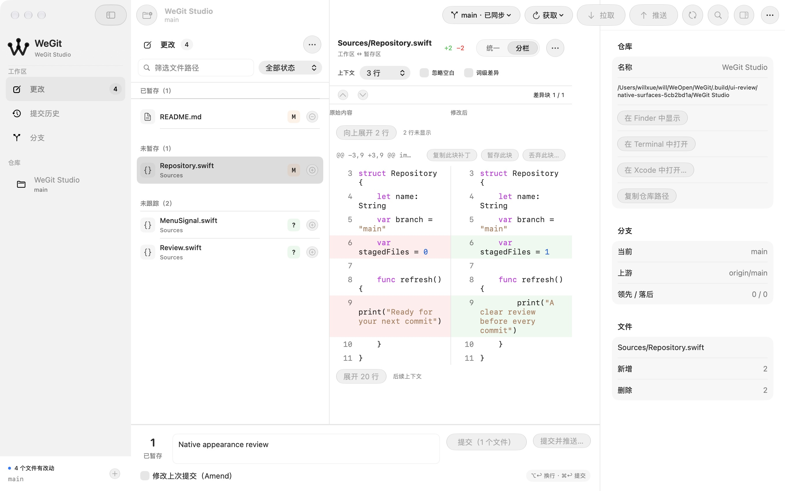

# 原生中性色与面板收敛 · 2026-10-14

按用户要求移除右侧检查器按钮的蓝色，并将界面配色统一为 macOS 原生语义颜色。保留现有玻璃控件，以中性色、系统层次、细分隔和留白组织界面。

## 实现

| 严重程度 | 位置 | 原表现 | 最终表现 | 原因 |
| --- | --- | --- | --- | --- |
| MEDIUM | GlassControls.swift / WorkspaceView.swift | 检查器打开时玻璃和图标都染蓝 | 开关均为中性玻璃；提示显示“显示/隐藏检查器”，AX 仍宣告已打开/已关闭 | 统一普通图标操作的层次 |
| MEDIUM | AppColors.swift / DiffContentView.swift / DiskDiffView.swift / CommitFilesView.swift | 不同面板叠加偏蓝手选 RGB、bar 和 quaternary 背景 | 容器/标题使用 windowBackgroundColor，读取/输入使用 controlBackgroundColor，边界使用 separatorColor；原生 List/Form 管理各自材料 | 统一材质与阅读层次 |
| LOW | AppStyle.swift / Components.swift / HistoryView.swift / ChangesView.swift | 图标色块、蓝色标记、引用和暂存装饰在多个区域重复 | 单色符号与品牌标记、中性引用/计数/悬停、统一分隔线 | 减少装饰层次，突出内容 |

AppColors 已移除手选 RGB 和浅深色十六进制分支。主操作采用系统 accentColor，风险和 Git 数据采用 systemRed/systemGreen/systemOrange 等语义色；代码高亮采用系统颜色，键盘焦点使用 keyboardFocusIndicatorColor。原生颜色随系统主题解析，本轮没有增加自定义主题颜色或新动画。

检查器按钮的动作、标识和已打开/已关闭值保留。没有改动 GitEngine、ProcessRunning、领域服务或仓库队列。

## 验证

- 最终应用源码摘要：`b5b9e32eeb997e1e091c509f6895fb3a6c1eb20601e16e602ef83c4fbcf0d866`。
- macOS 27.0.1 (26A434)、Xcode 27.0 (27A266a)、arm64；Debug、普通 Release 和严格格式通过。
- 两种主题实际核对检查器开/关和状态说明；实际查看更改、内存 Diff、历史/提交 Diff、分支、设置及菜单栏。Git 私有夹具的 HEAD、暂存条目、Diff 内容和状态一致；未执行提交、同步或配置写入。
- 初次查看后又收敛暂存分隔线、当前分支小标记和欢迎文件夹，并将输入焦点换为原生焦点色；最终 Changes/Branches 截图重新核对这几处差异。History/Settings/Menu bar 截图来自这次小差异前，其他外观代码相同，保留来源边界。
- 最终源码浅/深色 × 更改/历史/分支、Inspector 恢复的六种组合全部存活至少 10 秒，状态与启动夹具数据/索引字节保持不变。较早的启动源码也保留在 startup-initial.json。
- Git 核心输入与上轮 package-IDrILs 的两套 176 项测试源码逐文件一致，本轮没有重跑核心或完整 XCTest。没有重复既有无变化的 XCTest 初始化失败。
- 正常偏好、原窗口/分栏及私有测试域已恢复；JSON 视图偏好按语义比较，其余偏好逐值比较。系统辅助访问选项未改动。

检查器按钮仍有系统玻璃的按下、悬停和禁用反馈。完整状态矩阵、磁盘/特殊大文件运行、VoiceOver、实际对比度、系统辅助访问选项、144 阅读组合、Release 性能和正式分发继续待验，不能仅凭系统颜色名称判定辅助访问通过。**Approve** 仅限上述实际检查的视觉收敛范围，未检查范围保持 Not verified。

## 开发预览

包：`.build/releases/package-M47FMn/WeGit-0.1.0-development.zip`。

SHA-256：`75cf1834e848df38801b088882ed9804b83075c00e7e7c36446a8bf4a24b50f9`。

来源回执、签名完整性、空权限、AskPass/MIT、测试入口排除和 ZIP CRC 通过。普通用户模式已恢复原仓库/更改页/检查器并正常显示，证据见 ordinary-release.ax.txt。版本 0.1.0，开发 Bundle ID `org.weopen.WeGit.development`，ad-hoc 签名，未公证；源码仍未提交，V1.0 发布未完成。

完整结果见 [validation.json](validation.json)。截图里的紫色屏幕共享标识和指针光晕属于验收工具。
