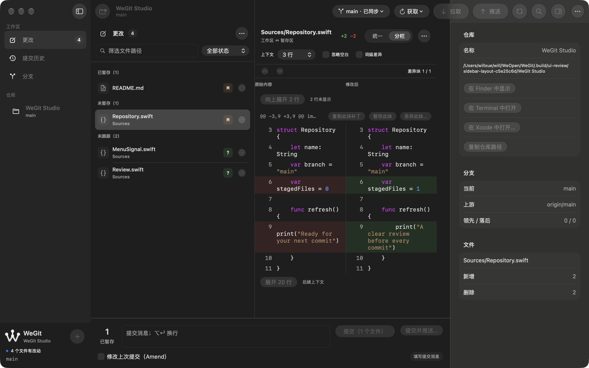
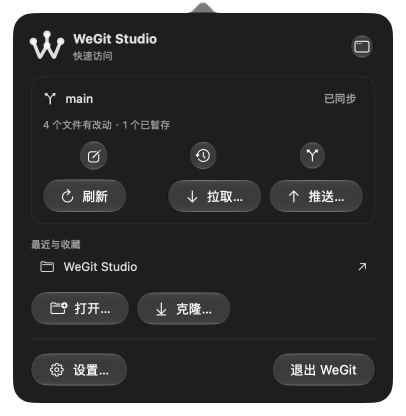

# 侧栏布局与快捷面板 · 2026-10-14

按用户截图调整侧栏位置、阅读底色、底部品牌及 Add、菜单栏主题与快捷面板间距。应用摘要 `4d8d4d26236a88a7188a16401e372187352b7470bf97e7b727bc517fc55cec07`，macOS 27.0.1 / Xcode 27.0 arm64。

## 实现

- 折叠按钮位于左侧原生标题栏右端，保留跟随分栏的系统位置和 ⌃⌘S；只使用工具栏自身玻璃材质，避免双层圆形。
- 品牌位于侧栏底部左侧，Add 在右侧放大到约 34 pt，与顶部图标按钮尺寸匹配；底部仍展示真实仓库状态和分支。
- 更改列表关闭默认灰色背景，分组标题作为有标题 trait 的普通行，阅读面与 Diff 共用系统 controlBackgroundColor。深色黑底统一，选中行保留原生灰色辨识；没有添加自定义 RGB。
- 快捷面板宽 380 pt、外围间距 18 pt，文本按钮增加横向 6 pt / 纵向 4 pt 内边距，路由图标按钮采用较大原生控件尺寸。
- 应用主题只覆盖自有窗口；状态窗口和模板 W 图标继承系统菜单栏 appearance。避免应用强制 darkAqua 让浅色系统栏上的模板图标变白。

## 实际验证与范围

浅色、深色、跟随系统的工作区及设置通过，浅深色快捷面板通过；侧栏点击隐藏和 ⌃⌘S 恢复通过；放大的 Add 实际打开原生仓库选择器并取消，原仓库保持。六种浅深色 × Changes/History/Branches + Inspector 恢复启动通过，详情见 startup.json。

严格格式、Debug、普通 Release 与原生回归编译通过。ThemeInteractionTests 增加侧栏位于列表左侧、品牌位于下半部、Add 与工具栏尺寸一致、打开/取消选择器的行为断言，尚未执行 XCTest；不重复先前相同的自动化初始化超时。精确尺寸的自动断言仍待执行，当前尺寸结论来自实际图像。Git 核心输入不变，本轮未重跑两套 Git 核心测试。

测试使用私有偏好和本轮 Git 夹具，全局/系统 Git 配置为 /dev/null；HEAD、porcelain 状态、暂存条目及 diff HEAD 与夹具来源相同。测试偏好精确恢复，正常偏好中的工作区 JSON 仅序列化顺序有变化，解码语义相同，其余状态恢复。没有更改系统辅助选项。

当前工具截图仅包含应用窗口或弹层，不能捕获整条系统菜单栏。因此状态图标的 actual 系统栏对比度仍待人工复核，不把模板 image 或 appearance 实现当成对比度验收。VoiceOver、完整键盘、系统显示选项、144 阅读组合和最终源码三十次 Release 性能继续待验。失败和兼容性边界见 [investigation.md](investigation.md)。

## 开发交付

普通 Release 包 `.build/releases/package-Hna4A9/WeGit-0.1.0-development.zip`，SHA-256 `0c4d33e2b17b0dd0399a4082ee5a6b7cc9405752309e291763cecc33c06ef2e3`。源码回执一致、签名完整性、空权限、AskPass/MIT、测试入口排除和 ZIP CRC 通过。普通包实际恢复原 repository / 提交历史 / Inspector 关闭通过，应用保持打开供用户查看。

版本仍为 0.1.0，使用开发 Bundle ID 和 ad-hoc 签名，未公证，V1.0 未标记发布完成。所有来源和验证范围见 [validation.json](validation.json)。

