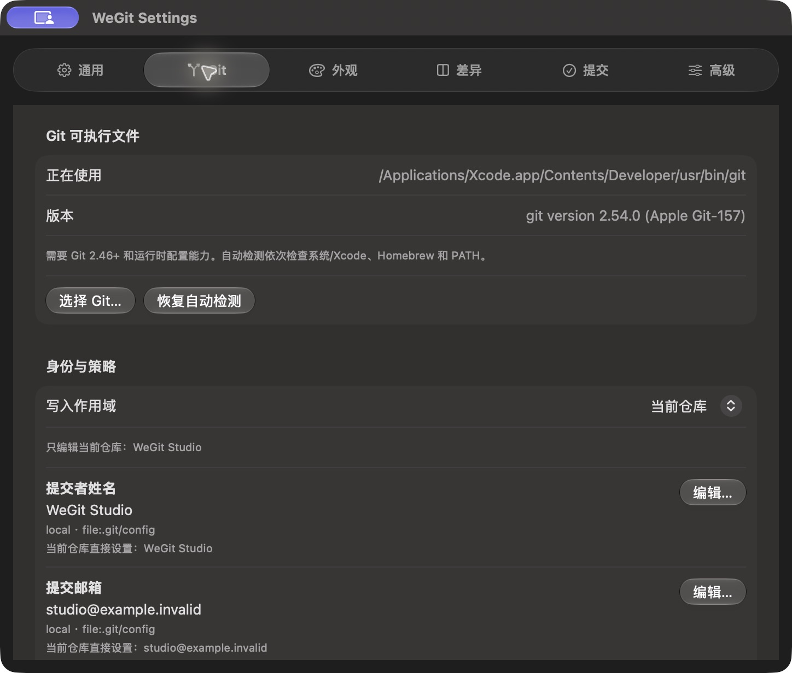
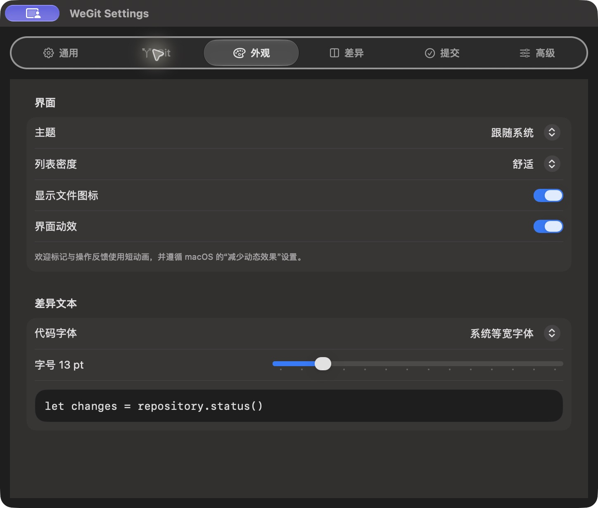
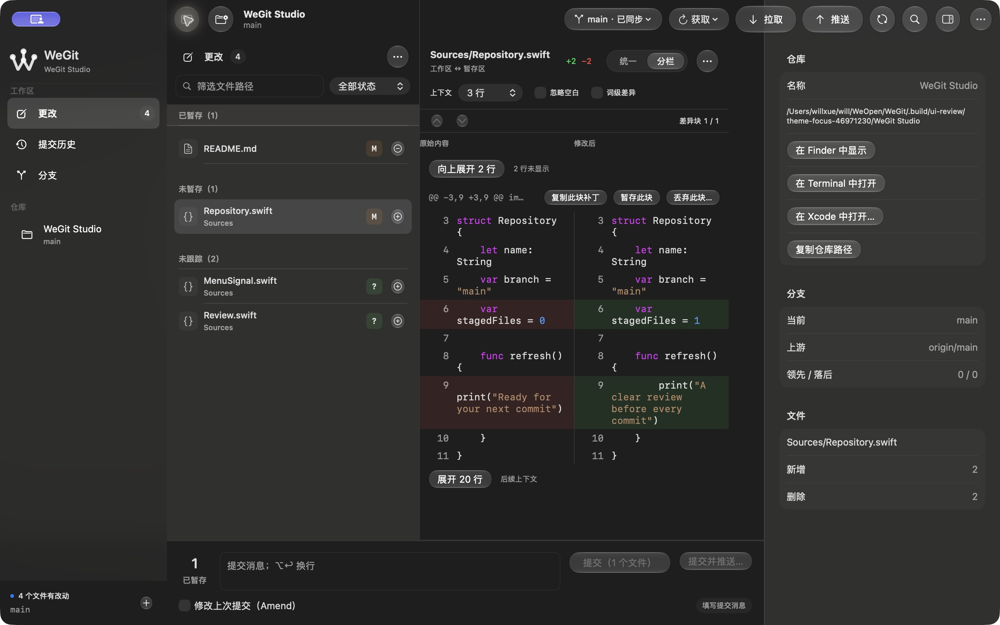

# Tabs 焦点、主题切换和侧栏按钮 · 2026-10-14

按用户截图修正三处实际问题。源码摘要 `26d0f892e51c1f4aa2edf95a01f3edcd45377af0b4663437c03c49e6432e9c4e`。

## 实现

- Tabs 禁用 NSSegmentedControl 与 cell 的默认蓝色焦点圈，自绘焦点改用系统标签色的中性边界。鼠标操作没有焦点框，键盘操作保留可见焦点、原生 radio button 与左右键即时选择。
- 主题偏好改变时同步设置应用及已打开原生窗口的 appearance；跟随系统明确清除覆盖。共享视图修饰器直接观察 AppPreferences，为 SwiftUI 内容提供 colorScheme，停止依赖分散的 preferredColorScheme。切换不重建 AppState 或仓库会话。
- 左侧使用与右侧相同的圆形玻璃组件。根据 [Apple 的默认工具栏移除说明](https://developer.apple.com/documentation/swiftui/view/toolbar(removing:))，在 sidebar 视图作用域移除默认宽胶囊；只保留一个侧栏按钮，支持显示/隐藏和 ⌃⌘S。

## 验证与保留失败

Debug/Release、严格格式及 ThemeInteractionTests 的原生编译通过。新回归包含左右尺寸、侧栏快捷键、保持设置打开时两窗口像素明暗、恢复系统主题、Tabs 蓝色像素/方向键与草稿/Git 数据保持的行为断言；尚未在 XCTest Runner 执行，不重复既有无变化的自动化初始化失败。

实际检查鼠标 Tabs 无蓝框、键盘中性焦点和方向键、侧栏关闭后按钮继续可见、⌃⌘S 恢复。设置窗口保持打开，选择浅/深色/跟随系统后首个可捕获画面正确，无额外暂停或再次激活设置窗口。主窗口与新开窗口同步另有启动/实际证据；跨窗口不激活时的像素断言仍待原生执行，不将手动截图当成毫秒性能结论。

失败回合保留：首轮主题修饰器位于环境注入外，隔离实例启动失败；修正注入顺序后启动成功。两次默认按钮移除作用域无效，形成重复按钮；最终按官方 sidebar 作用域移除，AX 与实际图像确认只剩一个侧栏按钮。部分主题菜单未完整出现在工具 AX 结果，改用当轮截图坐标完成选择，未将菜单缺失算成应用通过。

普通开发包 `.build/releases/package-WqSoDF/WeGit-0.1.0-development.zip`，SHA-256 `78f6ab75211db8aaab2dfd034f1c1286d7e0a8a52beb268ab9b3c9adccaed598`。未公证，不关闭 V1.0 发布门槛。最终启动、偏好恢复、签名与来源结果见 validation.json。

