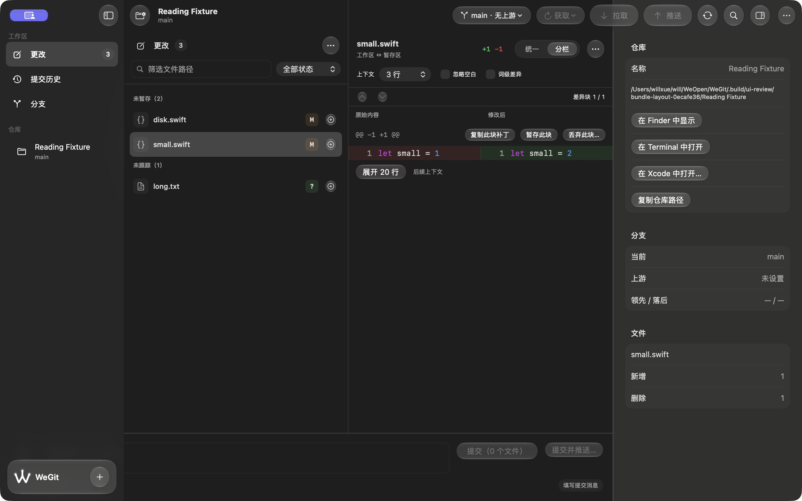
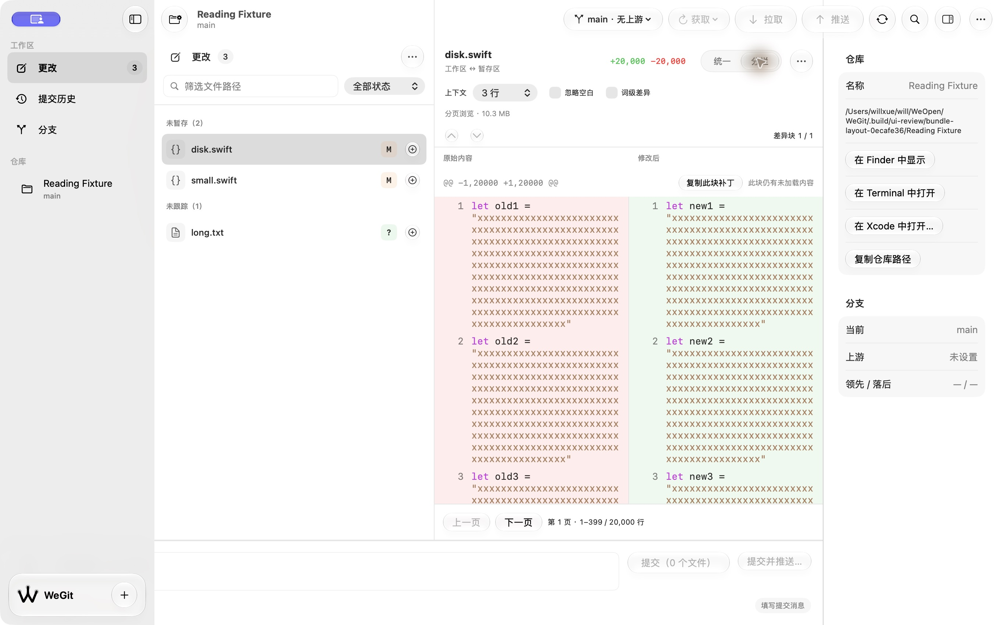

# 标识迁移与 Diff 边界 · 2026-10-15

完成用户要求的命名空间、检查器旁留白与 Split 标题内边距调整。最终源码摘要 `861bbdd36a693f8914992c42a01ace7e72acd158c628078edf09ccdc29f99f17`。

## 新标识

正式根标识采用用户最新指定的小写 `com.willxue.wegit`；开发、UITests、TestGit、AskPass、PerformanceTests 和 performanceHarness 保留用途后缀，统一此前缀。日志/signpost、队列及临时快照目录同样更新。当前构建配置和正式打包校验均使用新值。

旧前缀只在迁移读取来源、对应行为测试及不可改写的历史验收回执中保留，历史安装包/来源摘要没有改名冒充新版本。`PreferenceMigration` 仅作用于普通开发/正式域，保留已有目标值并一次性补齐旧值；完成标记防止下次启动把已删除设置重新复制回来。最近仓库数据库继续使用既有 WeGit/Repositories.store。

使用应用实际迁移源码编译执行的 15 项行为检查通过，涵盖草稿/工作区/书签字节、原生窗口与分栏偏好、目标值含 false 优先、旧域保持、再次启动、删除保持、来源优先级、全新安装及测试/性能隔离。检查已接入 scripts/verify.sh。真实新标识普通 Release 首次及再次启动恢复原 WeGit / 更改 / verify.yml / Inspector / 浅色，旧偏好域精确相同。首次启动后 25 个旧键中 24 个语义相同，另一个原生分栏帧随新布局调整，见 ordinary-migration.json。

## Diff 布局

原先对左右安全区重复补偿，导致 Diff 内容在检查器前留白。原生分栏负责水平边界，GeometryReader 只处理垂直安全区，横向内容铺到原生分隔线。内存与磁盘共用 DiffColumnHeaders，每侧标题有 12 pt 水平内边距，列宽和 1 pt 中缝与代码保持一致。补丁与代码复制逻辑没有改变。

实际检查内存 Split 浅深色及检查器开关、磁盘 10.3 MB 补丁分页的 Unified/Split 浅深色。两个深色 Split 行底色均延伸到检查器分隔前最后一个像素，没有额外空白列；精确坐标见 layout-pixels.json。新原生回归包含两种读取模式、Unified/Split 的边界与标题墨迹内边距断言，已编译，尚未执行 XCTest。

## 验证与边界

两套 Git 各 176 项 / 31 套件通过，Debug、Release、严格格式、原生回归编译、Shell 语法和六种浅深色恢复启动通过。测试域清理回无用户设置状态，旧偏好精确恢复后才验证正式的普通启动迁移；CFPreferences 清理后可能返回空字典，未将其误当成残留用户设置。夹具 HEAD、状态、暂存条目及 diff HEAD 与来源一致，没有更改系统选项。

工具曾缓存 Debug 路径的旧 Bundle ID，按名称还解析到旧版本；旧进程关闭并恢复偏好后，使用独立 Debug 副本路径绑定新标识成功。分页布局切换时出现瞬时 AXError.failure，后续 AX 选中值与图像确认动作已完成；不将其当作完整辅助访问通过。原生回归执行、全辅助访问、144 阅读组合及最终源码三十次 Release 性能仍待验。

普通 Release 包 `.build/releases/package-MXaett/WeGit-0.1.0-development.zip`，SHA-256 `707c83bc305fe7a11639a093a7bfb01656aaef6230a006892078d234a14dad77`。来源、签名、空权限、AskPass/MIT、测试入口排除和 ZIP CRC 通过。当前版本 0.1.0、开发标识 `com.willxue.wegit.development`、ad-hoc 未公证；正式 V1.0 门槛继续未完成。来源与证据见 [validation.json](validation.json)。

