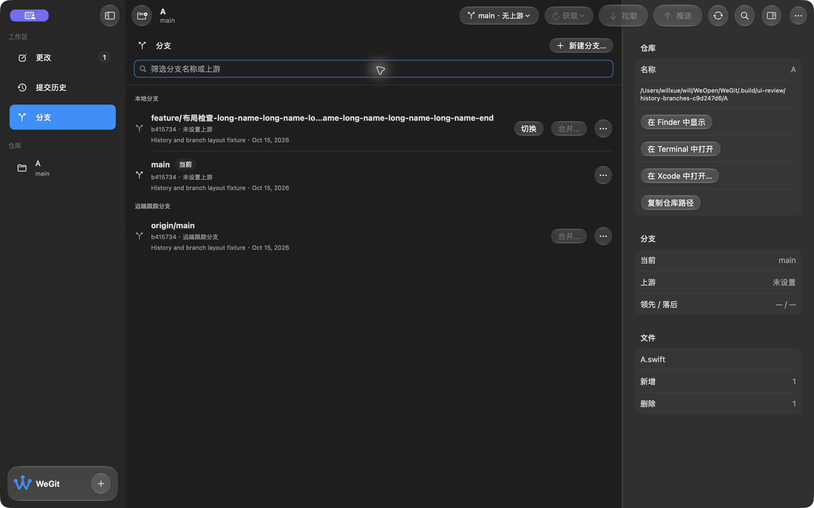
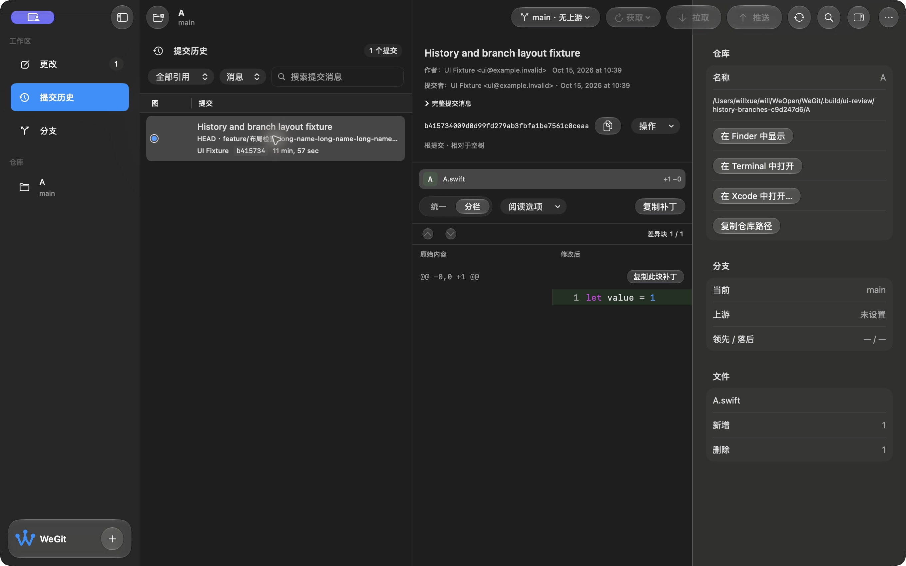
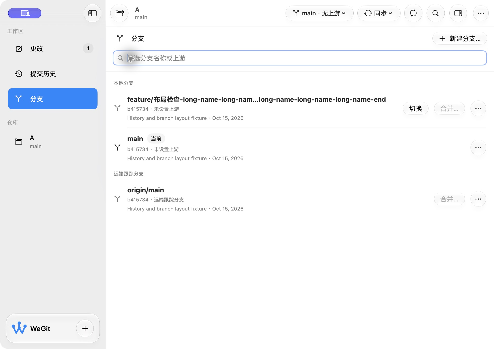

# 历史与分支页面修复验收 · 2026-10-15

应用源码摘要：`37b9029e85d18f84c620c4037d26eff6a83001952223e3cd99c560e96b0b8b2f`。环境：macOS 27.0.1 / Xcode 27.0 / arm64。应用修改范围为 WorkspaceView、HistoryView、HistoryTableView 与 CommitFilesView；Git 核心输入未变。

## 根因与修复

| 程度 | 位置 | Before | After | 原因与影响 |
| --- | --- | --- | --- | --- |
| HIGH | WorkspaceView 的横向安全区 | 分支页标题、筛选和名称延伸到 Sidebar 下 | 原生分栏的 Changes/History 保留水平铺满；纯 SwiftUI 分支页位于 detail 边界内 | 修复可读内容和输入区域被遮挡 |
| MEDIUM | HistoryTableView / CommitFilesView / BranchesView | 默认 Table/List 滚动背景为灰色，与详情黑底不同 | 隐藏额外滚动背景，统一使用原生 canvas | 统一阅读表面，保留原生选择、表格列标题和 Git 语义色 |
| MEDIUM | 分支名称与跟踪信息 | 长名称可能挤占操作空间 | 限定文本可用宽度，中间省略并提供完整提示 | 长名称、当前标记和操作保持可见 |

分支分组采用普通标题行并保留 isHeader trait。最初直接移除整个横向忽略修复了分支页，却让 Diff 重新出现约 30 pt 右侧留白；只在内部 HSplitView 忽略仍有留白。最终将原来 GeometryReader 的横向处理限定到原生分栏页面。中间候选截图保留，最终像素核对 Diff 增加背景到达 2077 px，检查器原生分隔为 2078～2079 px，中间没有空白。

## 实际检查

- 浅色、深色历史表格和提交详情；选择提交后文件列表和 Split Diff 正常显示。
- 本地、远端及含中文的长分支名；分支页筛选框能输入、筛选与清除，左侧内容不再被盖住。
- 分支页 Sidebar 折叠/展开、Inspector 关闭/打开，内容随可用空间铺满。
- 1360 × 850 pt 默认窗口，以及从私有原生 frame 偏好恢复的 980 × 693 pt 窗口；打开 Inspector 后扩展为 1292 × 693 pt，文字和动作可见。鼠标缩放尝试没有改变窗口尺寸，因此不将其算作缩放交互通过。
- 像素记录中，历史/分支灰色阅读区从 `(48,48,46)` 改为与详情一致的 `(30,30,30)`；浅色两处为 `(255,255,255)`。该记录只证明背景一致，不代表对比度验收。

## 构建、隔离与限制

严格格式、Debug、普通 Release 和原生回归编译通过。新增 `testBranchesStayInsideWorkspaceWithSidebarAndInspectorChanges` 断言分支筛选框边界、左侧点击输入和 Git 状态保持；该用例已编译，尚未执行，未重复既有 XCTest 自动化模式初始化超时。最终源码的浅深色 × 三页面、Inspector 打开的六种恢复启动通过，夹具内容及索引字节保持。

手动检查使用内存持久化、私有测试偏好域和拥有的 Git 夹具。正常域与测试域在检查后逐值恢复；普通 Release 打开原 WeGit 仓库、分支页、Inspector 和深色偏好，本地/远端分支名称完整可见。没有切换用户 Git 分支或改变系统显示选项。

一次私有 Debug 最小窗口恢复记录到 NSTableView delegate 重入警告；该次仍完成布局/输入检查，六种串行恢复未重复该警告。具体诊断范围见 diagnostic-notes.json，不据此宣称完整运行告警或辅助访问已验收。VoiceOver、完整键盘、完整原生套件、阅读矩阵和最终源码 Release 性能仍待验，V1.0 发布未完成。

## 开发预览

开发包：`.build/releases/package-Es87M6/WeGit-0.1.0-development.zip`。

SHA-256：`0e0e1ad2a2c93442d7e919c7128c9bf91fa2dda0ba66f1f95f5d0bcfd416284b`。

源码回执、签名完整性、空权限、AskPass/MIT、测试入口排除与 ZIP CRC 均通过。仍为 0.1.0 ad-hoc 开发预览，未公证，完整来源和日志见 [validation.json](validation.json)。

本轮已实际检查的页面修复范围：Approve。
