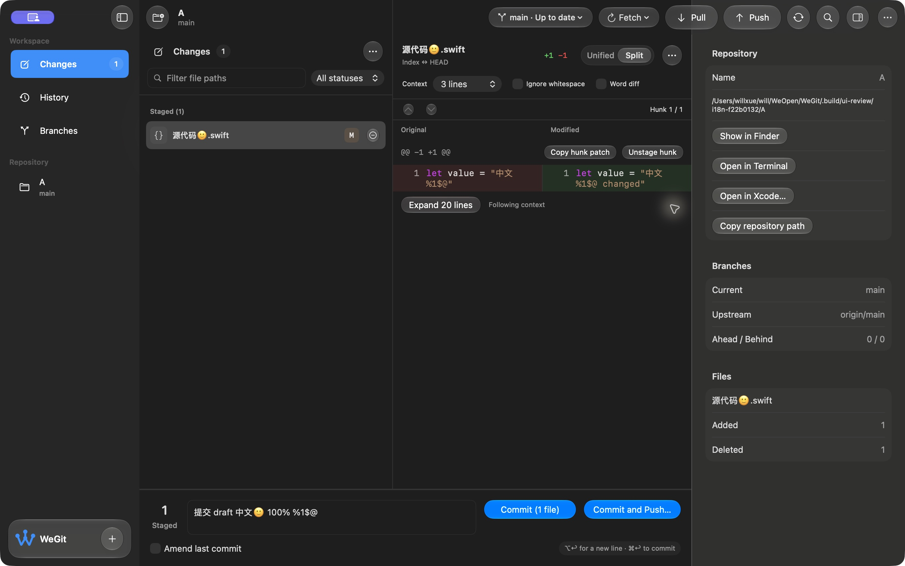

# 提交按钮统一与中英文验收 · 2026-10-15

本轮完成“提交并推送”与“提交”的主要胶囊按钮样式统一，并加入跟随系统、简体中文、English 三种界面语言选择。当前为开发预览，V1.0 发布仍未完成。

## 实现与实际行为

- 两个提交按钮使用相同主要操作样式、色彩、高度和字号，保留各自操作与禁用条件；英文下文字长度自然决定宽度。实际截图测得蓝色按钮高度差为 0 像素，见 [测量](button-pixels.json)。
- 设置 → 通用 → 界面语言可即时切换应用文案。语言切换不重建工作区，草稿、选择与仓库数据保留。系统原生菜单和对话框需重开应用；明确英文启动的菜单已核对。
- en / zh-Hans 各 941 个文本键与 7 个复数键，覆盖工作区、六类设置、确认/错误反馈和辅助访问文案。插值与原始文本分离；代码、路径、提交内容和 Unicode 不翻译。持久化路由原始值保持兼容。
- 修复英文验收暴露的底部提交编辑器被侧栏遮挡问题，按真实视口补偿左边距，同时保持 Diff 与 Inspector 相接。History 筛选器按可用宽度换行，英文选项完整可见。

## 验证与边界

| 验证 | 结果与证据 |
| --- | --- |
| Apple Git 2.54.0 / 最低 Git 2.46.0 | 各 182 项、32 套通过，[Apple](core-apple.log)、[2.46](core-git246.log) |
| 本地化专项与资源检查 | 新增 6 项行为测试；1194 处本地化字面量扫描，键和参数一致，[覆盖](coverage.log) |
| 格式、迁移与构建 | 严格格式通过、15 项偏好迁移通过，Debug / 普通 Release 通过 |
| 原生 UI 回归 | 新回归编译通过，[日志](native-compile.log)；未执行，现有 XCTest 初始化超时条件未变，本轮未重复无变化尝试 |
| 启动恢复 | 最终源码浅/深色 × 更改/历史/分支共 6 种带 Inspector 恢复通过，[启动报告](startup.json)；仅存活/状态校验，不是性能结论 |
| 实际 UI | 中英/系统切换、草稿保留、六类设置、History/分支/快捷面板、980 pt 窗口、侧栏/Inspector 开关已留截图和 AX 记录 |
| 夹具与偏好 | 私有仓库仅暂存本次文件，未提交或推送；源文件、原始提交及远端不变。[夹具](fixture-check.json)、[偏好恢复](preference-restoration.json) |
| 普通包 | 来源、签名完整性、空权限、AskPass/MIT、测试入口排除、双语资源、ZIP CRC 通过；已打开并恢复原用户工作区，[AX](ordinary-release.ax.txt) |

保留布局失败候选：`candidate-composer-clipped.png`、`candidate-composer-fixed-diff-gap.png`、`candidate-history-english-clipped.png`，供追踪修复依据。最终界面截图对应预览构建；与最终包的唯一输入差异为 `scripts/build_provenance.py` 新增本地化资源缺失拒绝检查，运行时应用/Core/资源完全一致。最终普通包另有 `ordinary-release.png` 与 AX 证据。

## 来源与交付

最终应用输入 SHA-256：`ca42e894d595190faf89793808f857b58a95159fdbb958d2287a8c76a23476d0`。工具链、逐文件摘要、证据摘要及限制记录于 [validation.json](validation.json)。当前工作区基于 c99aa80，含未提交改动；本轮没有提交/推送源码。

开发包：`.build/releases/package-l8oeCo/WeGit-0.1.0-development.zip`，Bundle ID `com.willxue.wegit.development`，ad-hoc，未公证。

SHA-256：`2aea6b787b7a90301023e54dde83e55e7ac5ef0846d2c434a7a1804a53a3dbf9`。

完整原生 XCTest、辅助访问/VoiceOver、144 阅读组合、最终源码 Release 性能，以及 Developer ID 签名公证、干净机器安装与真实 Beta 仍待验。本轮截图与启动检查不替代这些发布门槛。
