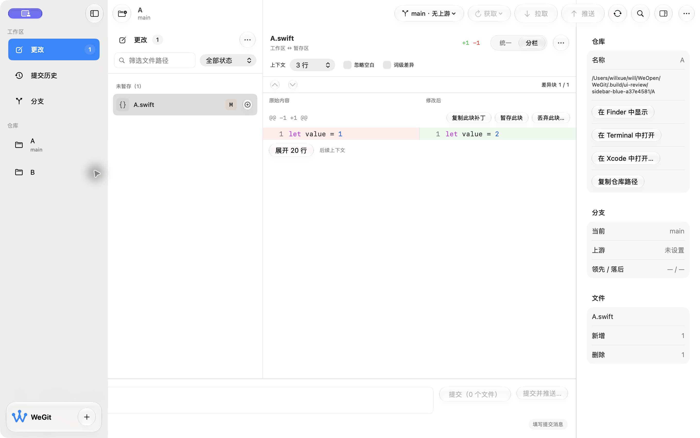
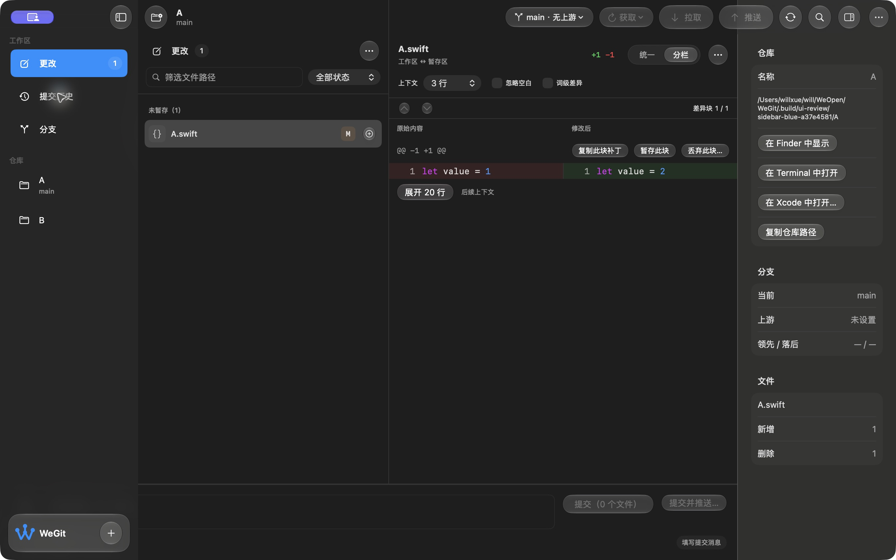
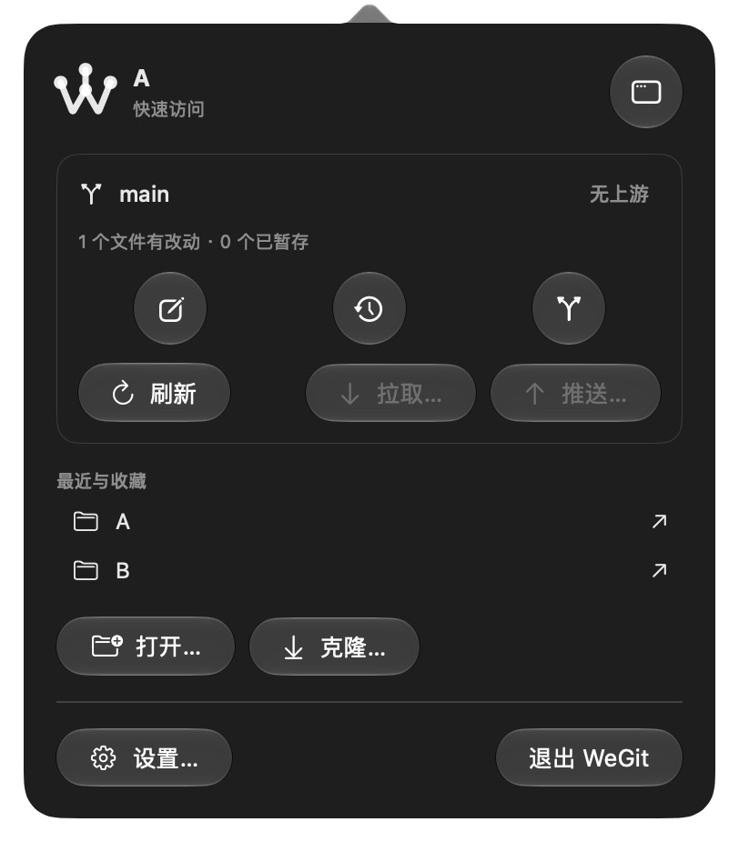

# 侧栏蓝色与点击区域验收 · 2026-10-15

应用源码摘要：`4a9ed24aaee2d3b39412d9a0a2aaeb8ae444d471c96e60c093d268adc105ac2d`。本轮修改 5 个应用呈现文件，Git 核心输入与上一轮一致。环境为 macOS 27.0.1 / Xcode 27.0 / arm64。

## 实现与实际行为

| 请求 | 实现 | 验证 |
| --- | --- | --- |
| 左下角 Logo 恢复蓝色 | W 使用原生 systemBlue，字标保留原生主文字色 | 浅深色实际截图；悬浮卡片和 Add 保留 |
| 侧栏选中恢复蓝色 | 原生 List 保留选择绑定，绘制一层蓝色圆角选中背景 | Changes / History / Branches 导航，浅深色检查，⌘1 / ⌘3 与 AX selected 状态 |
| 仓库整行可点 | Spacer 始终存在；标签水平扩展，命中形状与悬停内边距同处 Button 内部 | 名称仅 A/B 的私有仓库，分别点击距离文字约 120 pt 的行尾空白，核对工具栏与文件改变 |
| 快捷面板图标更宽松 | 三个路由及打开主窗口共用 32 pt 标签内框、14 pt 图标与 regular 原生圆形玻璃 | 浅深色外观约 40 pt 直径；历史入口与打开主窗口动作通过 |

仅设置 List.tint 时，系统仍绘制灰色选中背景；再加蓝色背景后产生灰色底座与额外缩进。两个中间回合截图保留。最终使用公开 NSTableView 的 sourceList 样式判断，关闭重复 selectionHighlight 绘制，保留 List 选择与原生语义，并移除多余行缩进。没有将侧栏改为自制的导航控件。

## 检查与范围

- 严格格式检查、Debug 与普通 Release 构建、diff 空白检查通过。
- 最终源码 Light/Dark × Changes/History/Branches、Inspector 打开的 6 种恢复启动通过，夹具内容和索引不变；这是存活/持久化检查，不是性能测量。
- 实际仓库行尾点击：浅色 B → A、深色 A → B。短名称确保点击点位于空白区域，截图坐标和 AX 结果记录于 validation.json。
- 私有测试域和正常开发域在测试后逐值恢复；普通 Release 重开 WeGit 仓库、更改页、verify.yml、Inspector 与原深色偏好，提交草稿仍为空。测试仓库不写入用户最近记录。
- 本轮未更改系统选项，未执行 Git 写入；仅在自己的 A/B 夹具初始化提交。测试启动后的语义内容有独立核对。

核心没有重跑；上一轮两套 Git 各 176 项的证据保留原始来源。完整 XCTest、VoiceOver、完整键盘方向键路径、自动辅助访问审查、144 组合和最终源码 Release 性能仍待验。未重复无变化的 XCTest 自动化模式初始化失败，也不以截图代替完整辅助访问结论。

## 开发预览

普通 Release 开发包：`.build/releases/package-TUUrjW/WeGit-0.1.0-development.zip`。

SHA-256：`224932210a6ed833b59ea84d7963093b33863080db09af82ec2a97a8cff08d3b`。

来源回执、签名完整性、空权限、AskPass/MIT、测试入口排除与 ZIP CRC 均通过。开发标识 `com.willxue.wegit.development`，仍为 0.1.0 ad-hoc 预览，未公证；V1.0 发布门槛保持未完成。完整来源与日志见 [validation.json](validation.json)。
