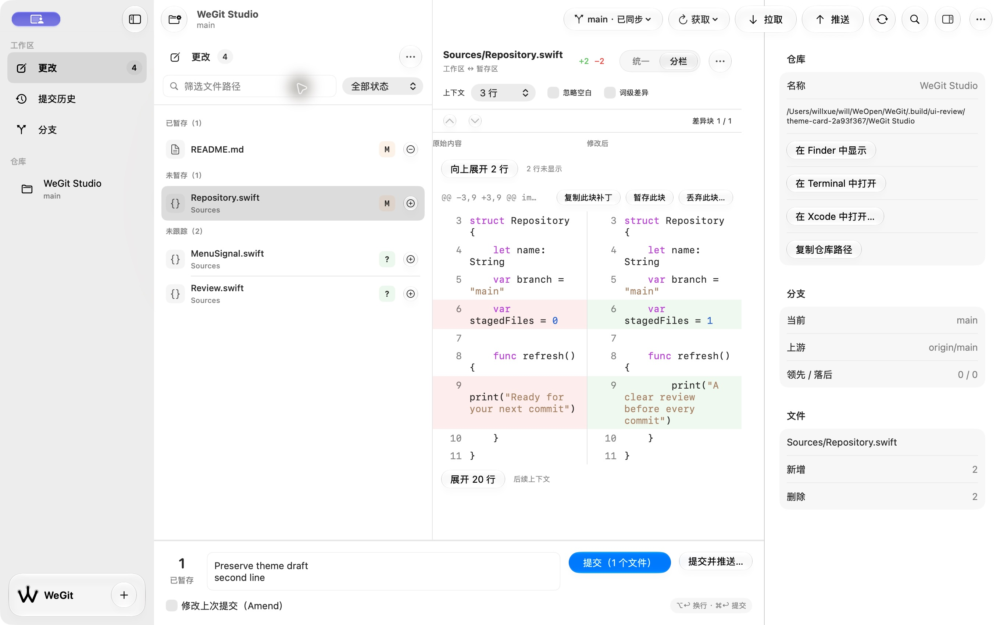
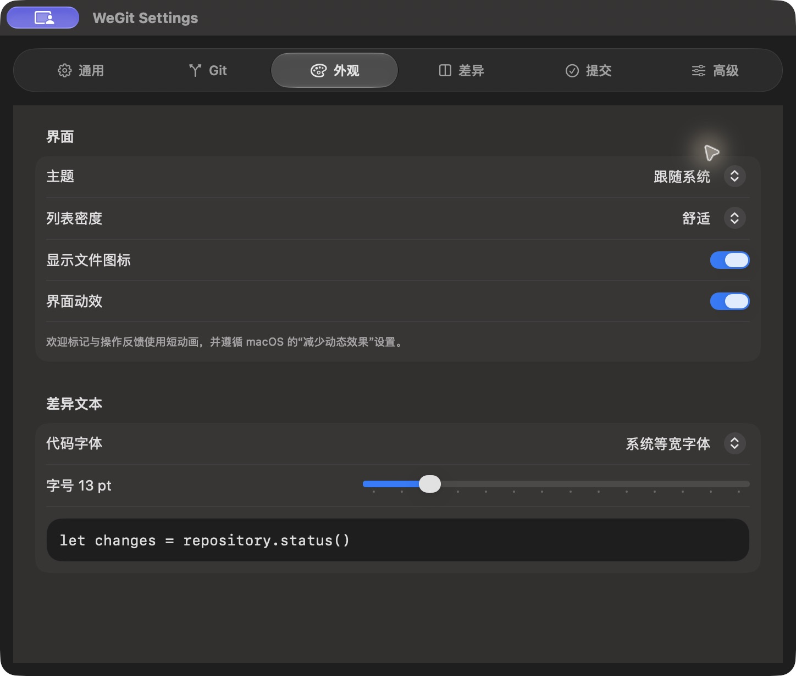

# 主题同步、浅色分隔与悬浮卡片 · 2026-10-15

完成主题修复、浅色黑线处理及侧栏底部卡片。最终应用摘要 `dbf169442292508368c91345850ea186b69777de516be7cdc1032fe2690cc34f`，macOS 27.0.1 / Xcode 27.0 arm64。

## 实现与实际问题

主题曾同时改写原生窗口并设置内容 colorScheme，System 从窗口已覆盖的颜色读回。首轮改成 preferredColorScheme(nil) 后，实际复现设置标题栏转深、内容仍浅的状态，失败图保留为 light-to-system-settings.png。最终观察未覆盖的 NSApplication.effectiveAppearance，把 Light/Dark 或实际 System 解析为明确的窗口呈现偏好，取消遍历全窗口的 appearance 写入。原生呈现偏好的作用范围参见 [Apple preferredColorScheme 文档](https://developer.apple.com/documentation/swiftui/view/preferredcolorscheme(_:))；System 来源采用本地 AppKit SDK 推荐的 application effectiveAppearance。

检查器分隔间隙提供原生 separatorColor 背景，两侧仍各自使用原生面板底色；背景不参与命中。浅色像素抽样从 RGB 42～43 改为 207，记录于 pixel-checks.json，证明黑线变为原生浅色分隔，不代表完整辅助访问对比度验收。

底部只有 W 品牌、WeGit 和 Add，去掉仓库名、改动状态和分支。卡片采用原生 regular 液态玻璃、18 pt 圆角；左右和下方 12 pt，上方 8 pt 外边距，12 pt 内边距，Add 约 34 pt。减少透明度/增强对比度有不透明系统色回退，实际切换仍待验。

## 验证

- 实际检查显式 Light/Dark/System、浅色返回系统后的设置内容/标题栏、工作区和弹层。系统设置临时改为 Light/Dark 时，System-mode 工作区自动更新，之后恢复原 Auto；GUI 选中和自动配置标志核对通过。恢复时两个明暗配置值与原值相同，最终检查 Auto 仍启用，但有效明暗已不同；没有将自动模式强制锁为旧 Dark，原始结果见 system-appearance-restored.json / system-appearance-final.json。
- 多行草稿经过主题变化与重新启动保留，Add 打开原生仓库选择器并取消通过。夹具 HEAD、状态、暂存条目及 diff HEAD 与来源一致，正常和测试两个偏好域精确恢复。
- 最终源码 Debug/Release、严格格式、增强原生回归编译及六种浅深色 × Changes/History/Branches + Inspector 启动全部通过。原生回归增加系统模式两窗口像素、移除底部状态、卡片外边距及浅色分隔像素断言；编译通过，尚未执行 XCTest，不重复既有未变的自动化初始化超时。
- 侧栏拖动尝试没有改变列宽，没有计作最窄侧栏或分隔拖动验收。完整窗口/阅读矩阵、VoiceOver、完整键盘、材料对比度和三十次 Release 性能继续待验。

截图属于最后一轮渲染实现，之后仅增加分隔背景 allowsHitTesting(false)，不改变绘制；最终源码六种启动和普通 Release 恢复另有证据。ordinary-release.png 使用最终普通包，恢复用户原 WeGit / 更改 / verify.yml / Inspector 打开 / Light 状态，应用保持打开。

Git 核心输入不变，本轮没有重跑两套 Git 核心测试或新增其通过结论。来源与验证范围见 [validation.json](validation.json)。

## 开发交付

`.build/releases/package-C653bx/WeGit-0.1.0-development.zip`，SHA-256 `ec3e23b0c11bb5ab31c2d0cdb07f1f29cad07bf3b149e59ec82b1130c734e592`。普通 Release 源码回执、签名、空权限、AskPass/MIT、测试入口排除及 ZIP CRC 通过，最终源码与包一致。仍为 0.1.0、开发 Bundle ID / ad-hoc、未公证，正式 V1.0 分发条件未完成。

