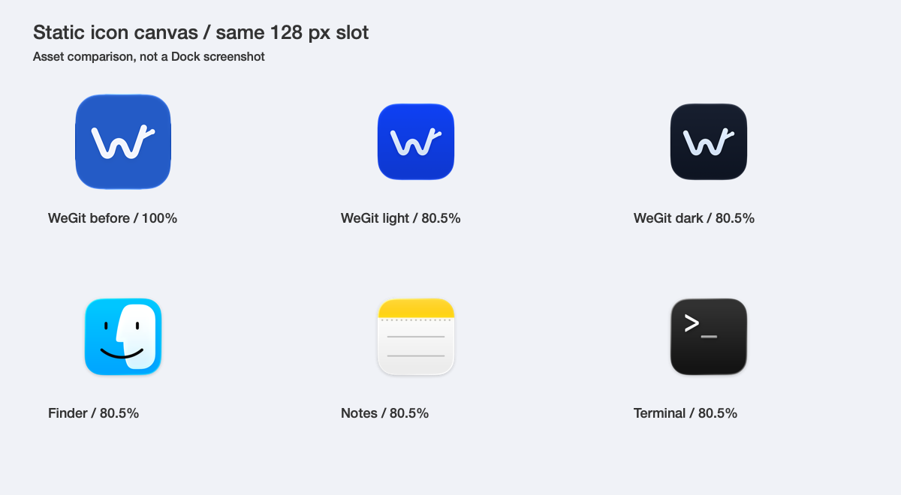

# Dock 图标比例与材质修正

日期：2026-10-16。macOS 27.0.1 / Xcode 27.0（27A266a），arm64。分支 codex/v1-validation，基于 c99aa80 的未提交工作区；未提交或推送。

## 根因与修正

运行中 Dock 通过 applicationIconImage 使用静态 ICNS。此前把 Icon Composer 的满幅导出直接封成 ICNS，丢掉了编译 .icon 时系统自动添加的 macOS 静态画布留白，导致静态图形的底板宽度为 100%。实际读取本机 Finder、Notes、Terminal 的 ICNS，其底板均为 256 画布上的 206 px（80.47%）。旧 WeGit 因而相对宽约 24.3%，属于导出错误。

新增 source/normalize-icon-canvas.swift，只在静态 iconset/ICNS 导出阶段居中归一为 824/1024；.icon 原生文档不再缩小，避免编译时双重内缩。最终原生编译 AppIcon.icns 为 206/256，运行中 Light/Dark 为 824/1024，比例一致。全部数据含坐标见 [bounds.json](bounds.json)与[测量源](measure-bounds.swift)。

此前生产资源重新建立了矢量几何并使用纯色底板/主体，因此没有忠实保留生成概念中的连续渐变和表面反光。该质量落差来自制作选择，不能归因于 Dock 自动降质。本次保持已有 W/分叉几何和应用内平面 Logo，使用 Icon Composer 原生 automatic-gradient 处理底板和珠白主体，增加浅层 refractivity；保持轻量浮雕与原生渲染。它仍是克制的原生材质版本，不宣称与生成概念的光照和质感逐像素一致。

原生编辑选项在 Icon Composer 的隔离副本文档中确认后用于母版；没有修改生成原图，没有再次调用 image_gen。[Apple Icon Composer 文档](https://developer.apple.com/documentation/xcode/creating-your-app-icon-using-icon-composer)说明原生图层、渐变与效果工作流。

## 对比与验证

上图直接读取资源并在相同 128 px 画布绘制，属于资源对比，不是 Dock 截图。系统 Dock 的 CUA 目标访问超时，未重复尝试或宣称已采集系统 Dock。

新增真实 NSApplication.applicationIconImage 画布比例回归，[修正前失败](regression-before.json)，[修正后 18 项通过](regression-after.json)。包含原有浅深色/System/无窗口/重置图标生命周期，并分别验证 Light/Dark 的透明留白。47 个 PNG/两份 ICNS 资源检查、改动 Swift 严格格式、Debug/普通 Release 构建通过。来源回执、AskPass/MIT、测试入口排除、主题 ICNS 字节一致、签名完整性、空权限、ZIP CRC 与校验和通过。

最终应用输入摘要 `6fbcded9970a9bb44ea7383051f84a3f0cb515e0934f11e2494fa2990c2acbda`，见 [回执](release-build-source.json)和[验证记录](validation.json)。本轮 Git 核心逐文件与上轮两套 Git 各 183 项通过的输入相同，没有为资源改动重复核心测试。没有据此扩展完整 XCTest、辅助访问、最终性能、正式分发结论。

实际打开最终普通包，[关于窗口](about-dark.png)使用修正后的深色图标；[主窗口 AX](ordinary-release.ax.txt)保留中文/Dark/WeGit/Package.swift/Split/Inspector 打开/空提交草稿，跟随本轮观察到的用户当前状态。没有切换应用或系统主题、没有新增仓库夹具。

## 保留与交付

第一版 67 文件逐项哈希不变。修正前第二版 .icon、ICNS、PNG、预览、导出器及验证记录保存到 branding/wegit-v2/revisions/before-dock-material-2026-10-16，生成原图与平面 Logo 保留。对比源和测量源在本目录，临时材质探索位于 .build/icon-material-review，未作为应用资源引用。

普通开发包：`.build/releases/package-mbWTnE/WeGit-0.1.0-development.zip`。

SHA-256：`e6ef5c5c0300833c753982b216f849f98dd40f335ce35787b2e9205152d0450f`。版本仍为 0.1.0，开发标识 com.willxue.wegit.development，ad-hoc 且未公证。[Manifest](manifest.json)与[校验文件](WeGit-0.1.0-development.zip.sha256)对应同一包。
