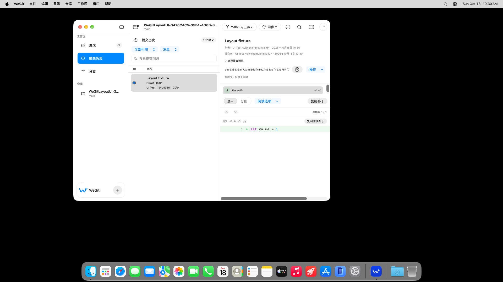
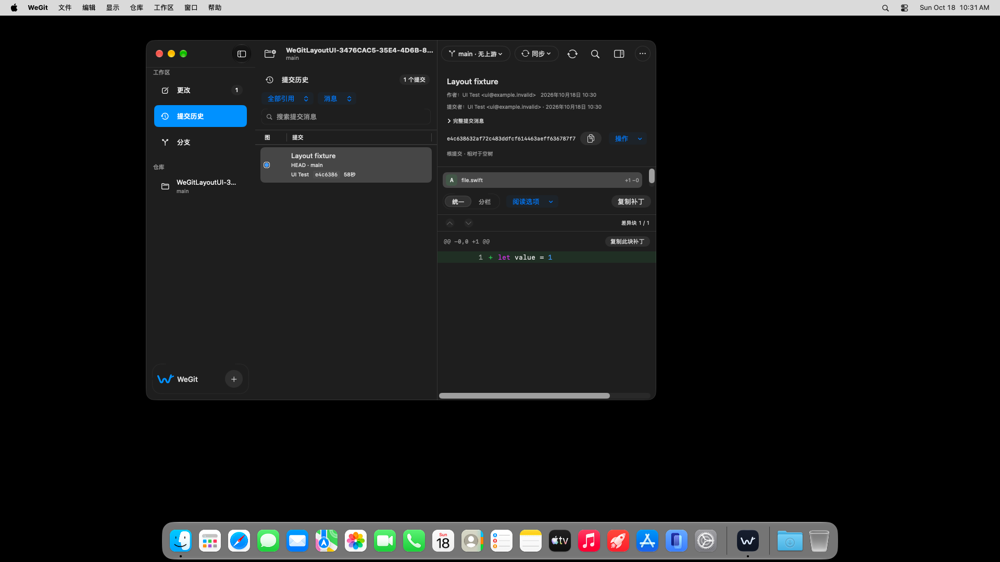

# 2026-10-18 同源独立辅助访问审查

[Run 39119367892](https://github.com/WeOpen/WeGit/actions/runs/39119367892)，实际源码 `bcca7f3498d9019e2c0576fa081f82d9a17a800a`，工作区干净。原强化 smoke 执行/通过 1/1、零失败/跳过（21.088 秒）；审查执行 1、通过 0、失败 1、跳过 0（85.405 秒）。用例实际进入 `performAccessibilityAudit`，浅深色均完成报告收集；没有统一忽略或例外返回 true。

59 是回调报告数，不是独立缺陷数，也不是 XCTest 用例数。最新审查不再停在旧 Sidebar 查询；历史 44 条保留其旧源码与范围，不能直接与这轮相减后声称修复数量。

| 类别 | 浅色 | 深色 | 合计 |
| --- | ---: | ---: | ---: |
| 元素说明 | 11 | 11 | 22 |
| 动作支持 | 7 | 7 | 14 |
| 对比度 | 15 | 8 | 23 |
| 合计 | 33 | 26 | 59 |

全部 120 项应用构建输入均与该 Git 提交逐文件核对。VM 的临时显示模式为 1920×1080，随后恢复 1024×768；原 SIP 关闭、Gatekeeper 开启。没有修改保护、辅助访问或本机显示设置。该回合不证明 VoiceOver、完整键盘、系统显示辅助选项或发布安装通过。

## 逐项判定的当前范围

| 类别 | 当前证据 | 尚待处理 |
| --- | --- | --- |
| 元素说明 22 | 两条 Disabled TouchBar，其余为原生 Group/布局容器；保留元素子树与路径 | 结合可聚焦性、实际朗读顺序及独立原生对照判定，不能隐藏父组而连带隐藏内容 |
| 动作支持 14 | Sync、More、分支、阅读选项、提交操作、历史范围与搜索字段；部分鼠标操作已在单项通过 | 鼠标成功不能代替 VoiceOver 或键盘动作；不因控件是原生 MenuButton/PopUpButton 就自动豁免 |
| 对比度 23 | 当前 PNG 与部分报告明显冲突；另有次要文字、状态色和选中行配色确实低于项目既有 4.5:1 文字目标 | 按实际色对判定；保留原图与报告，未关闭任何自动报告 |

设置主题/密度/代码字体的缺少名称是另一项已确认的问题，见 `../settings-labels/before-native-picker.txt`。当前审查只走最小历史窗口，不访问设置；设置名称修复不能抵扣以上 59 条。

## 颜色复核

此目录保留 bcca7f3 修正前的原生配色；用户随后已允许保持色相/布局并调整明度，修正及新结果另见 [语义色修正](../native-contrast/README.md)。`native-color-probe.swift` 用相同 AppColors 在本机只读解析 Aqua/Dark Aqua 的 sRGB 和 alpha，按实际 canvas/差异行背景合成；不启动 XCTest，不切换系统外观，不修改偏好。完整 12 对结果在 `native-color-pairs.json`；这不是全部界面或所有系统设置的对比度验收。

| 色对 | 浅色 | 深色 | 当前判断 |
| --- | ---: | ---: | --- |
| 主要文字 / canvas | 14.9384 | 12.2258 | 与 SHA 原生截图的高反差一致，系统报告仍待判定 |
| 次要文字 / canvas | 3.9494 | 5.8901 | 浅色低于 4.5，深色此色对通过目标 |
| 次要文字 / 新增行背景 | 3.8920 | 5.3093 | 浅色低于 4.5 |
| 新增绿色 / 新增行背景 | 2.0583 | 6.8916 | 浅色低于 4.5 |
| 选中侧栏白字 / 原生蓝背景 | 3.5201 | 3.2337 | 两种模式均低于 4.5 |

例如浅色主要文字为 RGB(39,39,39)，白背景，14.9384:1；SHA 的原始元素 PNG 也具有这个色对，却仍有 Contrast failed 报告。不能因此把所有对比度问题称为系统误报。

`contrast-observations.json` 为全部 23 条对比度报告保留 PNG 像素统计，使用时间戳唯一配对到原始元素截图。此表的“最高重复像素对比度”只用于复核：抗锯齿边缘会降低像素值，圆角外背景也可能成为最高对比像素；它不能自动识别文字前景或生成合格/豁免结论。以源色 alpha 合成、实际截图和控件状态共同判定。

原始完整窗口：

## 全部报告索引

每条均保留原始说明、元素子树/路径和同时间戳的原生元素 PNG。所有条目维持待判定状态。

| 编号 | 模式 | 类别 | 原始报告 | 元素图 |
| --- | --- | --- | --- | --- |
| 1 | dark | description | [This element is missing useful accessibility information.](issues/08033046-9B52-493A-BD78-51F029F6A9B9.txt) | [PNG](issues/D89FA5B6-6145-48C0-9E46-0A064CD707C9.png) |
| 2 | dark | action | [This element is missing accessibility action support equivalent to click/tap inputs.](issues/BD59C0AA-E6C3-4D12-AB20-5FB5CC440820.txt) | [PNG](issues/5E1A62A4-C499-462D-A31F-58B2AE9697C1.png) |
| 3 | dark | action | [This element is missing accessibility action support equivalent to click/tap inputs.](issues/5580E71E-B02A-4DB9-97C5-3A1D4F183E8B.txt) | [PNG](issues/6970294F-3B05-42BF-85F7-49F3BD5FBEC0.png) |
| 4 | dark | action | [This element is missing accessibility action support equivalent to click/tap inputs.](issues/FCE647F9-8DC7-49EC-A8C3-901D0643516E.txt) | [PNG](issues/82AFBE5A-2FF3-4FBA-9DB9-BD236BB18FD9.png) |
| 5 | dark | contrast | [Contrast failed for +](issues/4AB84540-1945-4484-9175-7F47E409ED53.txt) | [PNG](issues/61B691A0-BEB1-4CA3-9691-C503F2A99DD4.png) |
| 6 | dark | action | [This element is missing accessibility action support equivalent to click/tap inputs.](issues/5A25B8EF-2C1A-4D5A-90DE-066660A05B09.txt) | [PNG](issues/57EA576A-7985-4DFC-ACB9-E7F5CE245832.png) |
| 7 | dark | contrast | [Contrast failed for +1 −0](issues/D6F09A67-8BD5-47CE-8886-7FD1396BF41C.txt) | [PNG](issues/90566970-CBCC-449B-9B81-19CD8AD7DE61.png) |
| 8 | dark | contrast | [Contrast failed for file.swift](issues/E0EDC1E8-8360-4184-8818-CFC07E1376E1.txt) | [PNG](issues/2DC31B75-54C4-4A63-A954-A38DA1AC2991.png) |
| 9 | dark | action | [This element is missing accessibility action support equivalent to click/tap inputs.](issues/253D57A5-B0DD-4D52-B7BF-78F0F3BCD70E.txt) | [PNG](issues/A4AFAD47-EAD5-4BDF-BF09-D7A9680E4873.png) |
| 10 | dark | contrast | [Contrast failed for e4c638632af72c483ddfcf614463aeff636787f7](issues/449A199B-C08F-431B-BAB2-48402C454B6B.txt) | [PNG](issues/D553EDF6-CE15-422F-83BD-65A45B6083A8.png) |
| 11 | dark | contrast | [Contrast failed for e4c638632af72c483ddfcf614463aeff636787f7](issues/84741C4B-115F-4197-B059-E7A087AA282C.txt) | [PNG](issues/3E401F73-38A5-4C5A-B81E-88027999FBF8.png) |
| 12 | dark | contrast | [Contrast failed for 2026年10月18日 10:30](issues/D12C7DE9-8570-466D-99D2-9D896A62DDC4.txt) | [PNG](issues/C4BAC019-E741-441B-9C2B-593521EF8E75.png) |
| 13 | dark | description | [This element is missing useful accessibility information.](issues/9DDFFBC4-D798-44F7-B156-62293CF5E0DD.txt) | [PNG](issues/75248DEA-F1EB-49E8-8F2C-57B93EE0F4C5.png) |
| 14 | dark | contrast | [Contrast failed for 提交 e4c638632af7，作者 UI Test，0 个父提交](issues/7FA8D50C-D3BA-40FA-A3B6-6AA33C21565D.txt) | [PNG](issues/A50D434A-084F-4063-9EDE-DA8AA183F4D1.png) |
| 15 | dark | description | [This element is missing useful accessibility information.](issues/9EB0B7A5-7024-49A0-A2C6-28F1968D1831.txt) | [PNG](issues/B8AE96F6-183C-434D-ACDA-6914A196DAE5.png) |
| 16 | dark | description | [This element is missing useful accessibility information.](issues/9B4076FB-2D13-411E-A554-3A6BB4461EFC.txt) | [PNG](issues/6FE7BC52-1CC9-4A2D-ABF3-29F5BB592829.png) |
| 17 | dark | action | [This element is missing accessibility action support equivalent to click/tap inputs.](issues/9AA59E95-C31C-4716-A791-98990CD75FA1.txt) | [PNG](issues/413D482B-4189-4884-B783-AD111BD22568.png) |
| 18 | dark | action | [This element is missing accessibility action support equivalent to click/tap inputs.](issues/32BD2B70-F3E2-4FB3-BE53-5760CCEB1252.txt) | [PNG](issues/B9A70F79-5515-493C-AFBE-B74E71392982.png) |
| 19 | dark | description | [This element is missing useful accessibility information.](issues/FB081C41-A8CA-4B59-BD15-7E70780DBFCA.txt) | [PNG](issues/9EC029E7-BEC6-45CB-828A-8302DDA13D1D.png) |
| 20 | dark | description | [This element is missing useful accessibility information.](issues/2D77C628-5C24-4646-BEBA-DEA382FE0CE1.txt) | [PNG](issues/43CD175E-C194-460B-BB8B-C31D7EA309DD.png) |
| 21 | dark | description | [This element is missing useful accessibility information.](issues/F245827F-F60C-45E9-AA52-AE83F2D9BCC2.txt) | [PNG](issues/2D5B24A5-91C1-435E-BA76-B3AE15AD532D.png) |
| 22 | dark | description | [This element is missing useful accessibility information.](issues/E70B9F8F-E0CC-4DC5-86D9-366C25B32058.txt) | [PNG](issues/15778393-B9B5-46CC-839C-E4E2885FC8BF.png) |
| 23 | dark | contrast | [Contrast is not high enough for 提交历史 unless font size is larger.](issues/3C8EBD23-9B25-4C0E-A2E7-D21948118E4C.txt) | [PNG](issues/0E06A982-E7D4-4CBD-917E-E26E5FA23831.png) |
| 24 | dark | description | [This element is missing useful accessibility information.](issues/761F8E76-C09E-4D59-A3CD-D75546E83CF7.txt) | [PNG](issues/3C192F7B-1AD5-4E7D-87D1-2FB58452502E.png) |
| 25 | dark | description | [This element is missing useful accessibility information.](issues/826E4E53-1580-46AA-A504-D366B0CDBAA2.txt) | [PNG](issues/1ABD6B9E-9D87-43B4-A627-9D768CAFC1AA.png) |
| 26 | dark | description | [This element is missing useful accessibility information.](issues/2D867AA2-36FF-406C-88AF-363694D30B33.txt) | [PNG](issues/2C031BFB-ED97-4EC3-A2FB-81803FB9E630.png) |
| 27 | light | description | [This element is missing useful accessibility information.](issues/EC5D1AAC-32D6-4637-9C75-400DF984F43F.txt) | [PNG](issues/41FAC7DB-B9C2-47D9-AB00-2CC31AEFA786.png) |
| 28 | light | action | [This element is missing accessibility action support equivalent to click/tap inputs.](issues/F5C3C3D4-ADED-46C6-AEC0-DCE7D5D45A6D.txt) | [PNG](issues/8C538C32-362D-48F5-BCEA-E65E9043263D.png) |
| 29 | light | action | [This element is missing accessibility action support equivalent to click/tap inputs.](issues/AD03B3A4-4FE3-4682-8149-FF2234D2E0FB.txt) | [PNG](issues/D0007D66-11F8-4653-9A96-ACB2A4E8AC8E.png) |
| 30 | light | action | [This element is missing accessibility action support equivalent to click/tap inputs.](issues/1CCA2FD3-628C-46C3-900C-F5547F672091.txt) | [PNG](issues/34F1F8E9-70ED-4E03-836A-84884D8377F8.png) |
| 31 | light | contrast | [Contrast failed for +](issues/503A7B3D-53D0-4378-8FF8-2BE145C1A9B3.txt) | [PNG](issues/F3F1D980-DB9E-4AFF-977A-3E7FD0A03EE1.png) |
| 32 | light | contrast | [Contrast is not high enough for 1 unless font size is larger.](issues/89E492F8-1FEC-4628-88AA-B0ECBC85F1FE.txt) | [PNG](issues/FB92C5E5-55F1-40DD-AF9F-698A1CF2B915.png) |
| 33 | light | contrast | [Contrast failed for @@ -0,0 +1 @@](issues/BD2A6443-96CB-44F9-8437-392D987871B3.txt) | [PNG](issues/1E188DA2-9A2D-4144-AA7E-483A2E35367E.png) |
| 34 | light | contrast | [Contrast failed for 差异块 1 / 1](issues/9FB419D4-35A4-4A40-8C51-B737A6F89AD8.txt) | [PNG](issues/D3398FC3-CBC2-401C-A462-E465CA3EFC5B.png) |
| 35 | light | action | [This element is missing accessibility action support equivalent to click/tap inputs.](issues/1177B51F-C45E-4817-96B9-864E3421461C.txt) | [PNG](issues/49FA2241-4E0F-4063-ACCD-4CCBF8FBF2A8.png) |
| 36 | light | contrast | [Contrast failed for +1 −0](issues/69F3B7A1-4818-4653-A4F8-F928268A9BD0.txt) | [PNG](issues/62D6BE27-A317-4FD2-8EC3-981F9BD54BB2.png) |
| 37 | light | contrast | [Contrast failed for file.swift](issues/A521EEEB-EBB7-4111-A370-D7E1D4CE84A4.txt) | [PNG](issues/270669F1-90A4-4630-937D-83F6F51CE632.png) |
| 38 | light | contrast | [Contrast is not high enough for 根提交 · 相对于空树 unless font size is larger.](issues/56A35401-A1B6-4619-8BEA-BCD7A9DB83CA.txt) | [PNG](issues/D7C23B5C-CD1B-4F6C-A964-205E2F982345.png) |
| 39 | light | action | [This element is missing accessibility action support equivalent to click/tap inputs.](issues/DC21BFBF-2D07-4D46-847C-425BA1B83562.txt) | [PNG](issues/AE925AB0-47B1-4E39-8D6A-7696F9C51B0B.png) |
| 40 | light | contrast | [Contrast failed for e4c638632af72c483ddfcf614463aeff636787f7](issues/1285EB2C-0A8D-4A36-96AE-F952B3E86C7E.txt) | [PNG](issues/FAD76A46-2221-4ED4-B4C1-802243E8D783.png) |
| 41 | light | contrast | [Contrast failed for e4c638632af72c483ddfcf614463aeff636787f7](issues/C9DD51DB-A30A-4111-B7F4-8FFF1A1013AD.txt) | [PNG](issues/3DCFA17F-B52B-4539-B11C-973536E13EFA.png) |
| 42 | light | contrast | [Contrast failed for 提交者：UI Test <ui@example.invalid> · 2026年10月18日 10:30](issues/7A959A8D-61EA-4B60-A4BF-FA7B40668D84.txt) | [PNG](issues/AE3F96AE-915B-4C32-A7C8-1BC138C852DE.png) |
| 43 | light | contrast | [Contrast failed for 2026年10月18日 10:30](issues/3A0EFAEF-EB43-4A08-8FA0-49E521FD4C65.txt) | [PNG](issues/16C6A63E-4F7C-4B6D-9AAA-4E4BBCA039A2.png) |
| 44 | light | contrast | [Contrast failed for 作者：UI Test <ui@example.invalid>](issues/6F06AABB-6485-4A34-8AC0-0E5CEB33768D.txt) | [PNG](issues/8C1E603C-6081-483D-8E1C-641EB2602730.png) |
| 45 | light | description | [This element is missing useful accessibility information.](issues/9D532FD9-8E05-48D2-9B1E-135E6C641151.txt) | [PNG](issues/7BD1FF23-202B-4B22-A298-4FBA3AF49567.png) |
| 46 | light | description | [This element is missing useful accessibility information.](issues/8929708E-CB38-4E26-A5E0-E324C9F59DC5.txt) | [PNG](issues/E64765E6-E14C-4368-AB92-F73F17C7D9F2.png) |
| 47 | light | description | [This element is missing useful accessibility information.](issues/05869BD7-4DFF-42C4-9278-564692989811.txt) | [PNG](issues/AB4A25B7-27CB-4B12-A24C-01DC25CAAF7B.png) |
| 48 | light | action | [This element is missing accessibility action support equivalent to click/tap inputs.](issues/626A1082-2BA9-4595-9E70-4FC1890D47A3.txt) | [PNG](issues/4D9373F3-A243-404D-A0F6-BEBDA24396A3.png) |
| 49 | light | action | [This element is missing accessibility action support equivalent to click/tap inputs.](issues/F0CE529B-938C-4542-85DC-2C4573E6A7E8.txt) | [PNG](issues/E63454EE-E910-4234-8982-11DC78821795.png) |
| 50 | light | description | [This element is missing useful accessibility information.](issues/8A505E72-11F4-4901-961A-B299A11840AC.txt) | [PNG](issues/79E34A19-0C64-4369-895B-1F486FBA118F.png) |
| 51 | light | description | [This element is missing useful accessibility information.](issues/BD3ACE01-808C-442E-B212-F1D24D5872BA.txt) | [PNG](issues/ADFBEFB8-5EE1-4C9B-9157-5A5B4B158100.png) |
| 52 | light | description | [This element is missing useful accessibility information.](issues/95029591-9710-4C94-990D-62F3EF86B649.txt) | [PNG](issues/F1963EE2-0B9F-43F4-80C4-B6114E575712.png) |
| 53 | light | description | [This element is missing useful accessibility information.](issues/64596FCD-0426-413C-8ED6-138ED99784AA.txt) | [PNG](issues/08632338-9153-4FFE-98D5-3C94F093731C.png) |
| 54 | light | contrast | [Contrast is not high enough for 提交历史 unless font size is larger.](issues/B6DD1E13-C213-487C-AEA9-FEE9EE531856.txt) | [PNG](issues/FD9179ED-101F-4D3F-B101-54FD4BC1DD6D.png) |
| 55 | light | contrast | [Contrast failed for 1](issues/B7ED61D0-4BBB-4075-8987-1FE6BBB82FF0.txt) | [PNG](issues/1092262C-00A7-4FA8-A1CD-4007C8F234D0.png) |
| 56 | light | contrast | [Contrast failed for 更改](issues/1CABBE64-1EF5-45FD-B3C3-F44DF0632952.txt) | [PNG](issues/C46084FE-31A7-421D-8D28-4E7A21D36F82.png) |
| 57 | light | description | [This element is missing useful accessibility information.](issues/8FF6BFB2-C1DD-4A22-BE0E-B5C6D446FF7F.txt) | [PNG](issues/4104B67E-138D-4984-9A3C-7257DB11371E.png) |
| 58 | light | description | [This element is missing useful accessibility information.](issues/E88BB12D-AB0F-4D45-AAE4-793E1DBDDBC1.txt) | [PNG](issues/ABD29EE4-0909-4B9F-ADE2-DCF0A36846EF.png) |
| 59 | light | description | [This element is missing useful accessibility information.](issues/25E02A56-69F3-4076-A281-95DF902AB96B.txt) | [PNG](issues/93A97011-27FD-49AD-97CA-BEA943EA5A22.png) |
