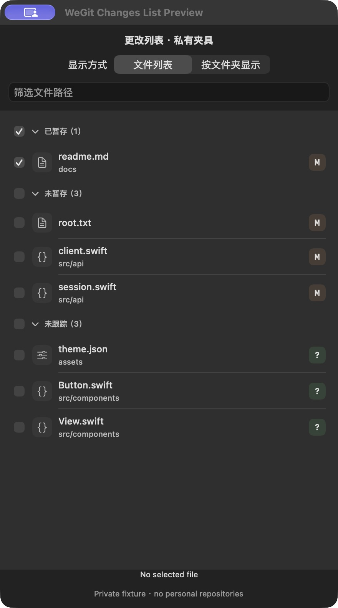
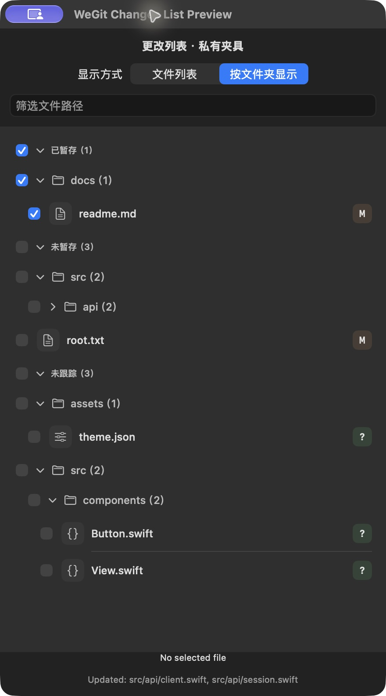

# 可折叠更改列表、暂存复选框与文件夹树

2026-10-19，`codex/visual-hierarchy-polish`，跟进 [Issue #32](https://github.com/WeOpen/WeGit/issues/32)。

## 行为

- 点击冲突、已暂存、未暂存、未跟踪的分组标题可展开/折叠；分组数量始终包含当前筛选下的文件。折叠和目录模式切换不改变当前阅读选择。
- 文件行正文继续用于选择差异；文件名前的原生复选框勾选即暂存，已暂存行取消勾选即取消暂存。行尾保留状态徽标，移除原暂存加号/减号。
- 非冲突分组的前置复选框处理当前分组和筛选范围内的文件。文件夹树中的目录复选框处理其符合筛选的后代文件，折叠不缩小操作范围。
- 冲突文件保留前置“标记已解决”按钮和原确认流程；不提供冲突分组/目录的批量暂存框。
- 在“更改”标题栏右侧的“显示方式”菜单选择“文件列表”或“按文件夹显示”。目录可逐级折叠，根目录文件保留在根层。显示方式跟随原有仓库视图恢复设置保存；旧记录缺少新字段时仍可读取并默认使用列表。
- 批量操作传递具体文件路径，继续走原 `RepositoryService.stage/unstage` 的 HEAD、仓库身份、冲突和串行保护。右键菜单、丢弃/废纸篓确认及全仓库的菜单操作保留。

## 已执行验证

| 检查 | 结果 |
| --- | --- |
| 文件树及实际暂存 | [23 项](tree-and-staging-checks.json)：嵌套层级、排序、特殊路径、名称冲突、折叠与筛选范围，以及私有 Git 仓库的暂存/取消暂存、部分暂存、工作文件字节及 HEAD 保留。 |
| 主题与仓库偏好 | [282 项](theme-and-preference-checks.json)：原主题检查及旧工作区记录兼容、新显示方式往返保存。 |
| 本地化 | 1012 个字符串、7 个复数键、1321 个源字面量扫描通过。 |
| 工具、格式、编译 | 30 项 Python CI 工具测试、仓库策略、严格 Swift 格式和差异空白检查通过；Debug 构建及 UI 测试编译通过。 |
| 实际原生组件 | 将产品的 `ChangesFileList` 源文件编入独立 AppKit/SwiftUI 预览，连接专属私有仓库。实际点击验证文件阅读选择、分组/目录折叠、列表/目录切换、文件暂存/取消暂存、筛选后全选及折叠目录批量暂存。[步骤结果](gui-verification.json)、[最终结构](folders-ax.txt)。 |

GUI 操作后直接读取私有夹具的真实暂存区：筛选 `client.swift` 全选只加入该文件；折叠 `src/api` 后勾选目录只加入 `client.swift` 和 `session.swift`，原先暂存的 `docs/readme.md` 保留。工作文件没有写入用户仓库。

下面两图是实际产品列表组件的私有夹具预览，顶部显示方式控件是预览壳提供的分段控件；产品工作区使用标题栏菜单。不是完整工作区运行截图。

## 回归与边界

新增原生 UI 回归用例检查草稿保留、分组/文件夹折叠、筛选范围内暂存与取消暂存；既有非冲突暂存按钮查询同步改为复选框查询，冲突按钮查询保留。新增用例的首轮编译曾因 `rows` 不是 macOS XCUIElement API 而失败，已按本机 SDK 改为 `outlineRows`，最终编译通过。UI 用例仅编译，未在本机执行 XCTest，也未宣称完整产品 UI/辅助访问验收通过。私有预览未接入真实用户仓库或生产偏好，结束后已关闭；未改变系统或安全设置。

源码摘要及范围见 [verification.json](verification.json)。独立文件树与暂存检查已接入常规原生 CI。
