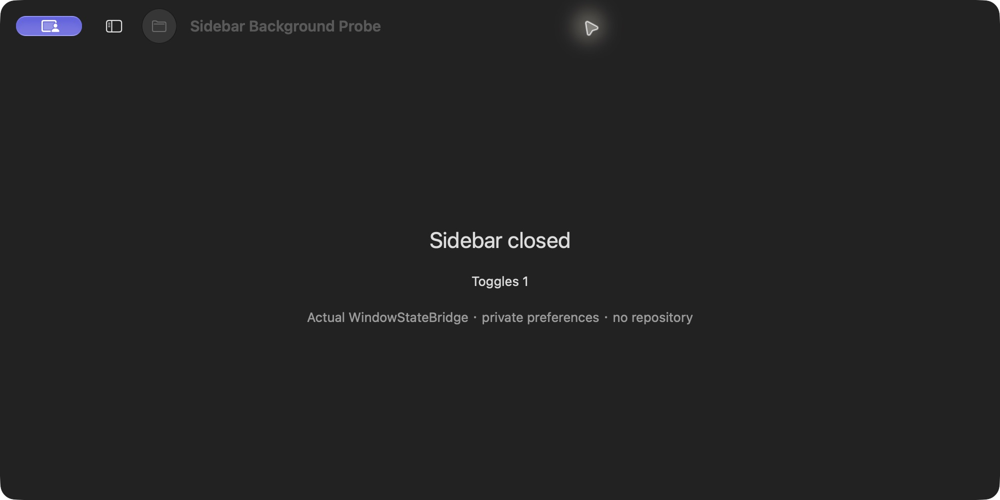
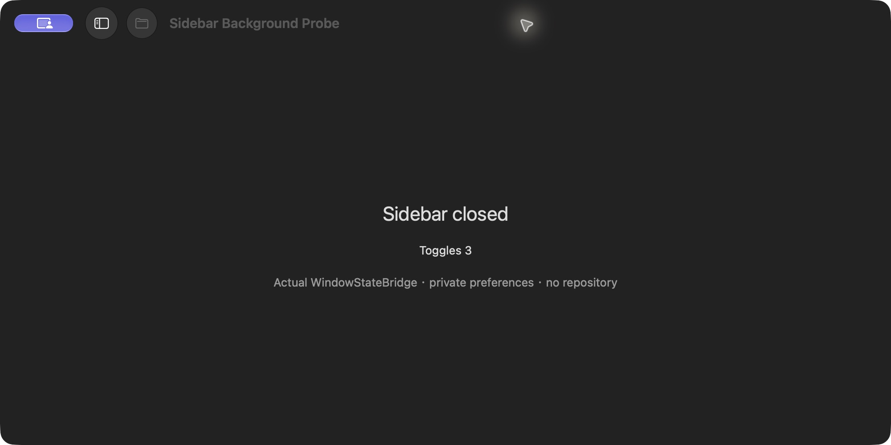

# 侧栏工具栏按钮背景

2026-10-19，`codex/visual-hierarchy-polish`，跟进 [Issue #33](https://github.com/WeOpen/WeGit/issues/33)。

## 原因与修复

`WindowStateProbe` 用自定义 `NSHostingView` 替换原生侧栏按钮，但内部使用 `.plain`，没有独立背景，依赖系统工具栏项原有背景。SwiftUI 收起侧栏时重建/迁移该项，新项不再提供原先的圆形背景。

本机 AppKit SDK 对 `NSToolbarItem.isBordered` 的说明仅承诺无自定义视图的情况，因此不能用它保障这个 hosting view 的背景。普通 AppKit 工具栏探针点击后仍有背景；换成与产品一致的 `NavigationSplitView`、实际 `WindowStateBridge` 源码与侧栏可见性更新后，复现了展开有背景、收起后无背景。

修复让自定义按钮始终绘制自己的圆形玻璃表面；减少透明度/增强对比度条件下保留实色及边框分支。标签和 hosting view 使用统一的 36pt 工具栏尺寸，标签内部提供圆形命中区域。原生项标识、侧栏动作、状态值、帮助说明和偏好注入保持。

## 实际验证

独立 SwiftUI 原生窗口编译使用产品 `WindowStateBridge.swift`，注入最小 `AppState` 与 UUID 私有偏好域，不访问仓库，不保存产品窗口状态。连续切换后仍能正确打开/关闭侧栏，帮助与状态同步更新。结束后关闭探针并清理专属偏好域；没有改变系统/辅助访问/安全设置。

背景检查比较按钮外围、不含图标的圆环区域与圆外角点，使用与新增 UI 用例相同的 `NSBitmapImageRep`/sRGB 采样方法。实际探针截图中，旧实现收起后差值约 0.00016，修复后明显高于 0.025 的检查阈值。展开/收起按钮位置不同，探针按各状态的实测位置采样；UI 用例直接使用按钮与窗口的实时 frame，不固定屏幕坐标。见 [pixel-checks.json](pixel-checks.json)。

## 检查与范围

- Debug 构建、原生 UI 测试编译通过。
- 本地化 1012 字符串、7 复数键、1321 个源字面量通过；严格 Swift 格式、仓库策略与差异空白检查通过。
- 新增原生 UI 回归用例重复切换四次，检查状态值及截图圆环背景，保留状态截图。该用例本轮仅编译，未在本机执行 XCTest。
- 本轮验证的是使用真实桥接控件的最小原生侧栏场景，不代表完整产品 UI/辅助访问验收。未实际切换系统显示选项，实色分支仅保留实现并编译。

结构化范围与源码摘要见 [verification.json](verification.json)。
