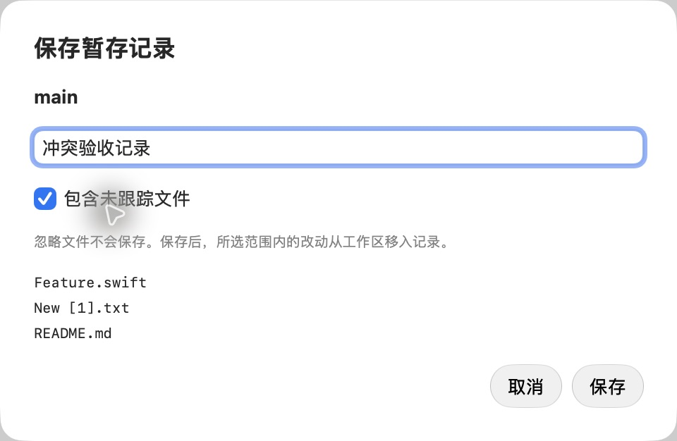
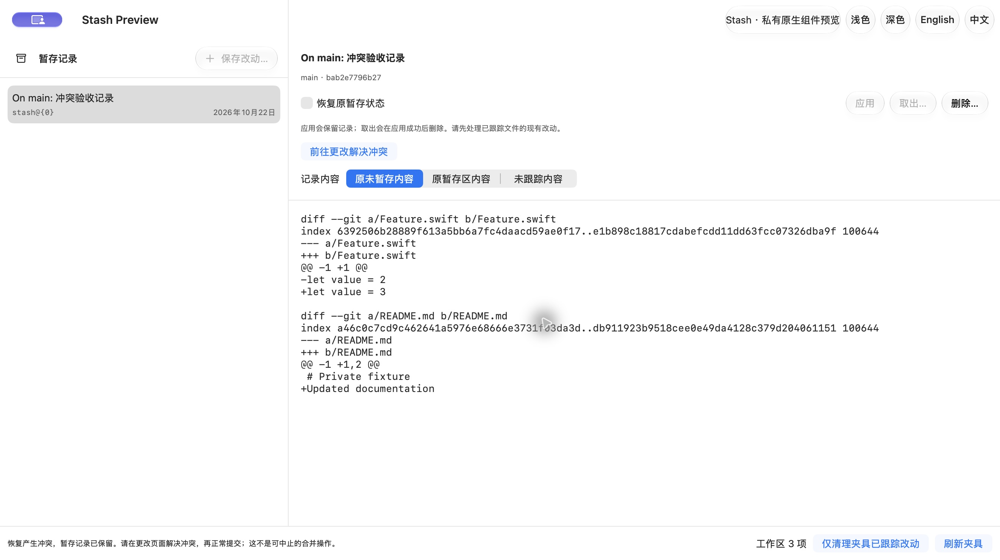
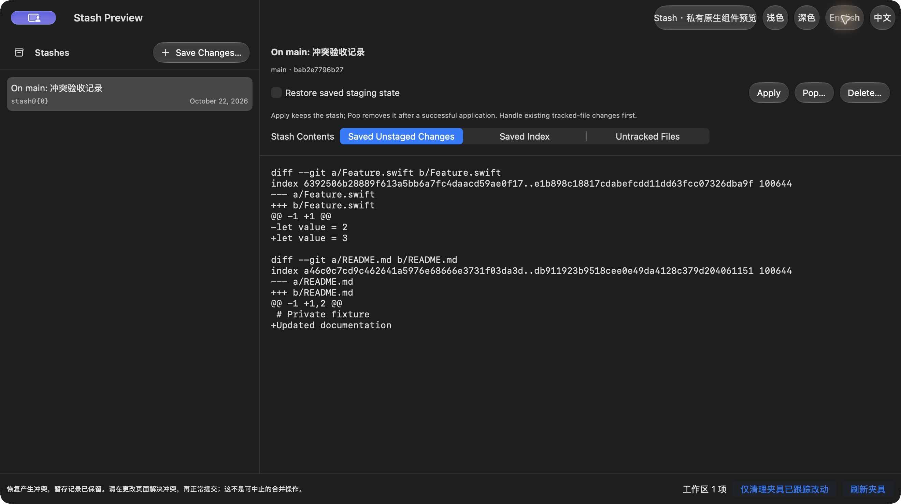

# v1.1 M1 · Stash management

2026-10-22 · Refs [#36](https://github.com/WeOpen/WeGit/issues/36). M1 implementation is ready for PR/hosted verification; this record does not close M1 or authorize a release. Usage and conservative restrictions are in [STASH.md](../../../STASH.md).

## Implemented behavior

- Named save with an explicit untracked-file choice and confirmed file scope; no automatic branch switch or ignored-file capture.
- Paginated list, immutable object identity and three read-only comparisons: saved index, saved unstaged changes, and included untracked contents. Product integration reuses the existing commit-file diff reader.
- Apply retains the record; Pop applies first and removes only after success. Delete confirms one record. Real conflicts retain the stash and expose Changes navigation without inventing a merge-abort operation.
- Serialized writes validate repository, HEAD/branch and list/scope snapshots. Preflight rejects destructive file/directory replacements, ignored obstructions, embedded repositories, symlink parents, submodules and special index flags.
- Stash commands opt out of the engine's default literal-pathspec option, which otherwise interferes with Git's internal untracked cleanup. Existing command callers retain their default.
- Numeric selectors are revalidated before removal; the command receipt checks the actual removed object. A concurrent wrong-object removal is re-stored and reported, possibly with changed ordering/message. Failed or uncertain removal after application returns a distinct applied-needs-review outcome.
- Reflog-only events refresh status/list: removing a non-top record may leave refs/stash unchanged and must not be ignored as ordinary log activity.

## Executed verification

| Check | Result and boundary |
| --- | --- |
| Standalone real Git | [55 checks](stash-checks.json), including layered bytes, special paths, stale targets/scope, conflicts, ignored obstructions, concurrent insertion/removal, timeout before/after removal, and timeout after a completed save. |
| Existing behavior lane | Sync counts 14, file tree/staging 30, map 13, themes 290, icons 18, native menu 30; reports are retained alongside this file. |
| Policy and formatting | 30 Python tests, repository policy, strict Swift formatting and diff whitespace checks passed. |
| Localization | 1088 string keys, 7 plural keys, 1408 source literals; arguments and source coverage passed. |
| Core / native UI | `swift build --build-tests` and `xcodebuild build-for-testing` passed. These compile tests; no local XCTest executed. The Xcode build includes the application. |
| Native component | Actual save/cancel/Pop-conflict interactions in an isolated preview; Git verified working/index/untracked bytes, retained stash, unmerged entries and absent MERGE_HEAD. Resolving the fixture conflict and committing normally removed the conflict state after refresh. English/dark controls were inspected. |

The preceding session additionally exercised Apply with index restoration, Pop cancellation/success and single deletion. Its [four Git checks](prior-native-fixture-checks.json) are retained separately from the [resumed checks](native-fixture-checks.json). Both used private synthetic fixtures; the preview fixture was deleted on close. No personal repository/global Git configuration or system security/accessibility setting was changed.

[verification.json](verification.json) and [Debug provenance](debug-build-source.json) pin the application inputs. The preview compiles the unchanged production StashBrowser and StashService with a private state adapter and a simple text-diff renderer. It does not verify full-app session orchestration, native menus or the product's existing diff reader. The final reflog-routing fix is independently checked; the preview adapter has no watcher. The retained [driver](preview/Preview.swift) and [build script](preview/build-preview.sh) can be copied to `.build/v1-1-m1/` to reproduce it from the repository root.

## Pending and prior failures

Full-app `StashWorkflowTests` and core `StashTests` are compiled but still need hosted execution. Full-app Pop/conflict/navigation, cancellation, external list updates, narrow-window layout and the complete existing functional/reading matrix remain unverified for this source. Component preview success is not their substitute.

M0's hosted [run 39385290549](https://github.com/WeOpen/WeGit/actions/runs/39385290549), source `29904b3`, passed smoke 1/1 but failed the functional suite: **48 total, 45 passed, 3 failed, 0 skipped**. The retained [summary](m0-functional-summary.json) records a non-hittable Changes outline row, the sidebar background condition, and toolbar-repository height 52 vs expected 36 pt. [#41](https://github.com/WeOpen/WeGit/issues/41) tracks these separately; their cause is not established by this Stash work.

No version bump, release/package, performance acceptance, protected-Mac installation, Beta feedback or accessibility acceptance is claimed. Remote, Tag and file history remain future milestones.
