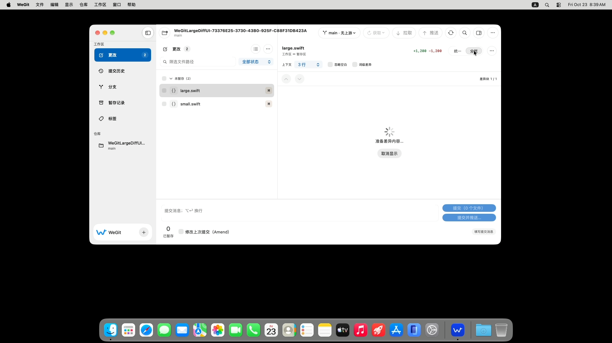

# v1.1 功能回归与性能证据

最新应用源码为 `835b8c4f5861b0f32844f13985a4742efb46b261`（1.1.0 / build 3）。[完整功能回归 39942545287](https://github.com/WeOpen/WeGit/actions/runs/39942545287) 实际 **54/54 通过、0 失败、0 跳过**；阅读矩阵保留 **144 张截图**。最小 smoke 实际 1/1 通过，140 个应用输入哈希与当前源码一致；[同一提交 main CI 39942469068](https://github.com/WeOpen/WeGit/actions/runs/39942469068) 成功。下列早期失败保留各自源码和时点，不代表当前功能仍失败。

四项功能 #36～#39、M0 回归 #41 和大差异修复 #49 已按此证据关闭。性能、Beta 与稳定发布门禁仍由 #35 跟踪；功能通过不等于完整发布验收。

[性能任务 39942623653](https://github.com/WeOpen/WeGit/actions/runs/39942623653) 执行后返回失败；随后上传因 `Failed to CreateArtifact ... ENOTFOUND` 失败，未留下可下载制品。仅凭步骤结果无法确认这轮各项实测值和失败分类，不能冒充性能通过。采集流程补充日志中的轻量原始测量、独立小型报告制品及有界上传重试，保持所有失败状态；修复后需补采。

## 以下为首次冻结源码的历史快照

源码固定为 `c7f6fd2d5a9e27d5edf8047614e94aab206a3d5d`；应用 `1.1.0` / build `3`。原检出的其他加载动画改动未进入本次源码或制品。实际 XCTest 只在托管环境运行，本机只编译与执行独立检查。

## 必需 CI

[main CI 39918956387](https://github.com/WeOpen/WeGit/actions/runs/39918956387) 成功：Apple Git、最低 Git 2.46 与 Homebrew Git 各 **204 项 / 37 suites** 通过。仓库策略、格式、本地化、独立行为、Debug/Release 和 UI 测试编译通过。源码回执的 140 个输入文件与固定源码逐一一致。

同次 CI 的真实临时 OpenPGP 检查为 Apple/Homebrew 各 **9 项**，包括提交与附注 Tag；两个结果均记录临时仓库删除、私有服务停止。交互 Pinentry、硬件密钥、真实服务凭据和原生签名对话框不在该范围。

同次独立行为结果保存于本目录；它们不代替完整应用原生交互。

## 原生功能

四项功能已分别通过托管专项。扩展文件历史 [39916980533](https://github.com/WeOpen/WeGit/actions/runs/39916980533) 在候选 `1b042be` 执行 smoke **1/1** 与专项 **1/1**，均为 0 失败/跳过；140 项应用输入与最终源码一致，覆盖已暂存重命名的旧路径查询和 HEAD/索引保留。

首次冻结源码完整 functional [39918960583](https://github.com/WeOpen/WeGit/actions/runs/39918960583) **54 项、53 通过、1 失败、0 跳过**。唯一失败为大差异分栏切换后的计数等待，四项新功能及原 M0 三项均通过。初始 M0 的 45/48 失败记录继续保留，不能用专项取代最终完整回归。

## Release 性能

[性能 smoke 39919364578](https://github.com/WeOpen/WeGit/actions/runs/39919364578) 成功：最小 UI smoke 1/1、普通/大型仓库界面各 1 次；单次界面预算结论为 null，不宣称达标。

后台每项 30 次，串行、Release、暖文件系统缓存、无网络。特性夹具为 20 Stash、4 Remote、1000 Tag、5000 次同文件修改，独立于界面夹具。

| 特性读取 | 普通 p95 ms | 大型 p95 ms | 预算 ms |
| --- | ---: | ---: | ---: |
| Stash 列表 | 22.63 | 23.54 | 2000 |
| Remote 配置 | 13.92 | 12.44 | 2000 |
| Tag 列表 | 42.13 | 33.10 | 2000 |
| 文件历史首次路径链与首屏 | 116.01 | 93.44 | 2000 |

后台进程峰值 RSS：普通 18.64 MiB，大型 236.13 MiB；Git 子进程分别 11.47 / 64.19 MiB。RSS 与界面/XCTest 内存指标分别记录。大仓库整体工作量与普通仓库不同，不能把新功能夹具尺寸相同当成整个应用内存相同。

[30 次界面任务 39920576080](https://github.com/WeOpen/WeGit/actions/runs/39920576080) **失败**：普通仓库实际 1 个性能用例失败、0 通过、0 跳过，完整保留 30 个样本。其余大型 30 次、启动和滚动因脚本提前退出未执行。保留普通仓库既有 p95 预算：外壳 500 ms、Status 300 ms、Diff 150 ms、History 300 ms、外部更新 1000 ms；启动 1000 ms。大型仓库界面保留实测，不伪造未定义预算。

## Beta 与发布

Beta 草稿尚未生成。Cherry-pick / Revert 按原计划整体后移。受保护干净 Mac 安装/首次系统提示、真实 Beta 反馈与稳定版完整验收未完成。自托管交互 runner 当前为 0；托管诊断不能代替 Full acceptance。v1.0 的单次例外不延续。

## 升级与回退的源码范围

与 `v1.0.0` 比较，`RecentRepository` SwiftData 模型与 `PreferenceMigration.swift` 未变化；新增 `changesByFolder` 视图偏好为可选值，读取缺失字段回落到 false。工作区仍以字符串保存页面，旧版未知页面回落到“更改”。这是源码检查，非实际下载/安装/回退验收；备份完整应用支持目录和重要仓库的要求保留。

## 普通界面的实测预算失败

| 指标 | 30 次 p95 ms | 既有预算 ms | 结果 |
| --- | ---: | ---: | --- |
| 外壳 | 1907.56 | 500 | 失败 |
| Status | 1707.93 | 300 | 失败 |
| Diff | 805.90 | 150 | 失败 |
| History | 2043.74 | 300 | 失败 |
| 外部更新 | 979.38 | 1000 | 通过 |

旧预算来自本地 Mac16,8 / 24 GiB，当前为托管虚拟机；环境差异是待验证假设，不据此豁免失败。当前修复采集脚本，只在原始样本与 xcresult 均证明为纯预算失败时继续其他独立范围，最终任务仍失败；交互/基础设施失败停止扩展。新增同 VM 固定 v1.0.0 源码对照，使用相同测量脚本与测试，应用源码不覆盖。对照与补充采样尚未执行。

## 采集修复的本机验证

33 项 Python 工具检查、工作流仓库策略、Shell 语法与差异空白检查通过。真实失败报告与 xcresult 摘要被识别为纯预算失败；附加应用崩溃失败后拒绝继续。没有在本机执行 XCTest，也没有调整耗时预算或屏蔽原性能断言。

## 大差异首次分栏的后续修复

[#49](https://github.com/WeOpen/WeGit/issues/49) 跟踪唯一剩余功能失败。视频中统一分页 399/2400、799/2400 均完成；切到分栏后，18 和 21 秒画面仍为“准备差异内容”。这不是已证实的 AX 旧值缓存。

本机独立 CLI 调用实际 Core 解析、文档准备与首屏分页，同一 2400 行输入在统一/分栏各约 10 ms。该测量没有 XCTest，也不代表托管界面耗时。首屏原先最多 399 行使用 eager VStack，分栏会一次创建近 800 个原生文本视图；候选改为从首屏就使用 LazyVStack，保留全部已加载行模型和选择数据。测试原五秒计数要求保留，仅增添失败截图与 AX 诊断。候选原生专项、完整回归与新源码性能待验。

PR #48 已通过必需 CI（39924851313）并合入 `3273764`，应用输入未变化。同 VM 固定 v1.0 对照与补充指标正在 [39939703443](https://github.com/WeOpen/WeGit/actions/runs/39939703443) 采集，该任务使用修复分栏前的应用输入，不能作为后续修改的性能通过证据。
