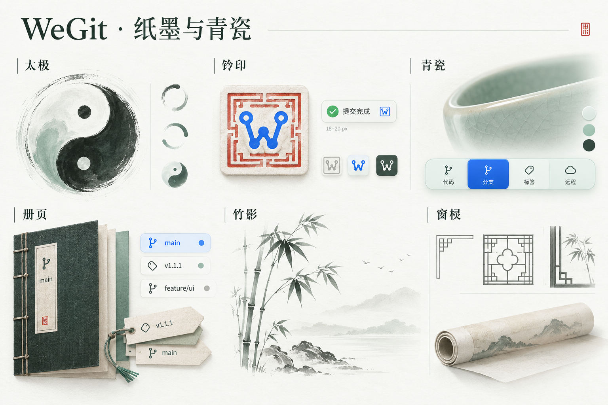

# 004 — 将中国传统元素融入 WeGit 的视觉与交互

日期：2026-10-24。状态：方案补充，尚未接入应用。基于 [v1.1.1 总方案](V1_1_1_PLAN.md)，延续用户已确认的原生工具感、蓝色品牌、太极 Loading 与主要布局。

## 1. 设计主线：纸墨与青瓷

让 WeGit 像一间现代书房：纸与墨承载记录，册页整理历史，印记表达落定，青瓷提供温润的操作层。传统元素与 Git 的「阅读、整理、记录、归档」联系起来，通过材质、轮廓、留白和局部反馈形成辨识度。

日常工作界面主要使用纸墨、青瓷、签条和印记；山水、竹影、卷轴与窗棂集中在欢迎、空状态和品牌区域。所有元素共享相同线条尺度与克制的配色，不为每个页面建立不同的古风主题。

保留现代系统字体、SF Symbols、原生菜单、焦点和快捷键。产品里的动作仍叫「提交」「推送」「储藏」「删除」，不改成难理解的古典名称；设计名称只用于本文与素材目录。

## 2. 元素与应用位置

| 元素 | 具体设计 | 位置 | 优先级 |
| --- | --- | --- | --- |
| 太极 | 保持完整图形匀速旋转，每圈 2.8 秒；作为全产品最明确的动态品牌元素 | 已有不定进度 Loading | 保留 |
| 纸墨 | 内容底色接近洁净素纸，主要/次要文字有墨色层次；纸纹只进入低频插画 | 工作区底色、详情、阅读层级 | P1 |
| 青瓷 | 控件表面带极轻的冷釉色和薄边，凹入轨道与选中 lens 有温润的器物比例 | 按钮、分段控件、侧栏品牌块、原生样册 | P1 |
| 钤印 | 品牌 W 嵌入细方印构图；完成反馈借用方印边界与一次轻落印动作 | 欢迎/侧栏品牌区域；明确的提交完成反馈 | P1 |
| 册页与签条 | 引用徽章像古籍签条，细长、微切角；历史详情的分组与边距借鉴册页排版 | Tag、分支引用、历史详情、文件历史 | P1 |
| 卷藏 | 用收起的纸卷或线装册页表达「先保存，稍后继续」 | Stash 欢迎/空状态；保存成功的图标样例 | P1，低频 |
| 竹影 | 两三节疏竹与少量叶片组成简洁线稿，和 W 的分叉线条呼应 | 工作区干净等空状态 | P1，低频 |
| 山水留白 | 极少的山脊、水线和留白，和 Git 的分支/时间意象联系 | 欢迎、无历史等装饰插画 | P1，低频 |
| 窗棂/回纹角 | 抽取一两组几何折角，不画完整窗格；形成品牌图形的轻边界 | 欢迎标记或侧栏底部品牌块的局部角饰 | P2 |
| 榫卯与水纹 | 榫卯的「嵌合」用于轨道/lens 比例；水纹用于低频完成动作的轻反馈 | 分段控件样例；复制等动作的候选反馈 | P2，择优采用 |

第一轮优先交付纸墨、青瓷、钤印、签条，再制作竹影/山水/卷藏这组三种同风格空状态。窗棂、榫卯、水纹根据实际样例是否增加清晰度决定，不要求全部堆到同一个界面。

## 3. 关键细节规格

### 3.1 纸墨：使内容更适合阅读

- 中央文件列表与 Diff 继续使用连续、稳定的底色；侧栏与检查器略收进，维持当前表面阶梯。
- 用洁净纸白与墨色层次形成气质，不把界面整体泛黄。代码、行号、选区和输入区没有纤维纹理、墨迹、水印或背景插画。
- 对真实照片/纸纹素材的需求仅存在于欢迎/空状态插画，优先用少量静态矢量表达；不引入逐帧噪声生成。
- 深色沿用墨色关系；文字、Diff 增删与词级高亮仍按原方案的实际背景对比度验收。

### 3.2 青瓷：器物感进入控件比例

- 从浅釉色、薄边、圆润但清楚的轮廓取得灵感；保留 36 pt 工具栏表面与 30 pt 普通控件体系。
- 釉青用于低对比度装饰和非必要的材质层次；功能图标、焦点、选中标签与正文使用原有可读语义色。
- 光泽优先由既有原生材质提供。不增加复杂折射 shader、额外 blur 叠层或整个窗口的动态高光。
- 自定义主题继续优先；状态色从现有 17 个角色派生，不扩大旧 JSON 的必填字段。

### 3.3 钤印：完成一次记录

品牌样例使用原有 W 轮廓，取细方印的边界/留白；不重画 Logo。欢迎/侧栏的 W 入印属于品牌装饰。

提交完成反馈可以将现有成功符号放进 18–20 pt 的细方印轮廓，一次 160 ms 的 opacity 0→1、scale 0.96→1，随后保持静态。成功文字与真实结果即时显示；印记不挪动输入框、按钮或其他内容。

- 成功仍沿用 positive 语义色；蓝色可以用于独立的品牌印记。朱印仅用于非功能性的素材研究/插画，不用红色表达操作成功。
- 是否落印由 [001 的明确结果](001-operation-feedback.md)和操作上下文决定，不能匹配「提交完成」字符串。Remote/Tag 待核对、失败、取消及 Stash appliedNeedsReview 不落成功印。
- 印记表示记录已完成，不代表 GPG/SSH 签名通过、身份认证、远端已发布或已经同步；这些状态继续由实际 Git 数据呈现。
- 普通用户事件只选一处强化反馈；不同时叠加落印、涟漪、声音与粒子。

### 3.4 册页与签条：整理引用和历史

- 引用/Tag 徽章使用 20–24 pt 高度、约 4 pt 圆角，可探索不超过 2 pt 的纸签折角；16 pt 小尺寸不清楚时取消折角。
- 保留完整名称查看、复制、稳定 ID 和原有选择语义；名称可中间截断，符号与状态不能只靠颜色区分。
- 册页主要体现在页边距、分组和签条轮廓；历史表格、Diff 与文件切换即时，不加入翻书、3D 翻页或横向滑屏。
- 原始提交图的节点、父子关系和分支颜色准确保留。山水意象用于装饰插画，不能把真实拓扑改成随意水墨线。

### 3.5 卷藏、竹影与山水：低频场景

统一 112×86 pt 插画画布，使用相同的细线/少量填充、2–3 层墨色及适当留白：

- 工作区干净：疏竹静立，标题仍直接表达当前状态；工作区干净不代表分支已推送。
- 尚无历史：一段山脊与空白页的组合，不绘制像真实提交节点的假数据。
- 尚无 Stash：收起的纸卷/线装册页，操作仍为「保存改动…」，不改成「藏卷」。
- 尚无 Tag：空签条/册页，创建入口和功能名称照常可读。

真正保存 Stash 成功后，可探索一次 160 ms 的「纸页→卷藏」图标过渡，随后保持静态。只改变局部装饰图标，记录列表、工作区、选区和实际操作即时更新；保存结果不确定时不播放成功收卷。此效果与提交的落印分别对应不同操作，不同一次事件叠加。

欢迎插画可用一次 280 ms 的局部墨线揭示，随后静止；切换文件、历史搜索和重新读取列表不重复播放。减少动效时直接显示。插画隐藏于 AX 树，状态文字与实际动作由正常 UI 提供。

### 3.6 窗棂、榫卯、水纹：候选点缀

- 窗棂只取 12–16 pt 角饰，限品牌/欢迎区域；不包围所有面板，不占用焦点或命中空间。
- 榫卯体现在分段轨道与 lens 的嵌合比例，沿用 `response: 0.28, dampingFraction: 1`；键盘/AX/程序更新即时，遵循 [002](002-motion-policy.md)。
- 水纹可以作为复制成功等低频事件的单次 160 ms 局部反馈；图标内容与业务结果不等待动画。若它与原生反馈重复，就保留更清楚的一种。
- 结绳、云纹、玉环可保留为后续素材探索，本版不默认加入主要工作界面。

## 4. 配色样例

这些是本项目的设计命名与 sRGB 样例，不宣称是某个朝代的唯一标准色。最终值仍结合原生材质与实际控件决定。

| 名称 | 浅色样例 | 用途 |
| --- | --- | --- |
| 素纸 | `#FAFBF8` | 洁净阅读背景 |
| 瓷白 | `#EEF3F1` | 外侧/弱表面层次 |
| 松烟 | `#25352E` | 主要文字与图形 |
| 淡墨 | `#53665B` | 次要文字 |
| WeGit 蓝 | `#2463DB` | 现有品牌 SVG 的蓝色；实际控件仍跟随系统强调色/自定义主题 |
| 釉青 | `#ADC9BC` | 非功能性材质与插画填充 |

深色样例使用 `#1C2420` 墨底、`#171E1C` 外侧底色、`#E8EFEB` 主文字、`#ACBDB4` 次文字；明亮品牌蓝与釉青分别探索 `#8CB8FF`、`#86AAA0`。不新增主题选择入口，先作为样册/现有自定义主题样例验证。

纸/瓷表面的墨色文字已做静态色对计算；釉青与背景的对比度仅约 1.6–1.7:1，不能用于正文、状态或必须辨认的图标。静态计算不替代玻璃、选区和深色实际渲染验收。

## 5. 融入原执行计划

| 原阶段 | 补充交付物 |
| --- | --- |
| M0 样例 | 更改/Diff、历史、设置三类浅深色样例加入纸墨/青瓷；另给印记、签条及空状态局部参考 |
| M1 设计系统 | 把材质、颜色和轮廓纳入已有 token/组件样册；定义普通、焦点、选中、禁用、成功、待核对的区别 |
| M2 核心页面 | 优先调整阅读表面、引用签条和明确提交成功的印记；真实结果优先于装饰 |
| M3 其余页面 | 统一竹影、山水、卷藏等空状态和品牌角饰，不替换原生功能图标体系 |
| M4 动效 | 落印/局部墨线/候选水纹逐项感受检查；一次性触发、可中断、关闭动效时静态 |
| M5 验收 | 校验小尺寸、浅深色、高对比度、状态辨认、旧主题兼容、空闲回落及已有性能预算 |

补充约 2–4 个设计/工程工作日作为初步规模估量，主要在 M0/M1/M3 消化；若素材精修或运行成本超出预期，再调整范围，不据此承诺发布日期。

## 6. 传统元素验收

1. 正常工作界面能通过配色、控件比例和引用/品牌细节识别中国气质；内容仍清晰，主要布局和熟悉操作保留。
2. 16/20/24 pt 印记与签条清楚；图形不裁切、装饰不抢命中、不覆盖焦点。
3. 成功、失败、取消、未同步和待核对分别从真实状态呈现；印记不能被误认成已签名/已推送。
4. 代码背景无纹理；所有新增绘制静态可缓存，不为材质建立随机噪声或持续时钟。
5. 原生菜单、快捷键、输入法、AX 名称/值、自定义主题和草稿不变；传统图形属于装饰，不新增重复的解释标签。
6. 延迟、CPU/RSS、帧数据按 [003](003-motion-performance.md) 验收；静止/隐藏对照允许零重绘，运动区间需要有效数据。

## 7. 视觉参考与生图

生图提示词见 [纸墨与青瓷参考图提示词](assets/traditional-elements-prompt.md)。图片用于方向与素材气质研究，生产 Logo/图标保留现有矢量来源，不能把概念图当成已实现界面或渲染验收。

前期内置 ImageGen 返回 503，自带浏览器控制读取持续超时，代理未成功提交或取得生成结果。随后用户提供了已生成的图板，现保存为 [视觉参考 V1](assets/traditional-elements-reference-v1.png)；来源为用户提供的 `/Users/willxue/Downloads/WeGit纸墨青瓷设计图板.png`，不是代理浏览器自动生成。

## 8. 用户提供的 V1 图板评审

2026-10-24：视觉气质可采纳；Logo、控件与文字细节需要修订。图板适合确定材质与意象，实际 UI 仍需要原生尺寸、状态和浅深色样板验证。保留当前主要布局和第 3 节的规范。

### 保留

- 纸白、墨绿与青瓷的冷暖关系，蓝色作为功能强调。
- 册页/签条对应引用与归档，竹影/卷轴对应低频空状态。
- 分区与留白，以及青瓷的薄边、窗棂最简的 L 形角饰。
- 大幅陶瓷、书册、水墨等素材作为美术研究；产品内分别转译成轻材质、微轮廓和小插画。

### 调整

| 优先级 | 图中位置 | 观察 | 下一版要求 |
| --- | --- | --- | --- |
| P0 | 钤印及小图标的 W | 生成图使用对称的圆点/折线 W，与现有圆润连续 W 和右侧分叉不同 | 使用现有 [品牌矢量](../branding/wegit-v2/mark.svg)，只调整外部印框与留白 |
| P1 | 太极大图与右侧小样 | 毛边、水墨和材质可用于插画，缩小后会损失轮廓；半环小样不能直接当运行阶段 | Loading 保留现有完整矢量、2.8 秒匀速与静态分支；大幅水墨留给欢迎素材 |
| P1 | 红框蓝 W 的石质印章 | 颜色与石质立体感适合材质研究，进入日常控件会过重 | UI 印记简化为单色细轮廓；品牌保持蓝色，成功沿用 positive，朱色不表达完成 |
| P1 | 提交完成胶囊 | 左侧成功勾与右侧蓝 W 印重复，强化反馈出现两次 | 保留一个成功符号；方印感融入其轮廓，单次 160 ms 局部反馈 |
| P1 | main/v1.1.1/feature/ui 徽章 | 右侧蓝/绿/灰圆点没有定义，容易被理解为同步、签名或状态 | 移除无含义圆点；只保留类型图标、名称和有真实依据的状态 |
| P1 | 青瓷分段控件 | 蓝色选中块有较强渐变、高光和阴影；示意命名也不完全对应现有页面 | 减弱立体感，把材质应用到现有 Diff/设置分段控件；沿用原导航、字段与命名 |
| P1 | 文字与尺寸注释 | 钤印标题看起来生成成了「铃印」，「远程」与现有术语需统一；18–20 px 不等于原生尺寸验收 | 文本重新排版为「钤印」及现有术语；macOS 尺寸使用 pt，提供 2× 像素输出 |
| P2 | 竹影、山水、窗棂和卷轴 | 当前是大幅素材，完整花窗、石块、飞鸟、开片/纸纹在小尺寸会密集 | 112×86 pt 插画只留两三节竹或一段山水；角饰 12–16 pt；代码与输入区洁净 |
| P1 | 整张图板 | 主要展示浅色、正常/选中态，未给焦点、禁用、忙、失败、待核对和深色 | 下一步制作真实组件样板与关键页面样例，不从图板推断交互或可读性通过 |

下一批样例：成功/待核对反馈、引用签条、Diff/设置分段控件、竹影/卷藏空状态。分别给出 16/20/24 pt 图标、30/36 pt 控件，以及浅色、深色、焦点、禁用、忙与错误状态。生成的展示标题可保留书卷气，应用正文/菜单/代码继续使用现有原生字体。

参考图 SHA-256：`675a2c5a54ebb99b6de0ad03ad2d1870dfb0dca23e215e7b45e937db702809af`。图片仅用于美术方向和后续对照，未作为生产 Logo、控件资产或性能验收。
